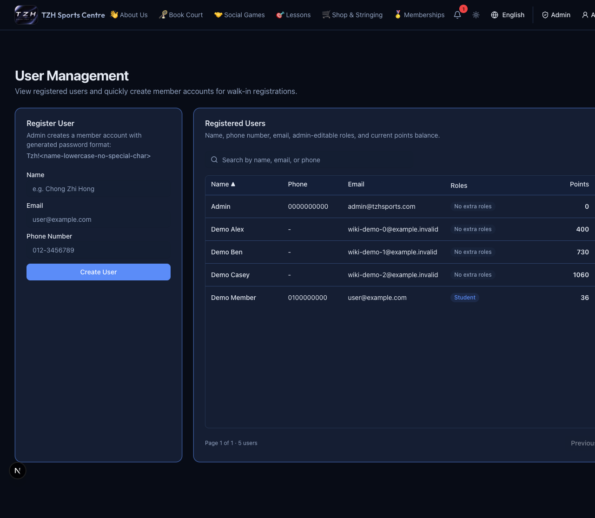

# 17–23 August 2026

[← Weekly changes](README.md)

- Change recurring court times or cancel this occurrence, this and upcoming, or all occurrences. [Try it →](../website/admin-courts.md)
- Eligible recurring court/lesson rules renew into the next month automatically; renewed court rules require payment. [Try it →](../website/admin-courts.md)
- Admins can retire non-admin logins while preserving bookings, payments and other history. [Try it →](../website/people-follow-up.md)

*Current screen with demo data.*

