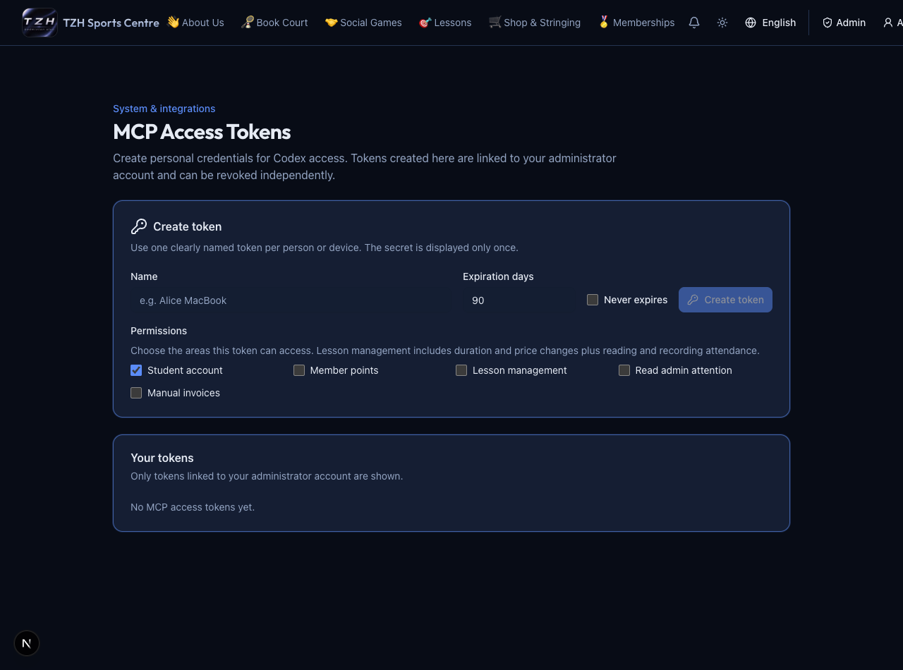

# 14–20 September 2026

[← Weekly changes](README.md)

- Admins can create and revoke personal MCP credentials; the customer workspace supplies setup and task skills. [Try it →](../mcp/getting-started.md)
- MCP audits can find existing cases, remove draft entries and delete draft/rejected cases with confirmation. [Try it →](../mcp/student-audit.md)
- Audit review shows entry details, proof counts and current/projected balances in RM; exact retries avoid duplicate records. [Try it →](../mcp/student-audit.md)
- Historical replacement credits are lifetime-valid; centre cancellation restores redeemed credits and replacements cannot chain. [Try it →](../website/student-accounts.md)
- MCP can preview and award positive member points. [Try it →](../mcp/points.md)
- Point awards have a clearer confirmation; membership progress includes deductions. [Try it →](../website/commerce-rewards.md)
- Receipt and audit-proof pickers attempt to shrink oversized images. [Try it →](../website/payments-invoices.md)

*Current screen with demo data.*

