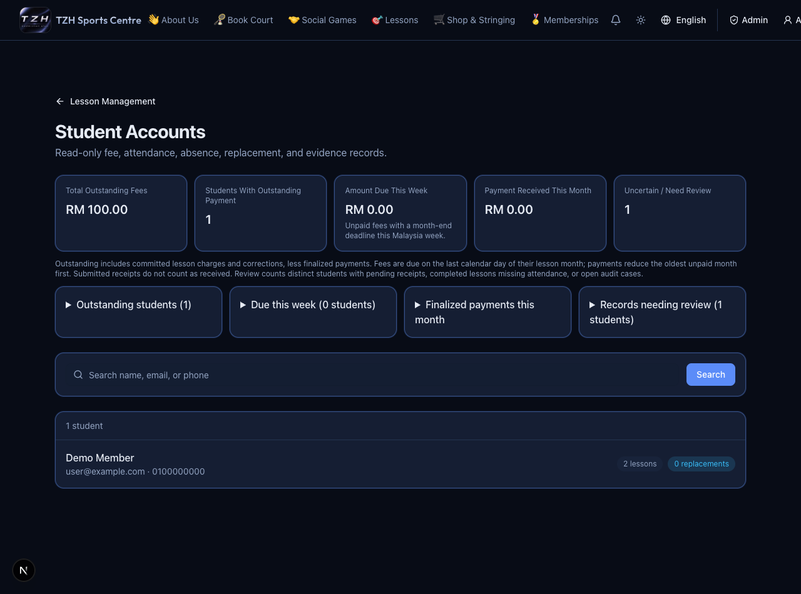

# 28 September–4 October 2026

[← Weekly changes](README.md)

- Student Accounts shows outstanding fees, payments received and work needing review. [Try it →](../website/student-accounts.md)
- Lesson fees use month-end due dates; received payments reduce the oldest unpaid month first. [Try it →](../website/payments-invoices.md)
- MCP can find lessons with student rosters and preview duration/price changes. [Try it →](../mcp/lesson-management.md)
- MCP can query missing attendance and record an explicitly approved batch. [Try it →](../mcp/attendance.md)
- One Lesson management permission covers lesson changes and attendance. [Try it →](../mcp/getting-started.md)
- Ask MCP for overdue, due-this-week and undated admin work. [Try it →](../mcp/admin-attention.md)

*Current screen with demo data.*

