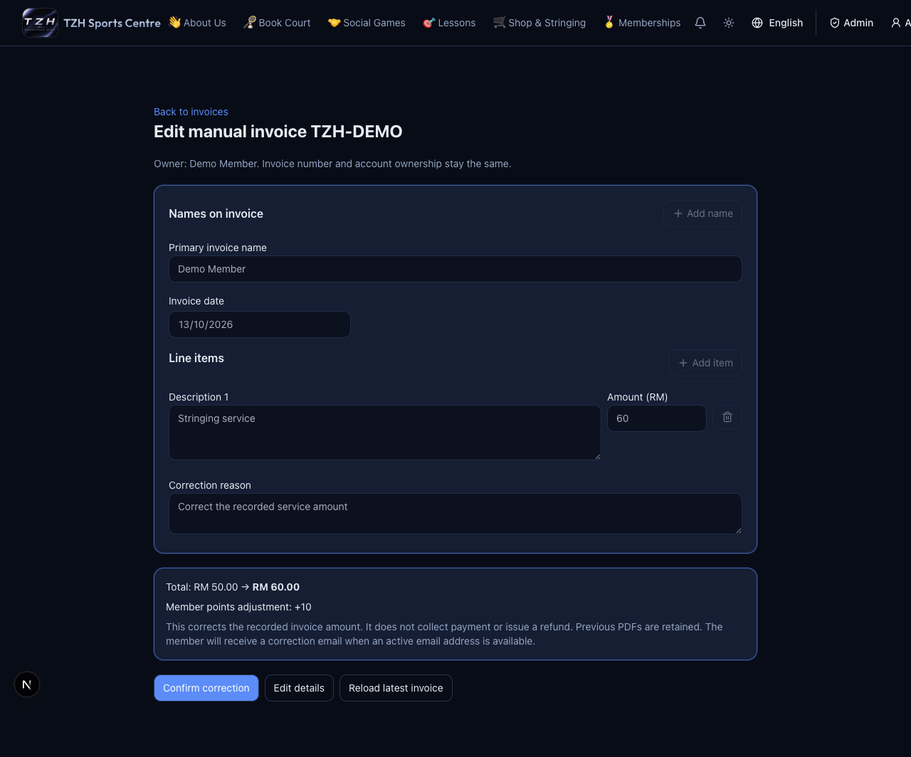

# 12–18 October 2026

[← Weekly changes](README.md)

- [Correct paid manual invoices](../website/admin-invoices.md), retain previous PDFs and return to the Invoices tab.
- [Review approved court bookings by month and cancel bookings](../website/admin-courts.md).
- [Create paid non-member invoices](../website/admin-invoices.md); the customer name stays first.
- [Compare monthly/lifetime rankings](../website/rewards-development.md); full names are admin-only.
- [See student hourly rates](../website/court-bookings.md) and [updated About Us photos](../guides/2026-10-12-13.md#6-check-student-rates-and-updated-photos--everyone).
- [Create already-paid member/non-member invoices through MCP](../mcp/manual-invoices.md).
- [All MCP functions are deployed](../mcp/functions.md).

## Coming soon

- **30-minute gap bookings:** Book a 30-minute slot when the slots immediately before and after it on the same court are taken. For example, if 15:30–16:30 and 17:00–18:00 are booked, 16:30–17:00 can be booked. Otherwise, the minimum is one hour.
- **Off-site lessons outside operating hours:** Coaches can arrange lessons at an external location outside the centre's operating hours. These lessons do not use or reserve a centre court.

[Step-by-step walkthrough and snapshots →](../guides/2026-10-12-13.md)

