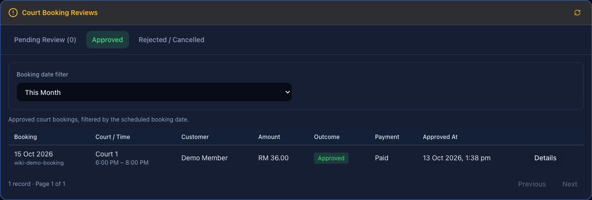
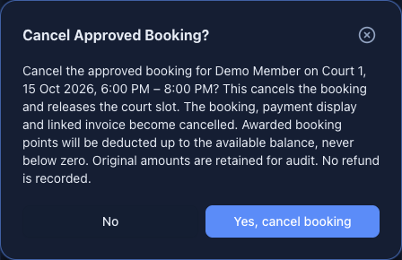
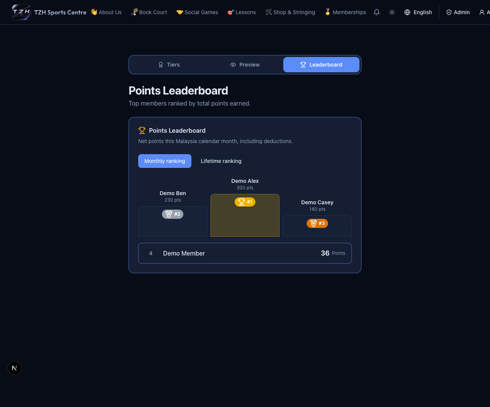
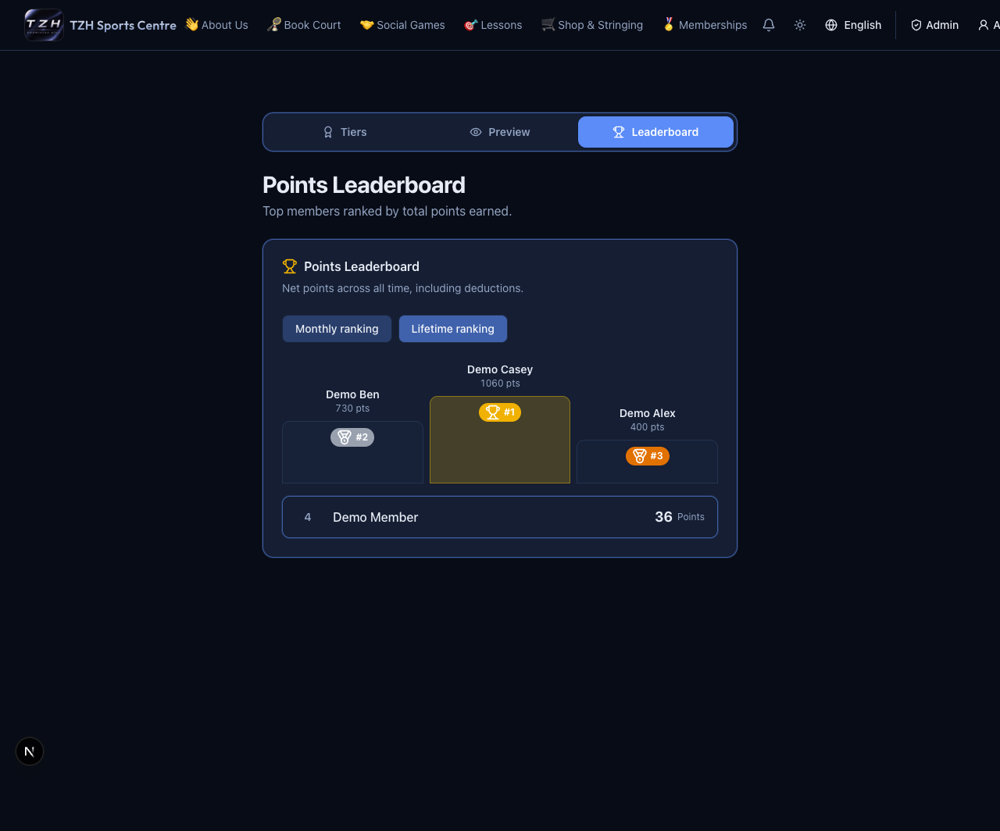
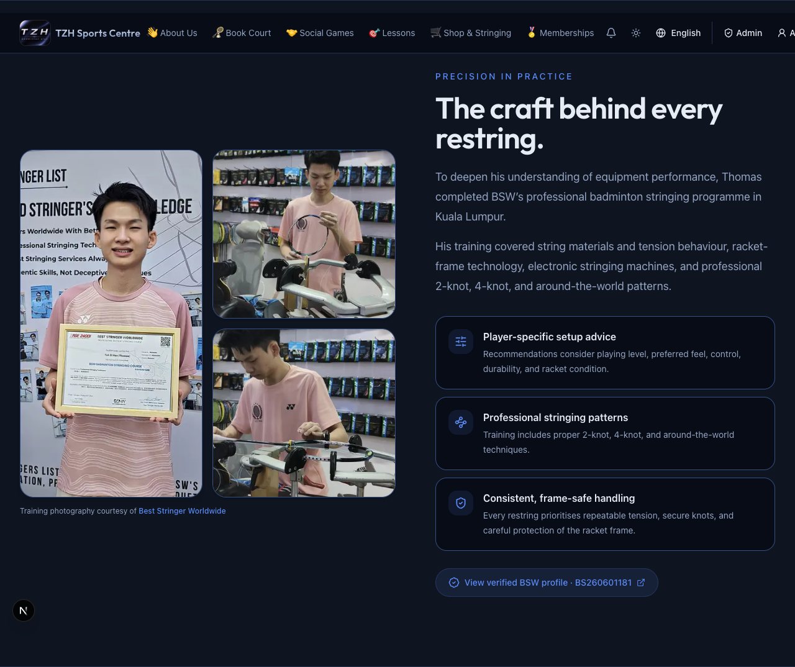

# Try the October 12–13 updates

[← Client guide](../README.md) · [Open website](https://tzhsports.vercel.app)

Use English to match the screenshots. All names and amounts shown are examples.

## 1. Find approved bookings — Admin

1. Open [Schedule → Bookings](https://tzhsports.vercel.app/admin/schedule?tab=bookings).
2. In **Court Booking Reviews**, choose **Approved**.
3. Try **This Month**, **Choose Month**, and **All Dates**. The month refers to the booking date, not the approval date.
4. Open **Details** for a booking. Use **Rejected / Cancelled** to view past rejected receipts and cancelled bookings.

**Expected:** Approved starts with the current Malaysia calendar month. Refresh reloads the selected list.

## 2. Cancel an approved booking — Admin

1. Open an approved booking's **Details**, or click its timetable cell.
2. Choose **Edit → Cancel Booking**.
3. Check the customer, court and time. Choose **No** to leave it unchanged, or **Yes, cancel booking** to cancel your agreed test booking.
4. Check **Rejected / Cancelled** for the result.

**Expected:** The court slot is released and the booking shows **Cancelled**. Previously awarded booking points are deducted up to the member's available balance. This action records no refund. Its invoice remains available and downloads show **CANCELLED / NO REFUND RECORDED**.

## 3. Create an invoice for a non-member — Admin

1. Open [Create Manual Invoice](https://tzhsports.vercel.app/admin/invoices/create).
2. Set **Customer type → Non-member** and enter the customer's name.
3. Set the date; add extra printed names if needed. The customer's name stays first.
4. Enter item descriptions and RM amounts. **Shift+Enter** adds a description line break.
5. Check **Payment already received** only when the money has actually been received, then choose **Create Paid Invoice**.
6. Open [Invoices → Invoices](https://tzhsports.vercel.app/admin/invoices?tab=invoices) to find and download it.

**Expected:** A paid invoice without a member account, points or email. For a registered customer, choose **Registered user** and search for their account instead; additional printed names do not share account access. Paid member invoices earn one point per complete RM and send an email when available.

## 4. Correct a paid manual invoice — Admin

1. In [Invoices → Invoices](https://tzhsports.vercel.app/admin/invoices?tab=invoices), choose **Edit** on a manual invoice.
2. Correct the printed names, date, descriptions or amounts, and enter a **Correction reason**.
3. Choose **Review changes**. Check the old/new totals and member points adjustment.
4. Choose **Confirm correction** to save, or **Edit details** to revise your changes.
5. Download the current PDF. **Correction history → Previous PDF** lets admins view earlier versions; **Back to invoices** returns to the Invoices tab.

**Expected:** The invoice number and account owner stay the same. Member points adjust with the total. This corrects the recorded amount; it collects no payment and issues no refund. Booking, lesson and shop invoices have no manual Edit action.

## 5. Compare leaderboard rankings — Everyone

1. Open [Memberships → Leaderboard](https://tzhsports.vercel.app/memberships/leaderboard).
2. Compare **Monthly Ranking** with **Lifetime Ranking**.
3. Try it signed out, then with an admin account.

**Expected:** Monthly uses this Malaysia calendar month's earned points minus deductions. Lifetime uses the full history, including expired points and deductions. Admins see full names; everyone else sees masked names. Rankings can differ from spendable point balances.

## 6. Check student rates and updated photos — Everyone

- Open [Court Booking](https://tzhsports.vercel.app/booking) and compare standard and student hourly rates in the pricing banner. Student rates reflect the **20% counter refund**; pay the full online amount first.
- Open [About Us](https://tzhsports.vercel.app/about) and scroll to the stringing section. The certificate presentation is on the left and the machine photo is at the bottom right. Tap a credential image to enlarge it.

## Codex invoice assistant

Using the [customer MCP workspace](https://github.com/zhihong0924/tzh-sports-centre-mcp), ask: “Prepare an already-paid invoice for non-member Demo Customer, dated 13 October 2026, for stringing RM50.” Check the complete preview before explicitly approving creation. For a registered customer, confirm the matched account first. Invoice corrections use the website.
