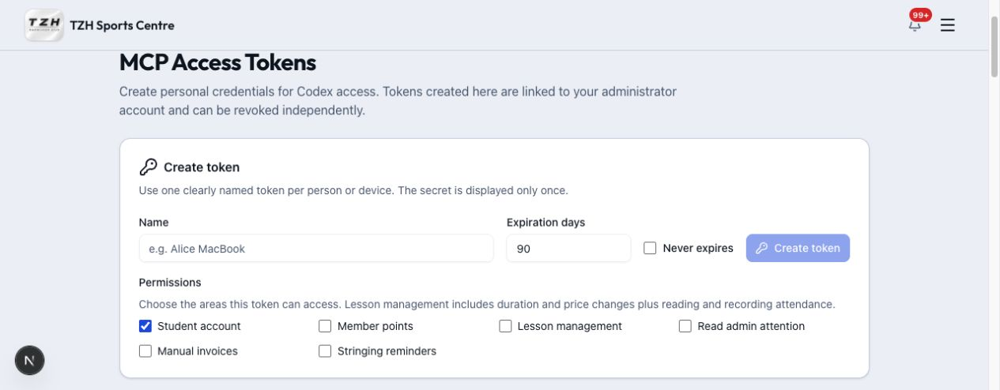
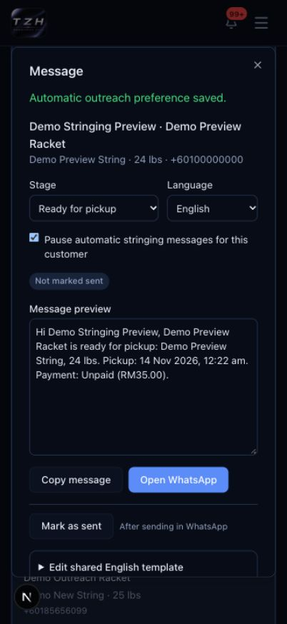

# Stringing reminders with Codex

**Administrator · Local preview; awaiting deployment and a supervised WhatsApp test.**
[Open Stringing](https://tzhsports.vercel.app/admin/stringing)

<strong>Choose payment reminder timing</strong>

In the connected customer workspace, ask:

> Use $tzh-stringing-outreach. Set the first payment reminder to two days after
> receipt, and the second follow-up to three days after the first message was sent.

Review both settings before saving. These are examples: choose your own waiting
periods, or disable either reminder. Timing is shared across the centre and starts
disabled until configured. A scheduled run reads these saved settings.

<strong>Preview the next messages</strong>

> Use $tzh-stringing-outreach. Show a dry-run count for payment reminders, ready
> rackets, feedback requests and due restring reminders. Do not send anything.

Payment reminders stop after payment. Pickup notices apply to Ready rackets.
Feedback is requested once, three days after collection, while unanswered.
Restring follows each job's saved reminder date. The assistant reports any
skipped work and incomplete scans.

<strong>Set up scheduled WhatsApp sending</strong>

After the release, use an owner-controlled test recipient first. Choose WhatsApp
Web with connected browser access, or the installed desktop app with computer
access, and sign in. Agree on recipients, message stages/templates, Malaysia
contact hours and the per-run limit. Keep the computer and session available.
Have TZH verify the test send and dashboard result before activating the schedule.

The MCP functions prepare the message/link and track the outcome. Codex uses the
approved WhatsApp application to send. Opening a link does not send a message.
Messages use the saved EN/ZH/MS preference. Already marked-sent stages are skipped. Use one sender and one job per customer
per run. If sending succeeds but recording is lost, a later run may send again.

Existing tokens inherit Stringing reminders permission when the release migration
runs; no replacement token is needed. Expired/revoked tokens remain invalid. New
tokens select **Stringing reminders** in MCP Access Tokens.

<strong>Pause messages or check sent status</strong>

In a job's **Message** dialog, select **Pause automatic stringing messages for
this customer**. It applies across that customer's stringing jobs.

Codex records successful sends using the same **Mark as sent** status in the job's
**Message** dialog. Already marked-sent reminders are skipped. There is no separate
recovery panel. If a message was not sent, its status stays unchanged for a later
run. Check WhatsApp if the outcome is unclear: a send followed by a lost status
update may cause a duplicate.

