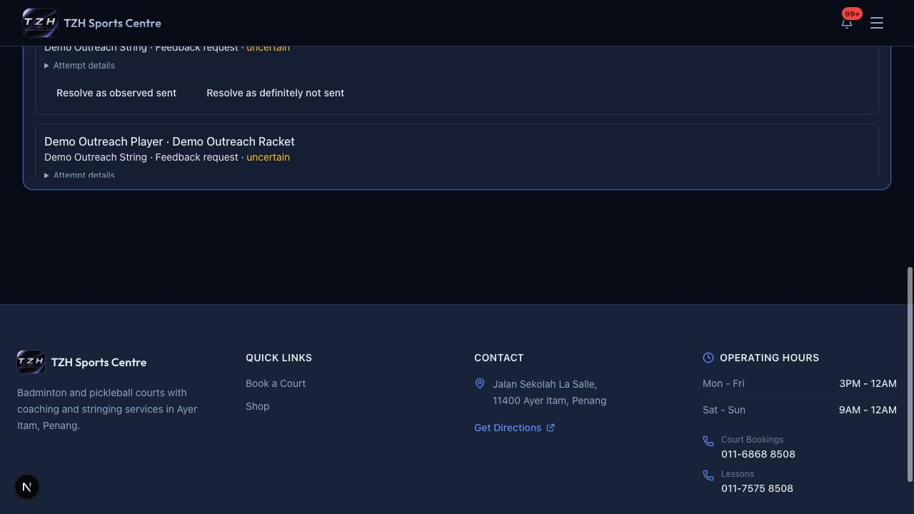

# Stringing reminders with Codex

**Administrator · Local preview; awaiting deployment and a supervised WhatsApp test.**
[Open Stringing](https://tzhsports.vercel.app/admin/stringing)

<strong>Choose payment reminder timing</strong>

In the connected customer workspace, ask:

> Use $tzh-stringing-outreach. Set the first payment reminder to two days after
> receipt, and the second follow-up to three days after the first message was sent.

Review both settings before saving. These are examples: choose your own waiting
periods, or disable either reminder. Timing is shared across the centre and starts
disabled until configured. A scheduled run reads these saved settings.

<strong>Preview the next messages</strong>

> Use $tzh-stringing-outreach. Show a dry-run count for payment reminders, ready
> rackets, feedback requests and due restring reminders. Do not send anything.

Payment reminders stop after payment. Pickup notices apply to Ready rackets.
Feedback is requested once, three days after collection, while unanswered.
Restring follows each job's saved reminder date. The assistant reports any
skipped work and incomplete scans.

<strong>Set up scheduled WhatsApp sending</strong>

After the release, use an owner-controlled test recipient first. Choose WhatsApp
Web with connected browser access, or the installed desktop app with computer
access, and sign in. Agree on recipients, message stages/templates, Malaysia
contact hours and the per-run limit. Keep the computer and session available.
Have TZH verify the test send and dashboard result before activating the schedule.

The MCP functions prepare the message/link and track the outcome. Codex uses the
approved WhatsApp application to send. Opening a link does not send a message.
Messages use the saved EN/ZH/MS preference. Limits prevent repeated daily sends
and defer additional jobs for the same recipient.

Existing tokens inherit Stringing outreach permission when the release migration
runs; no replacement token is needed. Expired/revoked tokens remain invalid. New
tokens select **Stringing outreach** in MCP Access Tokens.

<strong>Pause a customer or resolve an interrupted send</strong>

In a job's **Message** dialog, select **Pause automatic stringing messages for
this customer**. It applies across that customer's stringing jobs.

For an uncertain send, check the WhatsApp chat and stop the original runner.
In **Automatic outreach recovery**, choose the observed outcome and confirm it.
Expiry alone is not proof that nothing was sent. Resolving does not send a message.

