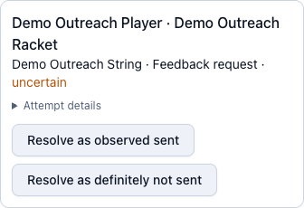

# Stringing reminders and feedback requests

**Administrator · Awaiting deployment and an owner-supervised test.**
[Open Stringing](https://tzhsports.vercel.app/admin/stringing)

MCP prepares and records messages. Sending uses the separately authorised WhatsApp
app or WhatsApp Web. Ask the owner to approve recipients, saved templates, schedule,
Malaysia contact hours and limits before any send. The feedback delay is three
Malaysia calendar days after collection, subject to owner setup confirmation.

## Try a dry run

With the **Stringing outreach** permission, ask:

```text
Use $tzh-stringing-outreach to list due restring reminders and feedback requests.
Report counts and skip reasons. Do not claim, open WhatsApp, send or record contact.
```

Only eligible collected services appear as ready. Disabled reminders, existing
contacts, submitted feedback, paused customers and unresolved attempts are skipped.
Private previews use the current account number and saved EN/ZH/MS language.
Do not put phone numbers, message bodies or private links in screenshots/summaries.

## Send one approved message

1. Start with the owner's test recipient. Privately review the exact destination
   and message, then explicitly authorise that send in the approved WhatsApp app.
2. The assistant reserves the service/stage and rechecks it before opening WhatsApp.
   Verify the chat and text, then send once.
3. Only a corresponding **new outgoing message** permits recording Sent. Opening
   WhatsApp or clicking Send alone is insufficient. Sent does not mean delivered,
   read or feedback received.

The approved run processes at most 20 attempts, with one message per recipient.
Other rackets/stages for the same recipient are deferred; the server also prevents
another automatic contact for that recipient on the same Malaysia day.

## Recover an uncertain send

Open **Stringing → Automatic outreach recovery**. Check the intended chat and stop
the original runner. Choose **Resolve as observed sent** only after seeing the new
outgoing message, or **Resolve as definitely not sent** only after verifying no
send occurred. Read and tick the confirmation, then **Confirm resolution**.
Expiry alone never permits a resend. Cancel makes no change.



Sent records the existing stage label and completes its original pending restring
reminder. It changes no payment, points, invoice, service progress or feedback
response. A definitely-not-sent resolution allows a separately authorised future
attempt; it does not send anything itself.

## Pause a customer

Open the customer's racket **Details → Stringing history → Request feedback**
(or **Message** for its active service). Tick **Pause automatic outreach for this
customer**. This covers all their rackets; manual messages remain available.
Untick to resume eligibility.


Actual daily scheduling and unattended sending require separate owner approval
after deployment and the supervised test. No sender is activated by this guide.
