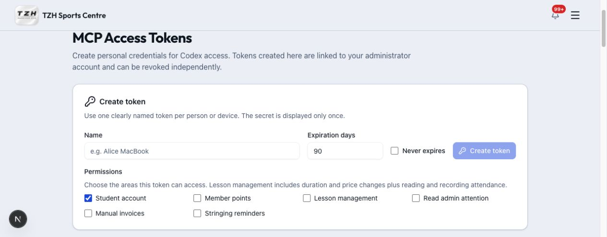
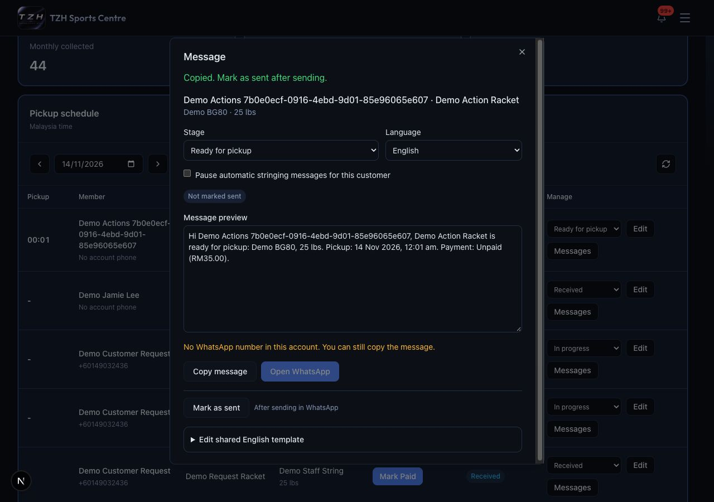
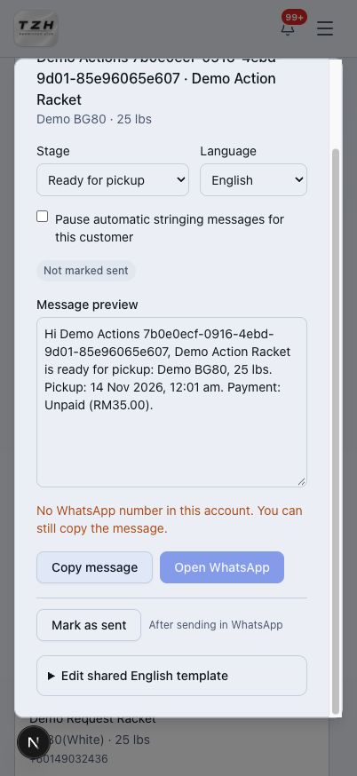

# Stringing reminders with Codex

**Administrator · MCP tools deployed; scheduled WhatsApp sending needs setup.**
[Open Stringing](https://tzhsports.vercel.app/admin/stringing)

<strong>Choose waiting periods in your scheduler prompt</strong>

Include your timing when setting up the Codex schedule, for example:

> Use $tzh-stringing-reminders. Send the first payment reminder two days after
> receipt, and the second reminder four days after the first recorded send.

These are examples; choose your own whole-day waiting periods. Timing stays in
that schedule's prompt. There are no website reminder-policy settings to save.
To disable a stage, leave it out of the schedule. If timing is missing, Codex asks
before processing that payment stage. Changing one schedule does not change others.

<strong>Preview the next messages</strong>

> Use $tzh-stringing-reminders. Show a dry-run count for payment reminders, ready
> rackets, feedback requests and due restring reminders. Do not send anything.

Payment reminders stop after payment. Pickup notices apply to Ready rackets.
Feedback is requested once, three days after collection, while unanswered.
Restring follows each job's saved reminder date. The assistant reports any
skipped work and incomplete scans.

<strong>Set up scheduled WhatsApp sending</strong>

Use an owner-controlled test recipient first. Choose WhatsApp
Web or the installed desktop app, and sign in. Enable connected browser access
to open the link; desktop use also needs computer access for the app and its
opening confirmation. Agree on recipients, message stages/templates, Malaysia
contact hours and the per-run limit. Keep the computer and session available.
Have TZH verify the test send and dashboard result before activating the schedule.

The MCP functions prepare the message/link and track the outcome. Codex uses the
approved WhatsApp application to send:

1. Codex opens the prepared WhatsApp link, just like **Open WhatsApp** on the website.
2. It follows **Open app / Open WhatsApp**, checks the chat and prefilled message,
   then sends. For approved Web use, it chooses **Continue to WhatsApp Web**.
3. It checks the new outgoing message in that chat, then records **Mark as sent**.

Codex can pass the prepared link directly to its connected browser; you do not
need to copy the link between tools. Private message details stay out of run reports.

Opening a link does not send. If the link cannot open the correct chat and draft,
Codex reports the problem; it does not automatically search your contacts or
enter the message manually. A chat-list preview alone does not confirm sending.
Messages use the saved EN/ZH/MS preference. Already marked-sent stages are skipped. Use one sender and one job per customer
per run. If sending succeeds but recording is lost, a later run may send again.

Existing active, unexpired tokens receive all current MCP permissions, including
Stringing reminders, through the owner-approved release update. No replacement
token is needed. Expired/revoked tokens are unchanged and remain invalid. New
tokens select **Stringing reminders** in MCP Access Tokens. After updating the
workspace and server, reconnect the MCP connection to load the renamed reminder
tools. Existing tokens do not need replacement.

<strong>Check sent status</strong>

Codex records successful sends using the same **Mark as sent** status in the job's
**Message** dialog. Already marked-sent reminders are skipped. There is no separate
recovery panel. If a message was not sent, its status stays unchanged for a later
run. Check WhatsApp if the outcome is unclear: a send followed by a lost status
update may cause a duplicate.

