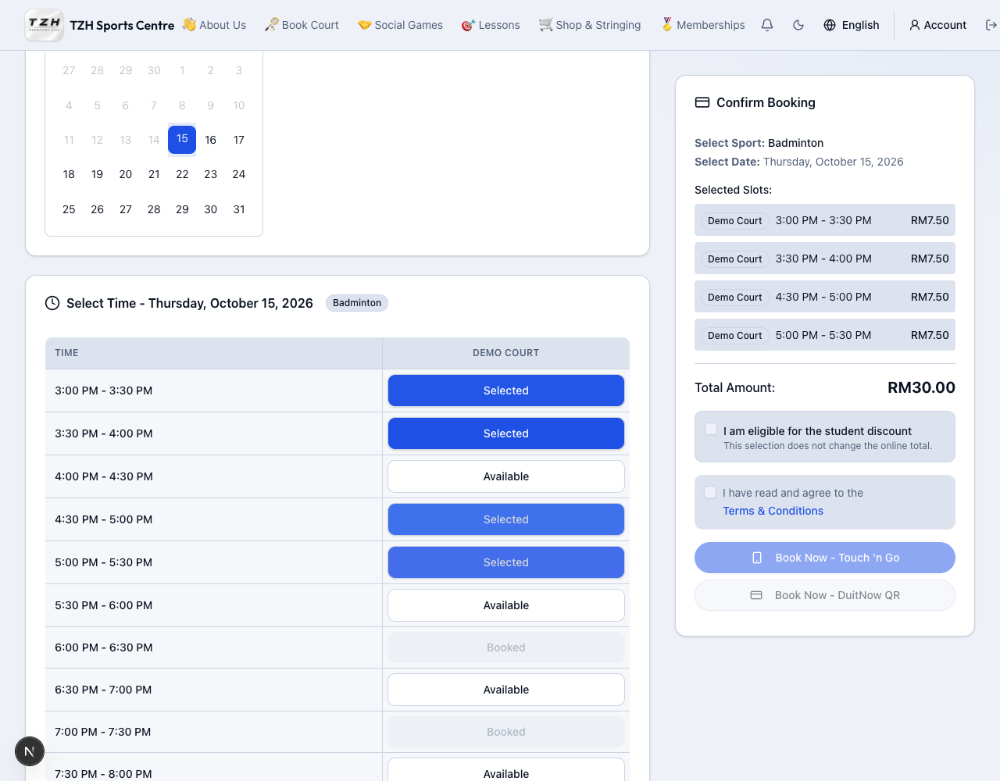

# Test 30-minute court bookings

[← Overview](../overview.md) · **Who:** Members; administrators can also create bookings

**Status: Testing** — available on the local test website; awaiting production deployment.

## Book an isolated half-hour

1. Open [local Book a Court](http://localhost:3000/booking), sign in and choose the date and sport.
2. Find a free 30-minute slot with occupied slots immediately before and after it on the same court. For example: **5:30–6:00 PM booked**, **6:00–6:30 PM free**, **6:30–7:00 PM booked**.
3. Select the free gap. Check that only the half-hour is selected and the summary charges the half-hour rate.
4. If testing the complete payment flow, use fictional test proof, submit the booking and let an admin review it through [local Schedule → Bookings](http://localhost:3000/admin/schedule?tab=bookings).

**Expected:** Both badminton and pickleball allow that isolated half-hour. Otherwise each continuous booking needs at least one hour. Opening/closing boundaries do not count as occupied slots. If neighbouring availability changes before confirmation, refresh and select again.

## Check the normal minimum

Choose a free stretch of court time. Selecting a slot selects a one-hour block. A single half-hour with only one occupied neighbour, or at opening/closing, cannot be confirmed. The same rule applies to admin one-off creation.

## Select and remove separate blocks

1. Select **3:00 PM** in a free stretch: **3:00–4:00 PM** is selected.
2. Leave **4:00–4:30 PM** free and select **4:30 PM**: a separate **4:30–5:30 PM** block is selected automatically.
3. Click either selected half of **3:00–4:00 PM**. That whole one-hour block clears; **4:30–5:30 PM** stays selected.

Clicking next to an existing block extends it by half an hour. Removing a slot from a longer block also clears any leftover half-hour that cannot be booked alone. Other valid blocks stay selected. Leaving a gap between your selections does not qualify it for the half-hour exception: both neighbours must already be occupied.

Half-hour payments use their actual amount for invoices and automatic member points. Uploading proof earns no points; admin payment approval finalizes the award.

