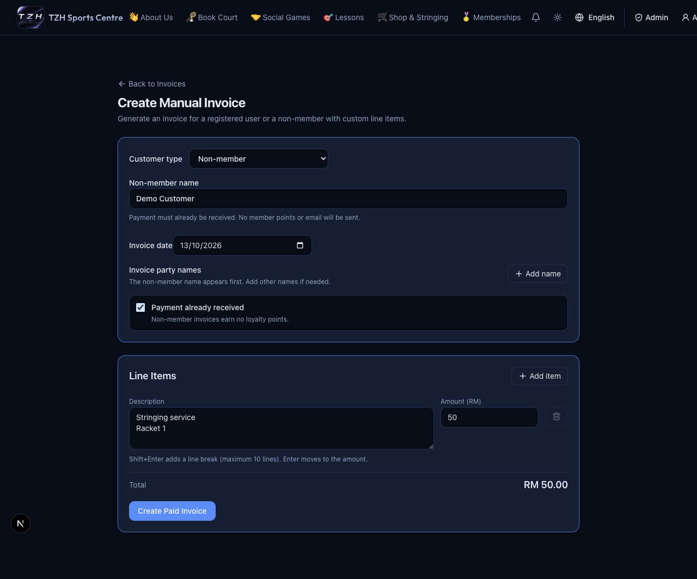

# Admin invoice review, creation and correction

[← Overview](../overview.md) · **Who:** Administrators

1. Open [Invoices](https://tzhsports.vercel.app/admin/invoices). **Payment Review** opens by default. Check uploaded receipts and confirm approval/rejection; use **Mark Paid (Counter)** only for received offline payments.
2. Choose [Create Manual Invoice](https://tzhsports.vercel.app/admin/invoices/create). Select a registered account or enter a non-member name. Add date, optional extra printed names, descriptions and RM amounts.
3. For a registered user, leave **Payment already received** unchecked to request payment, or check it for an actually received payment. Non-member invoices require it.
4. In **Invoices**, filter by customer/date/type and download a PDF or the invoice ZIP.
5. Choose **Edit** on a manual invoice to correct names/date/items/amounts. Enter the reason, select **Review changes**, inspect the total and points difference, then **Confirm correction**. Previous PDFs remain in correction history.

**Expected:** Unpaid requests have no issued invoice yet. Paid registered-user invoices earn one point per complete RM and can notify the account owner; non-members earn no points and receive no account email. Extra printed names grant no access. A correction keeps the invoice number/owner and neither collects payment nor refunds money. Booking/lesson/shop invoices cannot be edited here.

[Detailed October walkthrough](../guides/2026-10-12-13.md)

