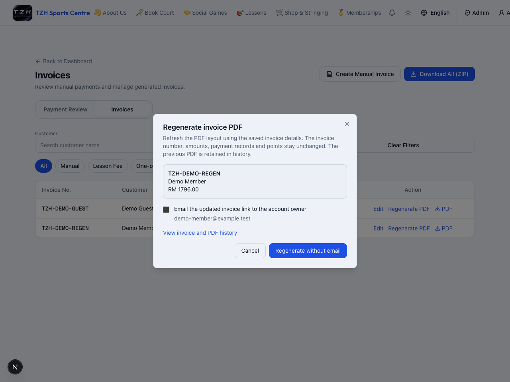
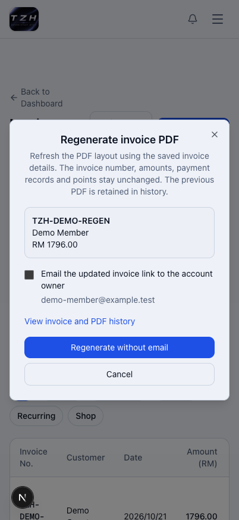
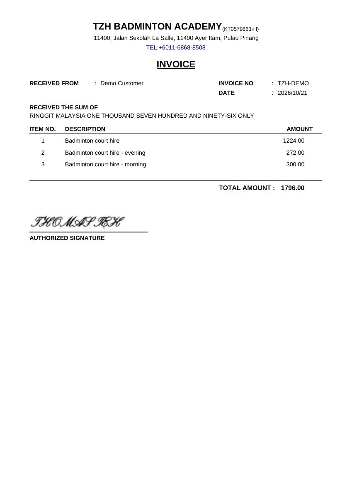

# Admin invoice review, creation and correction

[← Overview](../overview.md) · **Who:** Administrators

1. Open [Invoices](https://tzhsports.vercel.app/admin/invoices). **Payment Review** opens by default. Check uploaded receipts and confirm approval/rejection; use **Mark Paid (Counter)** only for received offline payments.
2. Choose [Create Manual Invoice](https://tzhsports.vercel.app/admin/invoices/create). Select a registered account or enter a non-member name. Add date, optional extra printed names, descriptions and RM amounts.
3. For a registered user, leave **Payment already received** unchecked to request payment, or check it for an actually received payment. Non-member invoices require it.
4. In **Invoices**, filter by customer/date/type and download a PDF or the invoice ZIP.
5. Choose **Edit** on a manual invoice to correct names/date/items/amounts. Enter the reason, select **Review changes**, inspect the total and points difference, then **Confirm correction**. Previous PDFs remain in correction history.

**Expected:** Unpaid requests have no issued invoice yet. Paid registered-user invoices earn one point per complete RM and can notify the account owner; non-members earn no points and receive no account email. Extra printed names grant no access. A correction keeps the invoice number/owner and neither collects payment nor refunds money. Booking/lesson/shop invoices cannot be edited here.

[Detailed October walkthrough](../guides/2026-10-12-13.md)

**PDF regeneration and total spacing — awaiting deployment:** Newly generated invoice PDFs keep
the total label separate from the digits, including totals such as RM1,796.00.
After deployment, open **Invoices** and choose **Regenerate PDF** beside a manual
invoice. Review the invoice number, customer and amount. Leave **Email the updated
invoice link to the account owner** unchecked for no email, or check it to notify
the displayed account email. Choose **Regenerate without email** or **Regenerate
and email**, then download the PDF to check the total line. The email option is
unavailable for non-members and retired accounts.

**Expected:** Regeneration refreshes only the PDF layout and keeps the previous
PDF under **Edit → Correction and PDF history**. It does not change amounts,
payments or points. An email is attempted only when selected; an email failure
is shown separately and does not undo the PDF refresh. If the result is uncertain,
use **Retry regeneration** with the same options before starting another request.
Existing PDFs keep their original layout until regenerated.

