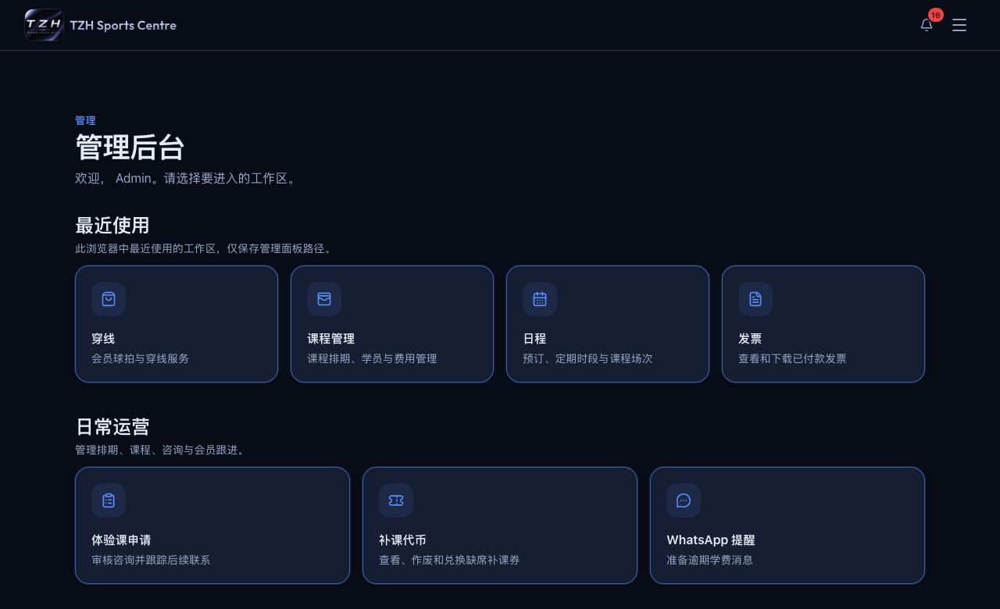
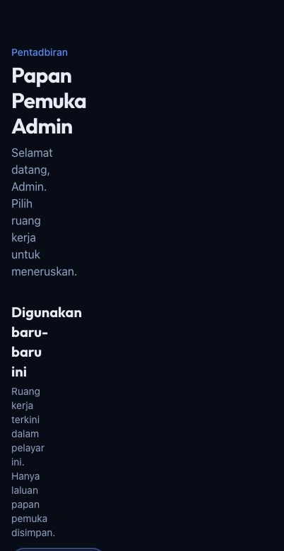

# Choose an admin language

**Role:** Administrator · [Open Admin Dashboard](https://tzhsports.vercel.app/admin)

**Availability:** Local preview; awaiting deployment.

1. Open the language menu in the top navigation. On a phone or compact screen,
   open the hamburger menu first, then tap the globe / current language.
2. Choose **English**, **中文** or **Bahasa Malaysia**.
3. The page reloads in that language. Open another admin tool to keep using
   the same selection.

Save an unfinished form before switching. Names, notes, product content and
issued invoices keep their original wording. The language chosen for a
customer's WhatsApp message remains separate.

Calendar month/day labels, fee-statement dates and totals, trial statuses and
questionnaire choices also follow the selected language. Stored lesson names,
venue names and custom questionnaire answers keep their original wording.
