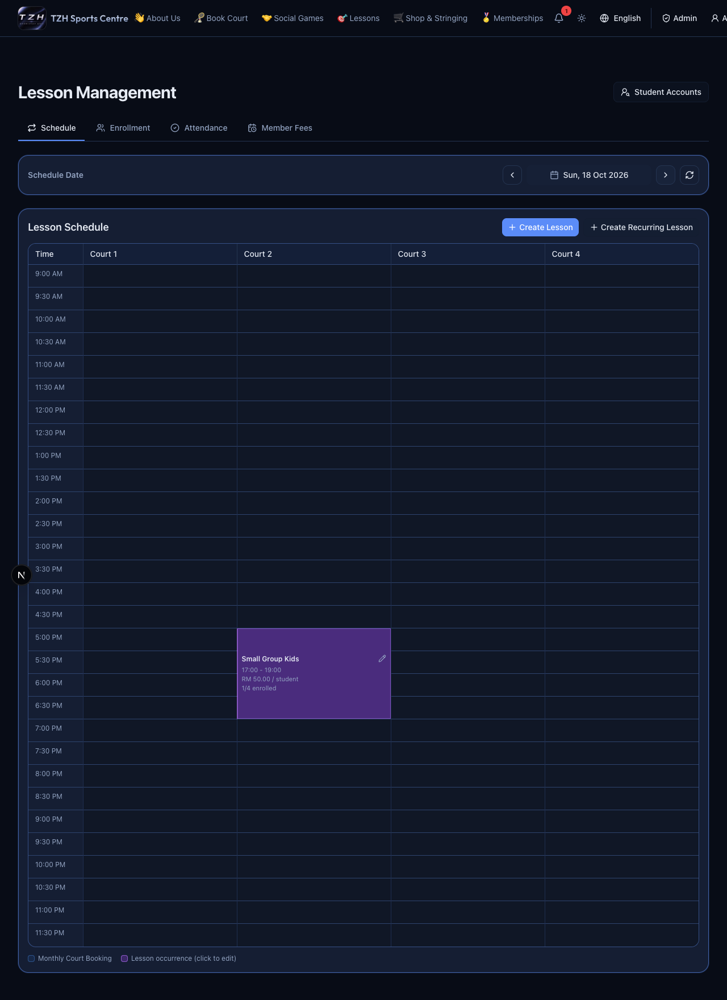
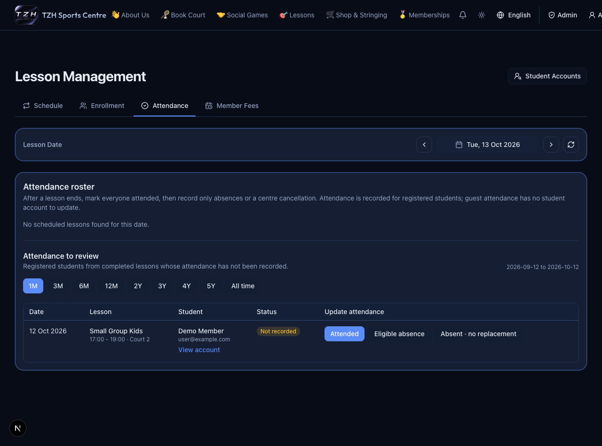
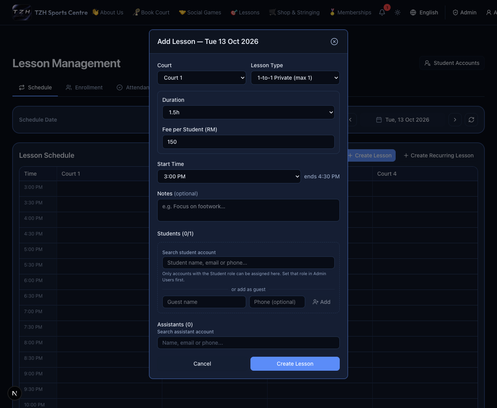
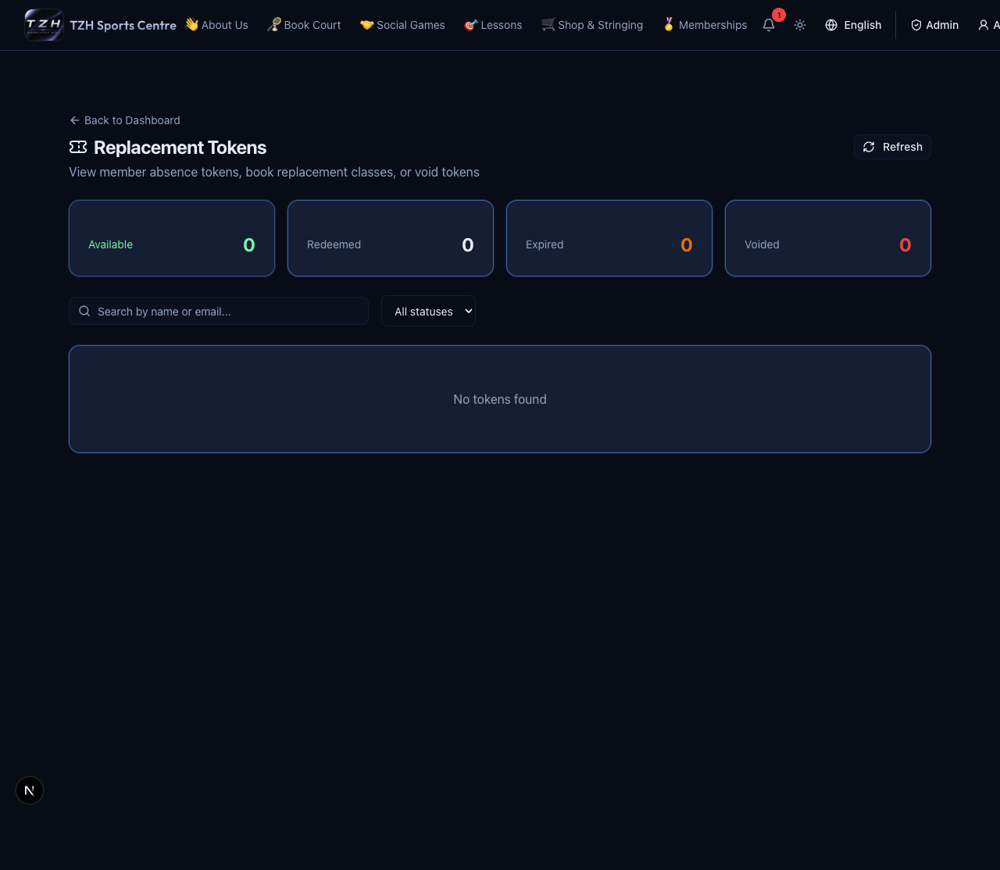

# Lesson Management

[← Overview](../overview.md) · **Who:** Administrators

1. Open [Lesson Management](https://tzhsports.vercel.app/admin/lesson-fees). **Schedule** shows concrete lessons with court, time, fee and student count.
2. Choose **Create Lesson** or **Create Recurring Lesson**. Enter the schedule and students/assistants. Per-session lessons allow custom duration, fee and capacity; monthly-flat lessons use their configured values.
3. Click a lesson for settings, notes, students and assistants, then save. Recurring edits offer **This lesson**, **This and upcoming lessons**, or **All lessons**; check the scope before saving.
4. Use **Enrollment** for the selected date to add/remove students. Registered students need the student role; capacity and duplicates are checked.
5. Use **Attendance** once a lesson ends. Record present, eligible absence or absence without replacement; use the distinct centre-cancellation action when the centre caused it. Review the proposed replacement and billing effects.
6. Work through **Attendance to review** using its period filters. A recorded row leaves the missing-attendance queue; **View account** opens Student Accounts.
7. Use **Member Fees** to search/sort accounts, open statements, review receipts or record an actually received offline payment.

8. Open [Replacement Tokens](https://tzhsports.vercel.app/admin/replacement-tokens) to find available live tokens or lifetime audit credits. Choose the replacement-booking action, select an eligible future lesson with space, and confirm the free replacement enrollment. Live tokens match the original lesson type and duration; audit credits follow their separate lifetime-credit workflow. Void a live token only after checking the reason.

**Expected:** Schedule, Enrollment and Attendance keep the selected date. Missing attendance is not proof of absence, and billing is based on enrollment. Eligible absence/centre cancellation can issue or restore replacement entitlements while retaining the original billable treatment. Replacement-funded sessions remain free.

