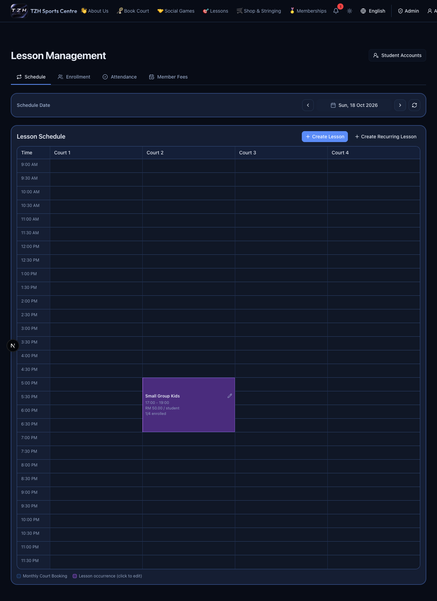
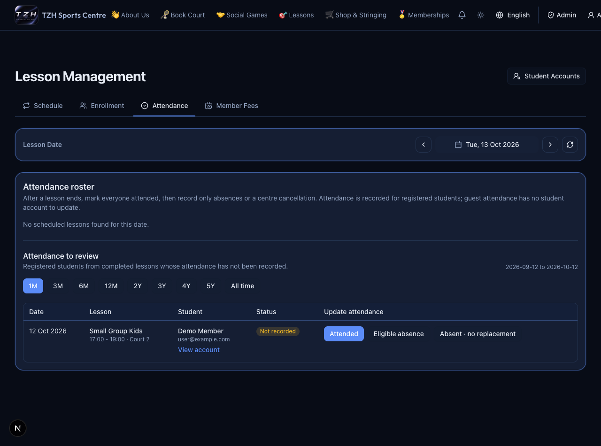
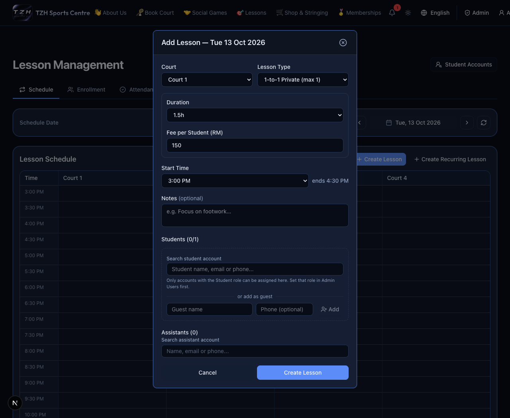
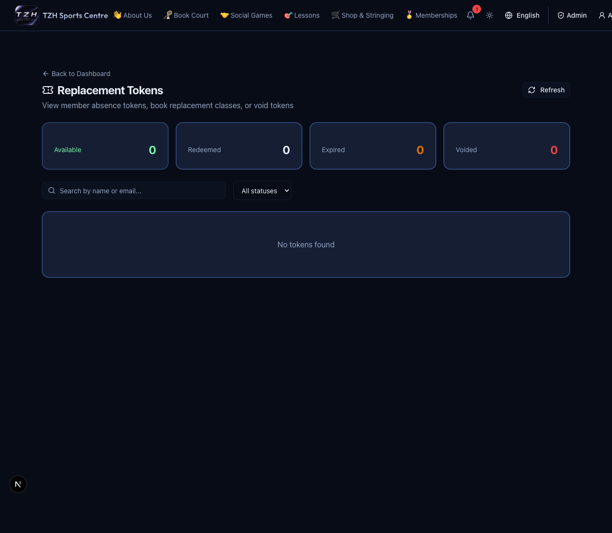
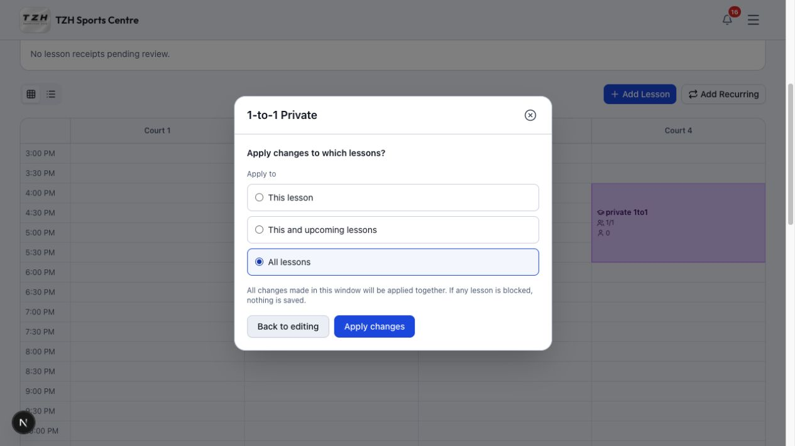
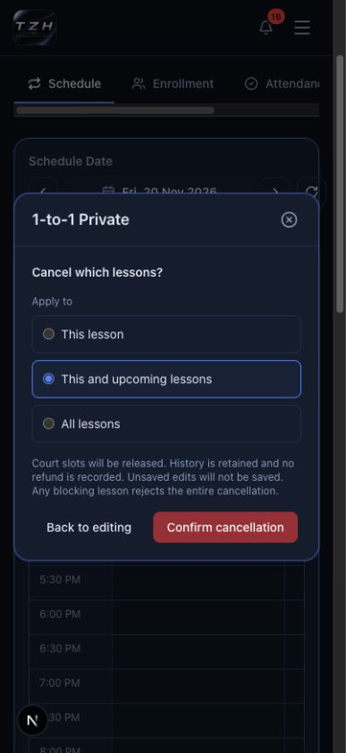

# Lesson Management

[← Overview](../overview.md) · **Who:** Administrators

1. Open [Lesson Management](https://tzhsports.vercel.app/admin/lesson-fees). **Schedule** shows concrete lessons with court, time, fee and student count.
2. Choose **Create Lesson** or **Create Recurring Lesson**. Enter the schedule and students/assistants. Per-session lessons allow custom duration, fee and capacity; monthly-flat lessons use their configured values.
3. Click a lesson for settings, notes, students and assistants, then save. After **Save Changes**, choose **This lesson**, **This and upcoming lessons**, or **All lessons**, then **Apply changes**.
4. Use **Enrollment** for the selected date to add/remove students. Registered students need the student role; capacity and duplicates are checked.
5. Use **Attendance** once a lesson ends. Record present, eligible absence or absence without replacement; use the distinct centre-cancellation action when the centre caused it. Review the proposed replacement and billing effects.
6. Work through **Attendance to review** using its period filters. A recorded row leaves the missing-attendance queue; **View account** opens Student Accounts.
7. Use **Member Fees** to search/sort accounts, open statements, review receipts or record an actually received offline payment.

8. Open [Replacement Tokens](https://tzhsports.vercel.app/admin/replacement-tokens) to find available live tokens or lifetime audit credits. Choose the replacement-booking action, select an eligible future lesson with space, and confirm the free replacement enrollment. Live tokens match the original lesson type and duration; audit credits follow their separate lifetime-credit workflow. Void a live token only after checking the reason.

**Expected:** Schedule, Enrollment and Attendance keep the selected date. Missing attendance is not proof of absence, and billing is based on enrollment. Eligible absence/centre cancellation can issue or restore replacement entitlements while retaining the original billable treatment. Replacement-funded sessions remain free.

For recurring lesson-fee payments and automatic loyalty awards, follow [Recurring payments and points](recurring-payments-points.md#recurring-lessons).

For external venues and times outside centre operating hours, see [Off-site lessons](offsite-lessons.md).

## Apply an action to a recurring series

**Awaiting deployment.** Open [Lesson Management → Schedule](https://tzhsports.vercel.app/admin/lesson-fees),
choose the date and click the lesson. The same window is available from
[Admin Schedule → Lessons](https://tzhsports.vercel.app/admin/schedule?tab=lessons).

Make your changes to settings, notes, students or assistants, then click **Save
Changes**. The window asks **Apply changes to which lessons?** Choose **This
lesson**, **This and upcoming lessons**, or **All lessons**, then click **Apply
changes**. **Back to editing** keeps your unsaved work. Each prompt requires a
fresh choice. Unrelated students and occurrence-specific assistants are kept.

To cancel instead, click **Cancel Lesson**. Choose the scope in **Cancel which
lessons?**, then click **Confirm cancellation**.
This releases the affected court times and keeps history. Cancelling upcoming or
all lessons also stops the series from generating more sessions; earlier lessons
remain when you choose upcoming. Cancellation does not save other pending edits.

If any lesson is full, conflicts or has protected payment, attendance, replacement
or salary history, the whole action is rejected. Nothing is partially saved.
Review the error and reopen a stale window before retrying. No refund or replacement
credit is created here; use **Attendance** for centre cancellations with replacement
entitlements.

