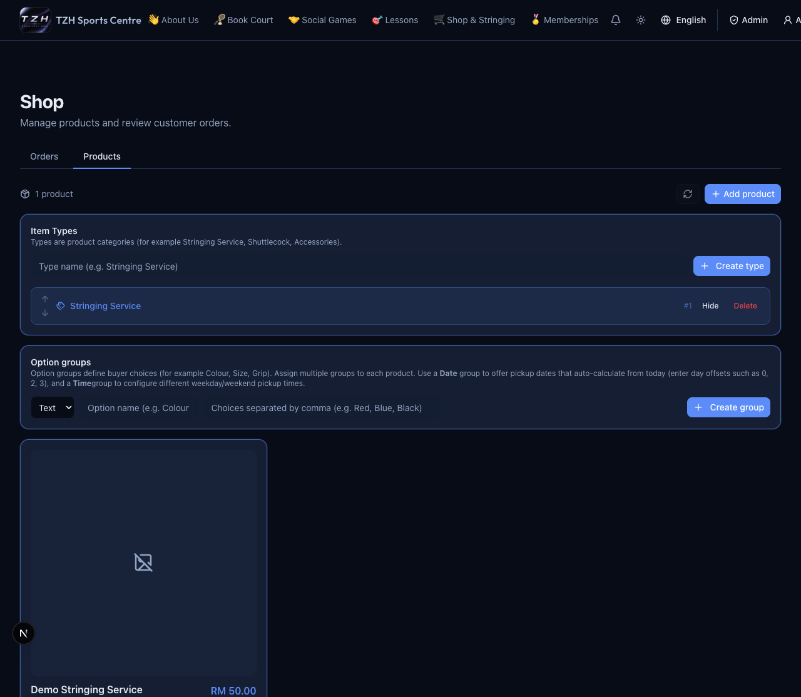
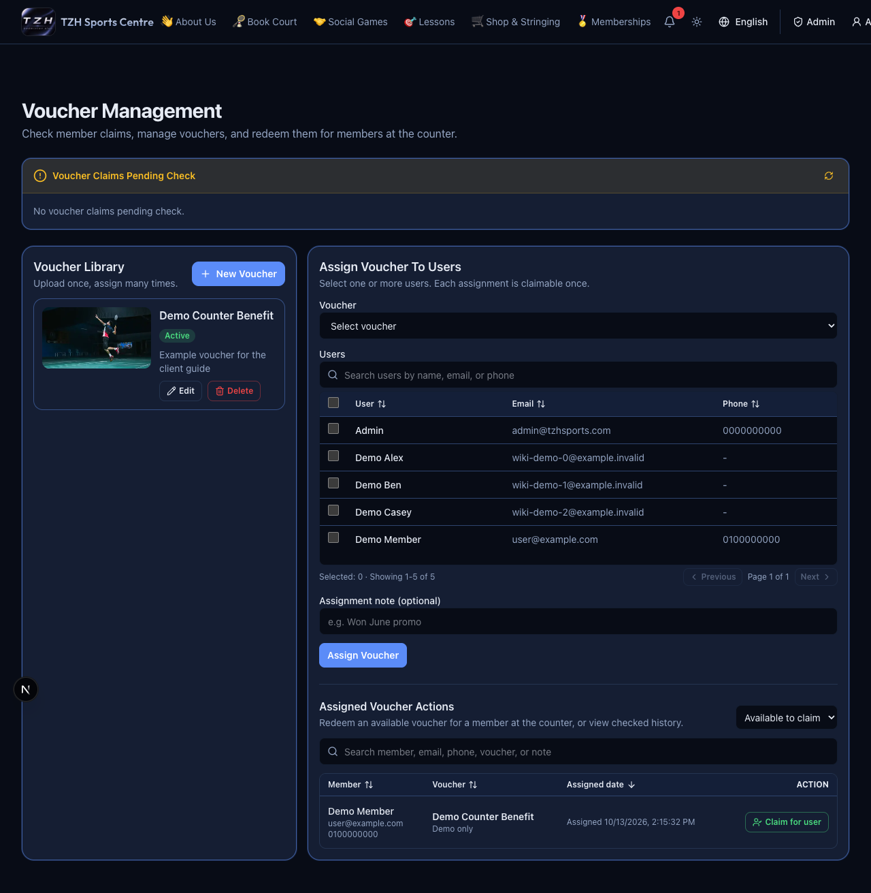
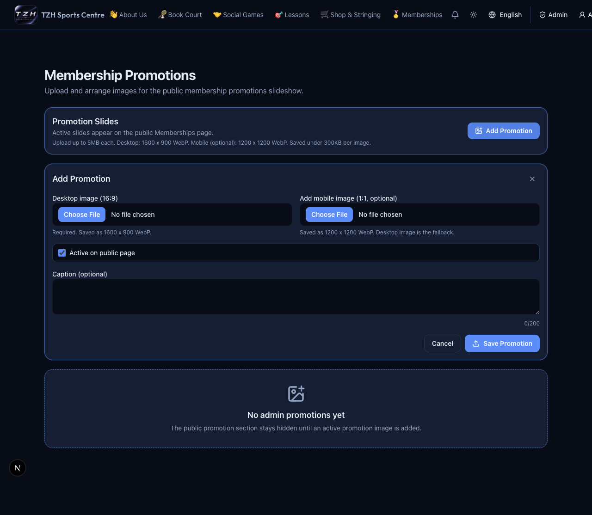
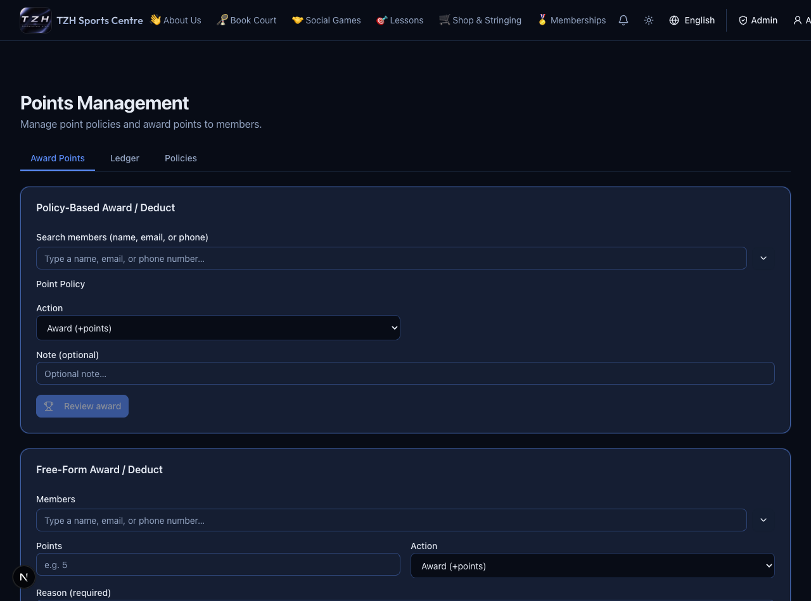

# Commerce, points, vouchers and promotions

[← Overview](../overview.md) · **Who:** Administrators

## Shop

Open [Admin Shop](https://tzhsports.vercel.app/admin/shop). Maintain products, prices, stock and active visibility; assign Item Types and reusable option groups. Text groups list choices; Date groups offer day offsets; Time groups use weekday/weekend pickup windows. Review receipts in **Orders**, confirm approval/rejection, then progress approved orders through packing, shipping and delivery as appropriate.

## Points

Open [Points Management](https://tzhsports.vercel.app/admin/points). Maintain reusable policies or select members for policy/free-form awards or deductions. Review the calculated change before confirming. Use a reason so the member history explains the adjustment. Paid purchases earn points automatically; do not duplicate those awards manually. MCP supports positive awards only.

## Vouchers

Open [Vouchers](https://tzhsports.vercel.app/admin/vouchers). Create a template with image/label, assign an active voucher to selected accounts, then check member claims in **Voucher Claims Pending Check**. **Available to claim** supports **Claim for user** at the counter; **Checked history** retains completed claims.

## Promotions

Open [Membership Promotions](https://tzhsports.vercel.app/admin/membership-promos). Choose **Add Promotion**, upload a desktop image and optional square mobile image, add a caption, and save. Edit, activate/deactivate, reorder or delete slides. Check Home and Memberships for the resulting order; without a mobile image the desktop image is used.

