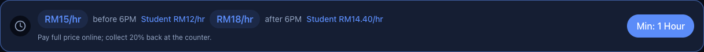
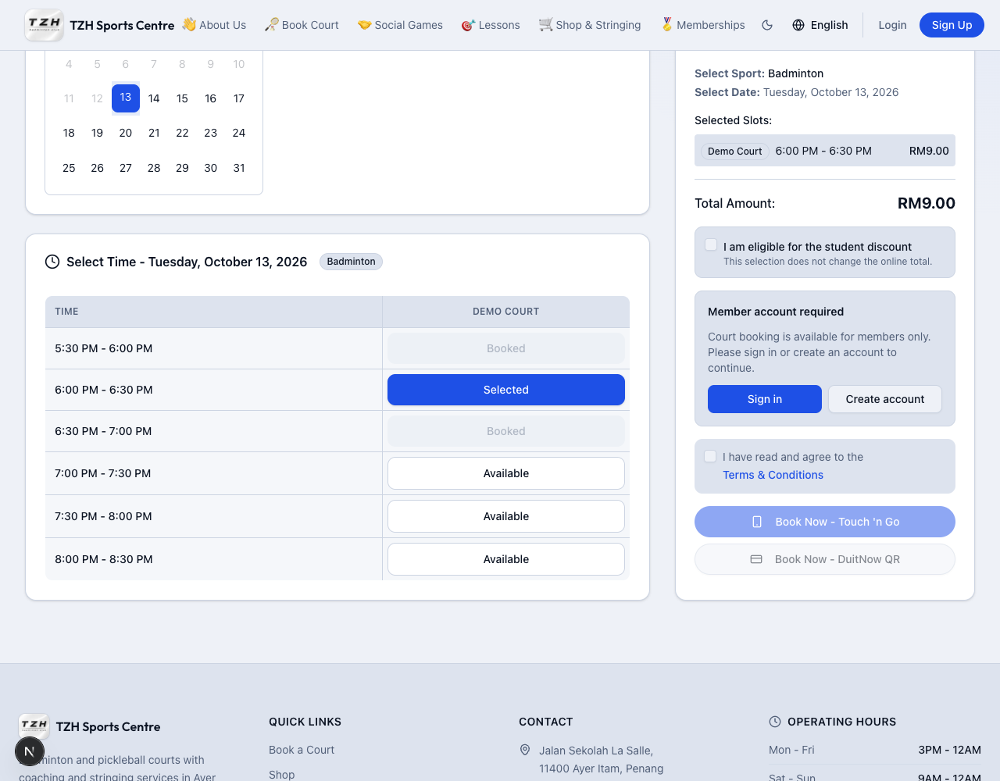

# Court bookings

[← Overview](../overview.md) · **Who:** Visitors can browse; members can book

1. Open [Book a Court](https://tzhsports.vercel.app/booking). Choose badminton or pickleball and review the displayed rates and minimum duration.
2. Choose a date, court and consecutive time slots. You can select multiple court blocks before confirming.
3. Check the booking summary and confirm. Select the offered payment method, pay the displayed full amount externally, and upload your receipt before the countdown expires.
4. Wait for admin receipt approval. Open [My Bookings](https://tzhsports.vercel.app/my-bookings) to check the outcome and upcoming one-off or recurring sessions.
5. After approval, check [My Invoices](https://tzhsports.vercel.app/my-invoices) and [My Points](https://tzhsports.vercel.app/my-points).

**Expected:** Uploading a receipt means pending review, not paid approval. An expired hold releases the court. Student rates reflect a 20% counter refund: pay the full online amount first. [Admin cancellation](admin-courts.md) releases the slot but records no refund.

## 30-minute gaps

**Testing (local only; awaiting production deployment):** Both badminton and pickleball normally require at least
one hour per continuous booking. You can select a single 30-minute gap only when
the slots immediately before and after are already occupied on that same court.
Opening/closing boundaries do not qualify. Select the free gap, check the
half-hour total and follow the normal payment steps. If a neighbouring booking
changes before confirmation, refresh availability and select again.

Follow the [30-minute court booking test guide](30-minute-court-bookings.md) on the local test website.
