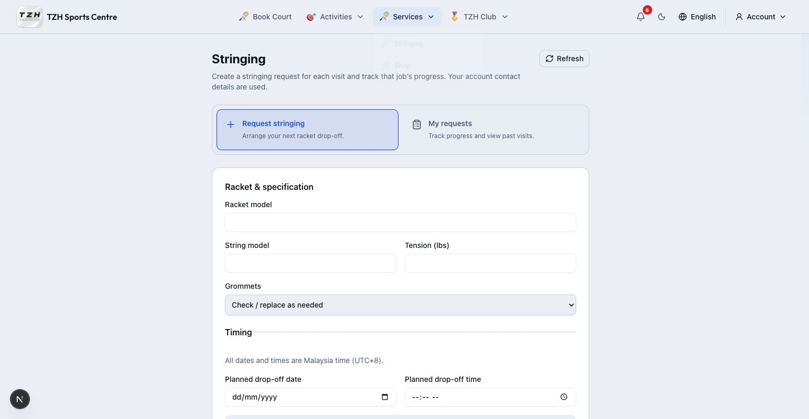
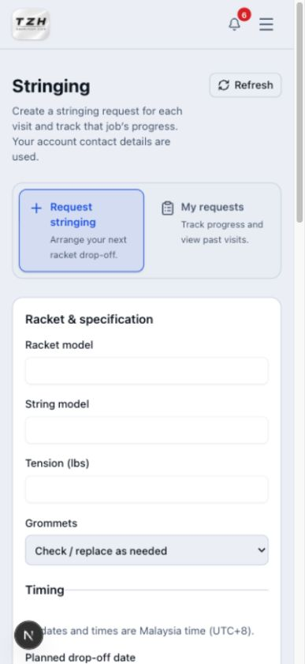

# Request and track stringing

**Signed-in customer · Awaiting deployment**
[Open Stringing](https://tzhsports.vercel.app/stringing) · [Admin guide](stringing.md)

Open **🏸 Services → Stringing** from the navbar. On smaller screens, open the
menu beside the notification bell, then expand **Services**.

- **Activities:** Social Games and Lessons.
- **Services:** Stringing and Shop.
- **TZH Club:** Memberships and About Us.

**Book Court** stays directly available. Use **Account** for your account and
sign-out actions.

<strong>1 · Request stringing</strong>

**Services → Stringing → sign in → Request stringing.** Complete your account phone number
if asked. Enter the **Racket model** for this visit, then the string, lbs, grommet preference
and planned times. Put grip identifiers or other details in **Special instructions**.
All times are Malaysia time; staff confirms fees and pickup after inspection.

Choose **Request stringing** to plan a new visit or **My requests** to track progress.
Use **Refresh** beside the page title to reload saved details.

**Review request → Confirm request.** Keep the reference and bring your racket
at the planned time. No payment is taken by this request.

<strong>2 · Track or cancel</strong>

**My requests** shows your requests and admin-created history. **To be confirmed**
means staff has not quoted the fees. After staff records payment, download the
linked invoice. Use Previous/Next for older services.

**Cancel request → Confirm cancellation** works only while still Requested.
Contact the centre for other changes. Each visit is a separate job, even when the racket model is the same.
There is no racket profile to create or reuse.

<strong>3 · Choose pickup</strong>

Normally choose a pickup date after the drop-off date. **Same-day pickup available
today** permits later-today pickup only when both dates are today and the centre
is open. Staff can switch it off; if availability changes, your details stay and
you can choose a later pickup date.

