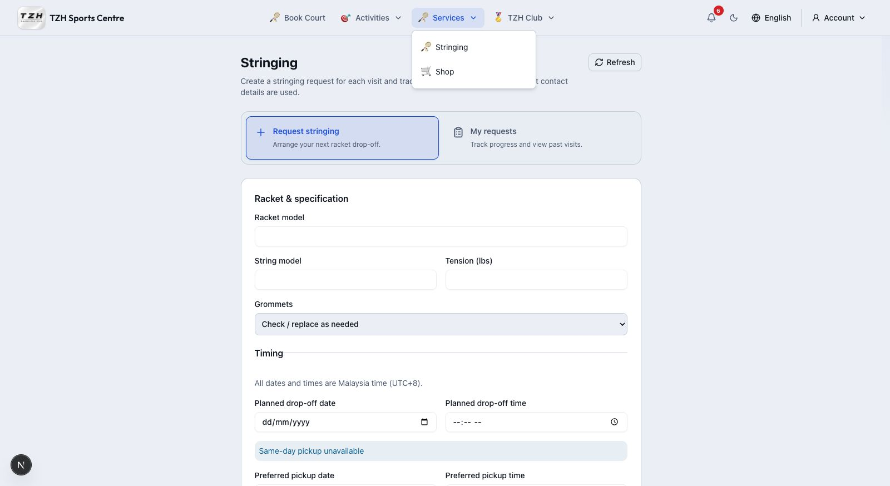
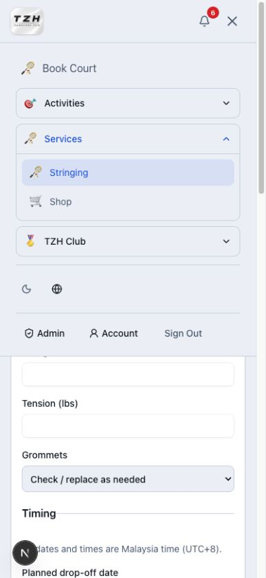
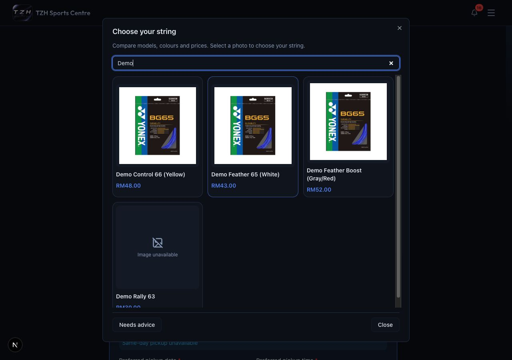
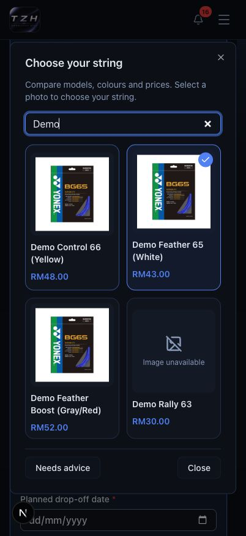
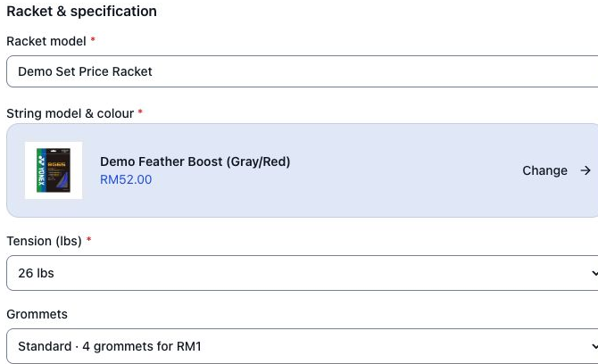
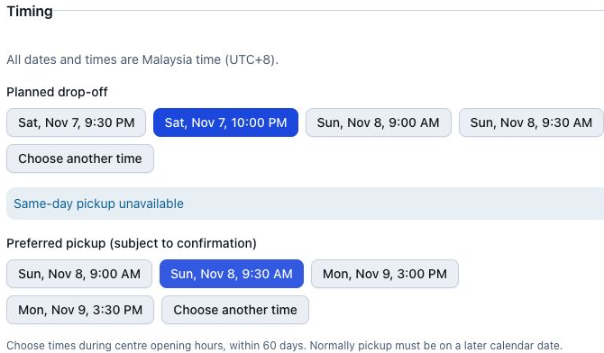
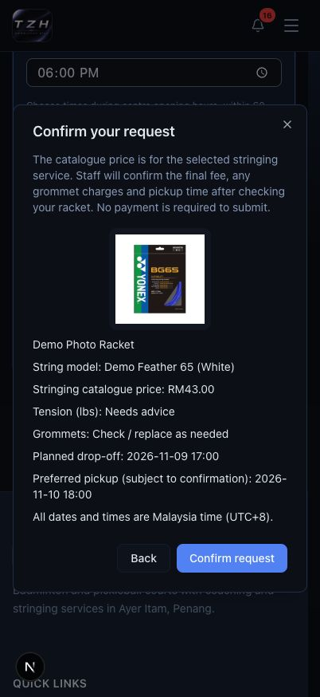
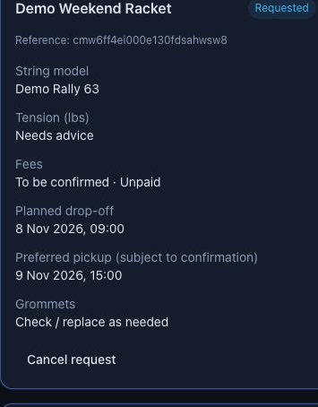
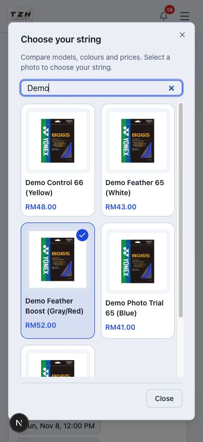

# Request and track stringing

**Signed-in customer**
[Open Stringing](https://tzhsports.vercel.app/stringing) · [Admin guide](stringing.md)

See [a complete customer visit](stringing-complete-visit.md) for the request, completed service, invoice and feedback screens.

Open **🏸 Services → Stringing** from the navbar. On smaller screens, open the
menu beside the notification bell, then expand **Services**.

- **Activities:** Social Games and Lessons.
- **Services:** Stringing and Shop.
- **TZH Club:** Memberships and About Us.

**Book Court** stays directly available. Use **Account** for your account and
sign-out actions.

<strong>1 · Request stringing</strong>

**Services → Stringing → sign in → Request stringing.** Complete your account phone number
if asked. Enter the **Racket model** for this visit. Under **String model & colour**, tap **Choose a string**, search by model or colour and tap a photo. Use **Change** on the selected card to pick another string. Every choice includes its catalogue price. The price also
appears on the selected card and in **Confirm your request**. Select **Tension (lbs)** from **18–34**, or choose **Needs advice** for staff to advise on tension.

The photo picker and prices are **awaiting deployment**. Use this request form for
stringing services; Shop is for merchandise purchases.

Put grip identifiers or other details in **Special instructions**, then choose
your grommet preference and planned times. Standard grommets cost **RM1 per four** and high-quality grommets cost **RM1 per two**. Staff check your racket to determine how many are needed. You can also ask staff to check the racket or request no replacement. All times are Malaysia time. Staff
confirms the final fee, any grommet charges and pickup after inspecting your racket.

Choose **Request stringing** to plan a new visit or **My requests** to track progress.
Use **Refresh** beside the page title to reload saved details.

If a photo is unavailable, the name and price remain selectable.

**Submit request → Confirm request.** While **Saving…** is shown, wait for
**Request accepted**. An orange retry warning appears only if the outcome is uncertain.
Keep the reference and bring your racket
at the planned time. The confirmation explains that staff will confirm the price
and pickup time after checking your racket. No payment is required to submit.

Under **Timing**, tap a suggested **Planned drop-off**, then tap a **Preferred pickup**. To enter a different date or time, select **Choose another time** under that heading. Staff confirms pickup after inspecting your racket. The time suggestions are **awaiting deployment**.

<strong>2 · Track or cancel</strong>

**My requests** shows your requests and admin-created history. **To be confirmed**
means staff has not quoted the fees. After staff records payment, download the
linked invoice. Use Previous/Next for older services.

**Cancel request → Confirm cancellation** works only while still Requested.
Contact the centre for other changes. Each visit is a separate job, even when the racket model is the same.
There is no racket profile to create or reuse.

String model and tension have separate labels (**awaiting deployment**). A chosen string stays visible when you choose **Needs advice**.

<strong>3 · Choose pickup</strong>

Normally choose a pickup date after the drop-off date. **Same-day pickup available
today** permits later-today pickup only when both dates are today and the centre
is open. Staff can switch it off; if availability changes, your details stay and
you can choose a later pickup date.

The request form has outlined fields in light and dark themes.

Fields marked **\*** are required. If a string is withdrawn before submission, use **Refresh** and choose another listed string.
