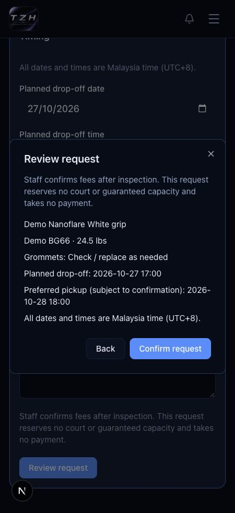
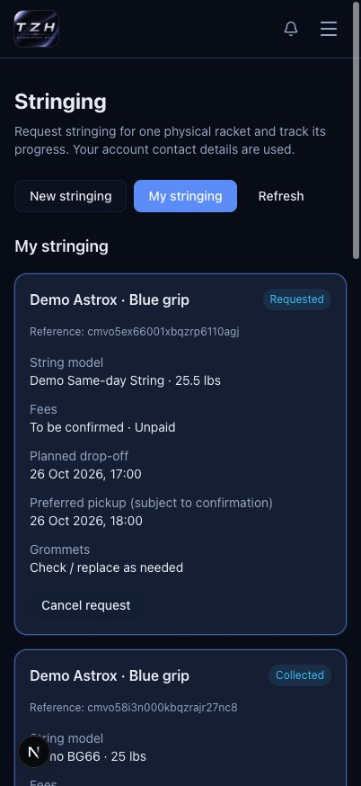

# Request and track stringing

**Signed-in customer · Awaiting deployment**
[Open Stringing](https://tzhsports.vercel.app/stringing) · [Admin guide](stringing.md)

<strong>1 · Request stringing</strong>

**Home → Stringing → sign in → New stringing.** Complete your account phone number
if asked. Choose your racket or add one physical racket with its model and an
optional grip/nickname. Enter string, lbs, grommet preference and planned times.
All times are Malaysia time; staff confirms fees and pickup after inspection.

**Review request → Confirm request.** Keep the reference and bring your racket
at the planned time. No payment is taken by this request.

<strong>2 · Track or cancel</strong>

**My stringing** shows your requests and admin-created history. **To be confirmed**
means staff has not quoted the fees. After staff records payment, download the
linked invoice. Use Previous/Next for older services.

**Cancel request → Confirm cancellation** works only while still Requested.
Contact the centre for other changes. An active racket cannot receive a second
request; it becomes available again after collection or cancellation.

<strong>3 · Choose pickup</strong>

Normally choose a pickup date after the drop-off date. **Same-day pickup available
today** permits later-today pickup only when both dates are today and the centre
is open. Staff can switch it off; if availability changes, your details stay and
you can choose a later pickup date.

