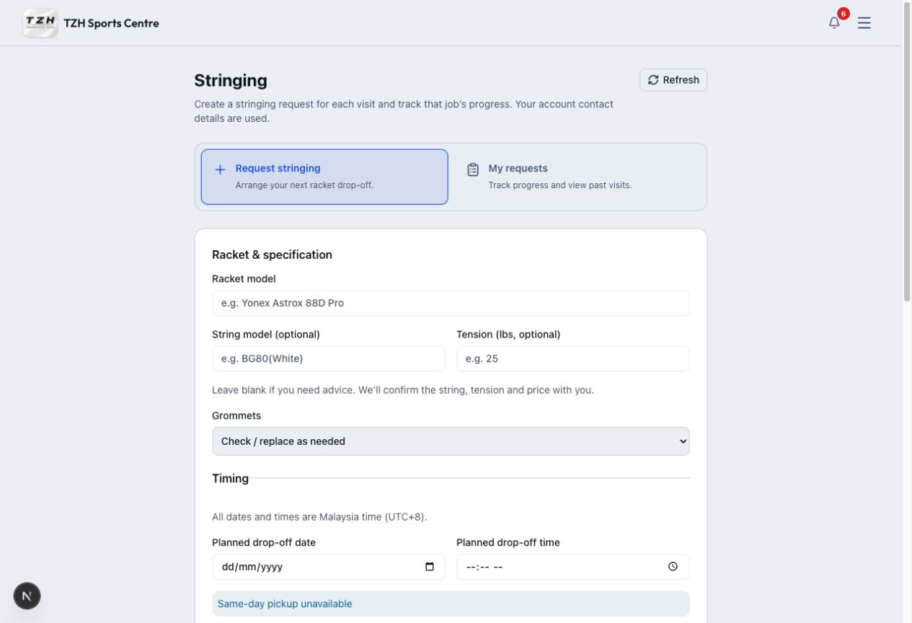
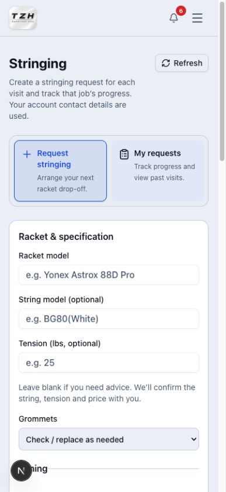
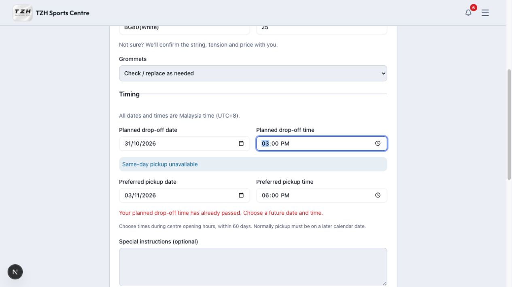
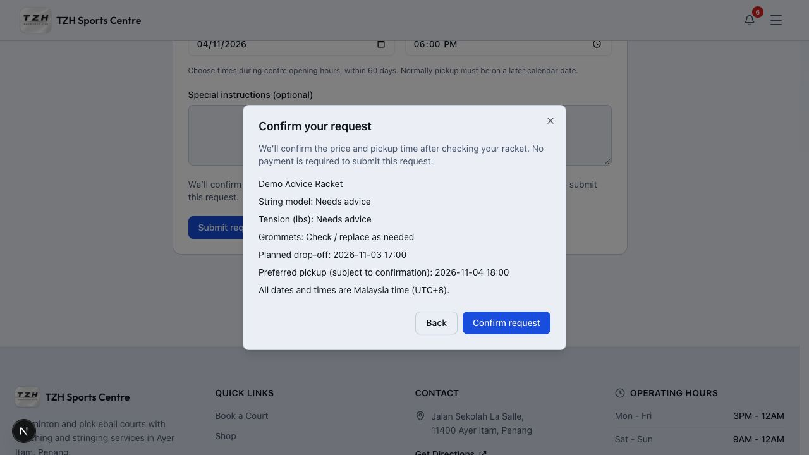
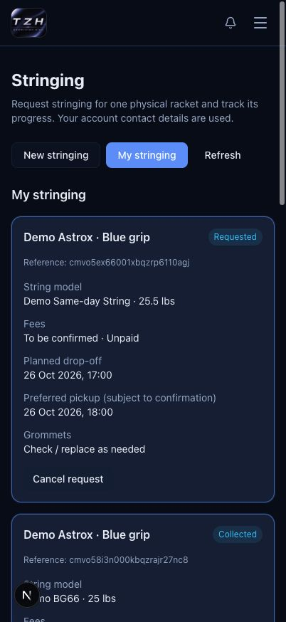
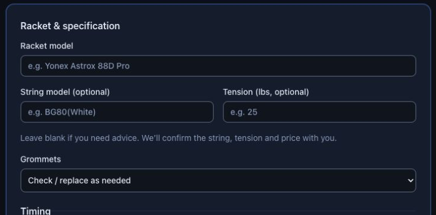
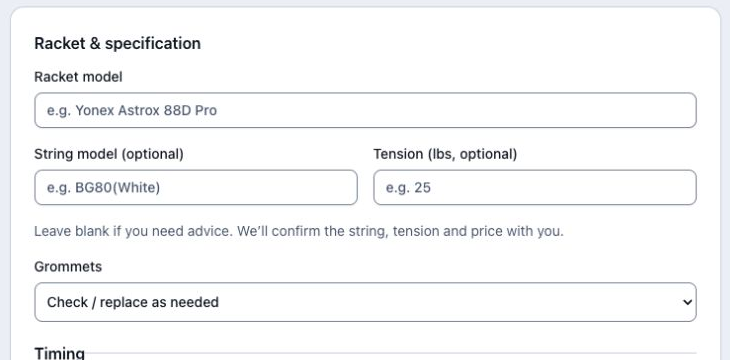
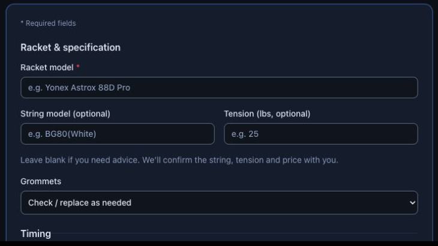

# Request and track stringing

**Signed-in customer · Awaiting deployment**
[Open Stringing](https://tzhsports.vercel.app/stringing) · [Admin guide](stringing.md)

Open **🏸 Services → Stringing** from the navbar. On smaller screens, open the
menu beside the notification bell, then expand **Services**.

- **Activities:** Social Games and Lessons.
- **Services:** Stringing and Shop.
- **TZH Club:** Memberships and About Us.

**Book Court** stays directly available. Use **Account** for your account and
sign-out actions.

<strong>1 · Request stringing</strong>

**Services → Stringing → sign in → Request stringing.** Complete your account phone number
if asked. Enter the **Racket model** for this visit, then the string, lbs, grommet preference
and planned times. For String model, use **model(color)**, for example **BG80(White)**. Put grip identifiers or other details in **Special instructions**.
**String model** and **Tension** are optional. Leave either blank if you need advice;
it will show **Needs advice** until staff confirms your setup. The examples inside
the fields disappear as you type; the confirmation hint stays visible. Staff will
confirm the string, tension and price with you.
All times are Malaysia time; staff confirms fees and pickup after inspection.

Choose **Request stringing** to plan a new visit or **My requests** to track progress.
Use **Refresh** beside the page title to reload saved details.

**Submit request → Confirm request.** While **Saving…** is shown, wait for
**Request accepted**. An orange retry warning appears only if the outcome is uncertain.
Keep the reference and bring your racket
at the planned time. The confirmation explains that staff will confirm the price
and pickup time after checking your racket. No payment is required to submit.

Choose a future drop-off and a later pickup, within 60 days. If a time has passed,
the message under **Timing** identifies which one to change before confirmation.

<strong>2 · Track or cancel</strong>

**My requests** shows your requests and admin-created history. **To be confirmed**
means staff has not quoted the fees. After staff records payment, download the
linked invoice. Use Previous/Next for older services.

**Cancel request → Confirm cancellation** works only while still Requested.
Contact the centre for other changes. Each visit is a separate job, even when the racket model is the same.
There is no racket profile to create or reuse.

<strong>3 · Choose pickup</strong>

Normally choose a pickup date after the drop-off date. **Same-day pickup available
today** permits later-today pickup only when both dates are today and the centre
is open. Staff can switch it off; if availability changes, your details stay and
you can choose a later pickup date.

The request form has outlined fields in both light and dark themes, including optional string and tension preferences.

Fields marked **\*** are required: racket model, planned drop-off date/time and preferred pickup date/time. String and tension can remain blank when you need advice.

