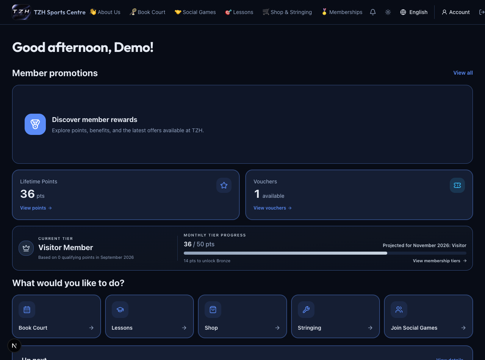
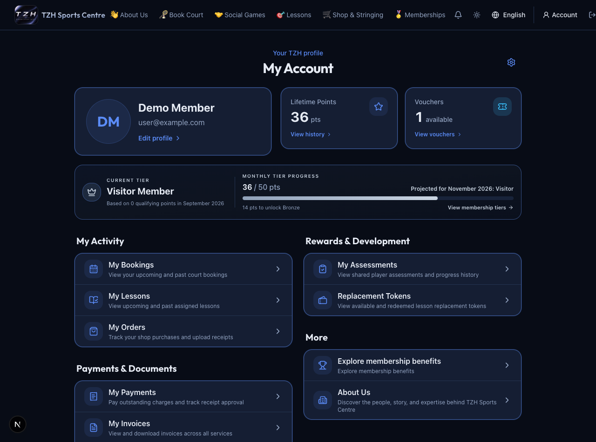
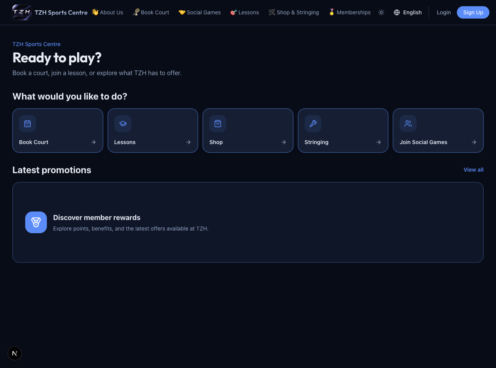

# Getting started

[← Overview](../overview.md) · **Who:** Everyone

1. Open [Home](https://tzhsports.vercel.app). Use the quick links for Book Court, Lessons, Shop, Stringing or Social Games. [About Us](https://tzhsports.vercel.app/about) contains the centre story, qualifications and contact information; tap a credential image to enlarge it.
2. Choose [Sign In](https://tzhsports.vercel.app/login) or [Register](https://tzhsports.vercel.app/register). Google sign-in is available when configured. Use [Forgot Password](https://tzhsports.vercel.app/forgot-password) for the reset-email flow.
3. After sign-in, open [Account](https://tzhsports.vercel.app/account). Choose **Edit profile** or the settings gear to update your details at [Settings](https://tzhsports.vercel.app/account/settings).
4. Complete your mobile number when prompted, then return to your intended task.
5. Open the navbar bell for required actions. Members see payments, receipts, delivery confirmation and review acknowledgements; available vouchers appear separately.

**Expected:** Member Home shows your own rewards, tier progress and next activity. Staff tools appear according to your roles. On mobile, use the bottom navigation and menu; desktop uses the top navigation.

