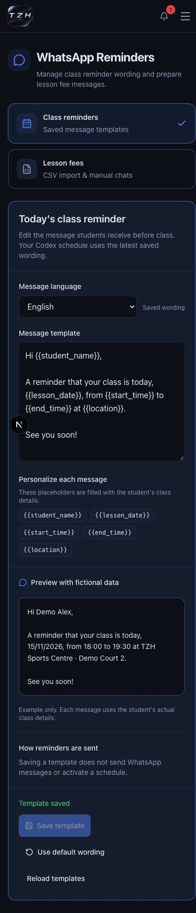
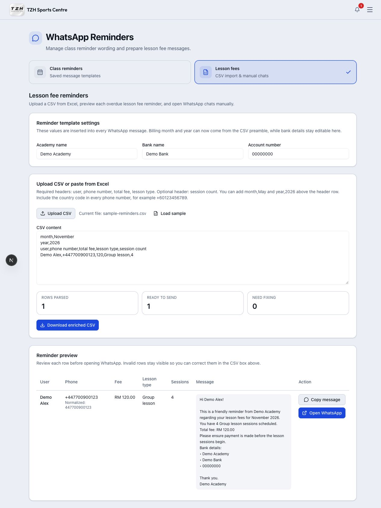

# Edit today's class reminder

**Role:** Administrator. **Availability:** Live. Scheduled sending needs approved server contact hours and WhatsApp setup.

Open [WhatsApp Reminders](https://tzhsports.vercel.app/admin/reminders), then
choose **Class reminders**. The editor and example preview are on this page.

1. Choose **Message language**: English, 中文 or Bahasa Malaysia.
2. Edit **Message template** using the supported placeholders below the box.
3. Check **Preview with fictional data**, then click **Save template**.

The Codex schedule uses the latest saved wording in its selected language. Saving
here does not send a message or start a schedule. **Use default wording** restores
a draft; click **Save template** to keep it.

On a phone, the editor and preview stack in one column. The Save action follows
the preview. Switching between **Class reminders** and **Lesson fees** keeps your
drafts while this page stays open.

For sending setup, see [Today's lesson reminders in Codex](../mcp/lesson-reminders.md).

For fee messages, choose **Lesson fees**, or [open fee reminders directly](https://tzhsports.vercel.app/admin/reminders?view=fees).
Upload/paste the CSV, check the fee message preview, then open each WhatsApp chat
manually. This section does not record payments or send automatically.

