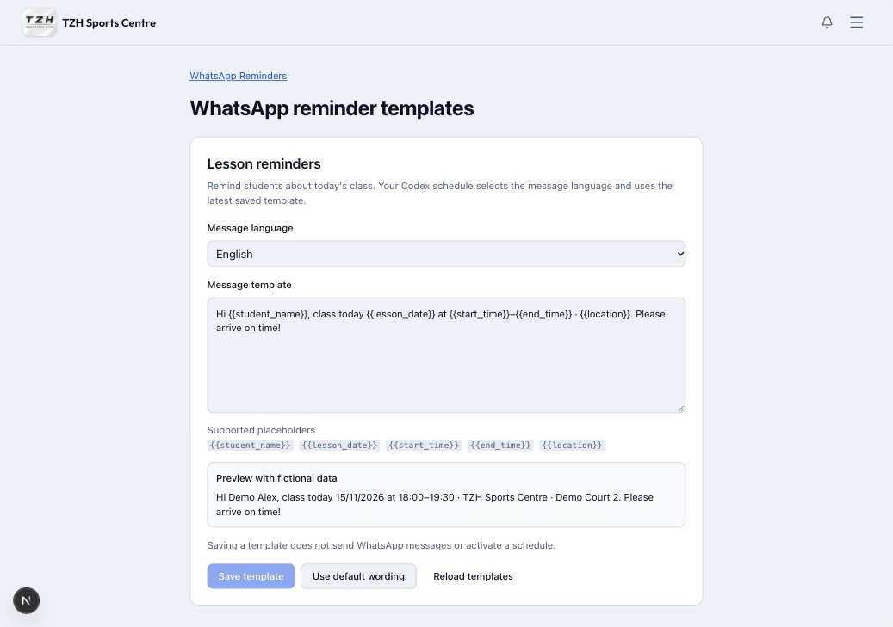

# Edit today's class reminder

**Role:** Administrator. **Availability:** Preview; awaiting deployment.

Open [WhatsApp reminder templates](https://tzhsports.vercel.app/admin/whatsapp-reminders),
or **Admin → WhatsApp Reminders → Edit lesson reminder templates**.

1. Choose **Message language**: English, 中文 or Bahasa Malaysia.
2. Edit **Message template** using the supported placeholders below the box.
3. Check **Preview with fictional data**, then click **Save template**.

The Codex schedule uses the latest saved wording in its selected language. Saving
here does not send a message or start a schedule. **Use default wording** restores
a draft; click **Save template** to keep it.

On a phone, the editor stacks the same controls in one column.

For sending setup, see [Today's lesson reminders in Codex](../mcp/lesson-reminders.md).
