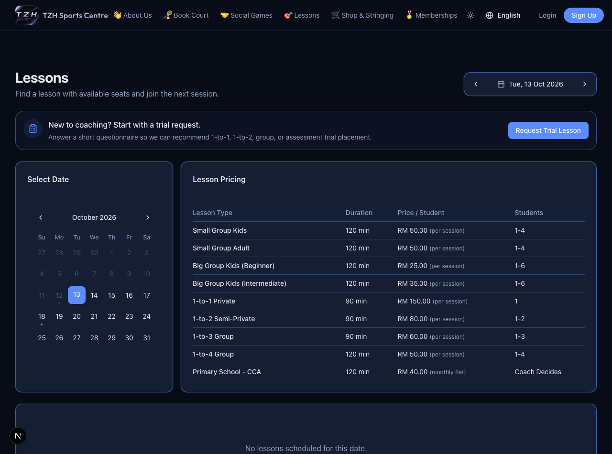
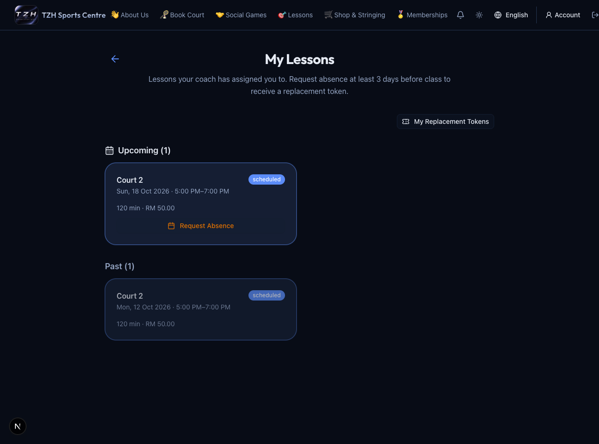
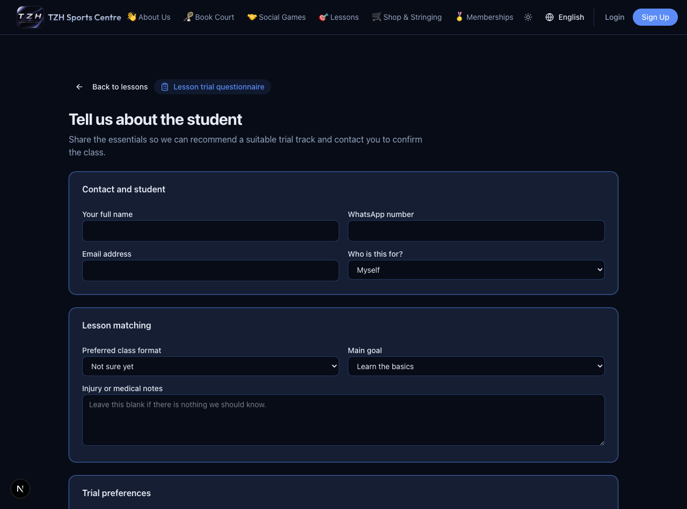

# Lessons, trials and replacements

[← Overview](../overview.md) · **Who:** Visitors, members and lesson students

## Browse or enroll

1. Open [Lessons](https://tzhsports.vercel.app/lessons), choose the date and lesson, and check its time, fee and available places.
2. Follow the enrollment form. When payment is required, confirm the enrollment, pay via the displayed QR, and upload the receipt within the payment window.
3. Members check [My Lessons](https://tzhsports.vercel.app/my-lessons); monthly/admin-managed charges appear in [My Lesson Fees](https://tzhsports.vercel.app/my-lesson-fees).

## Request a trial

Choose **Request Trial Lesson**, or open [Trial Request](https://tzhsports.vercel.app/lessons/trial). Complete contact/student details, preference, goal, safety notes, preferred date and consent, then submit. Keep the request reference and wait for admin contact. The recommendation is provisional; submission reserves no seat and collects no payment.

## Unable to attend

In My Lessons, choose **Request Absence** when offered. Eligible admin-assigned lessons must be at least 72 hours away. The original lesson remains billable; its seat is released and an eligible replacement token is created. Check [My Tokens](https://tzhsports.vercel.app/my-tokens) and contact the centre to book a matching replacement. Live tokens normally expire after three months; historical audit credits are separate lifetime credits. Replacement-funded lessons cannot earn another entitlement.

**Testing (local only; awaiting production deployment):** Off-site lesson cards and statements show the external location. See [Off-site lessons](offsite-lessons.md) for how admins and coaches arrange these classes.
