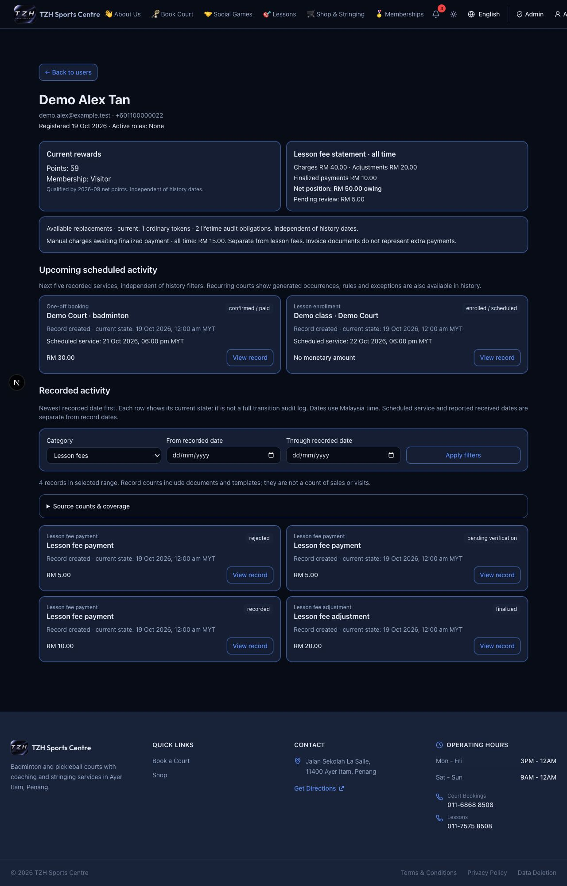
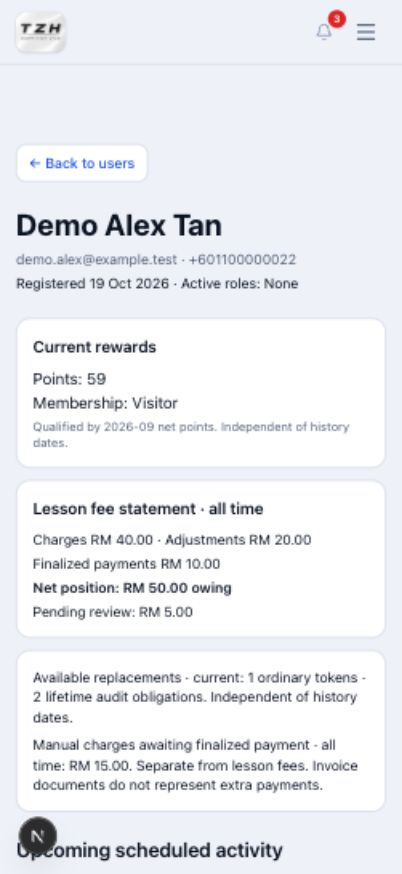
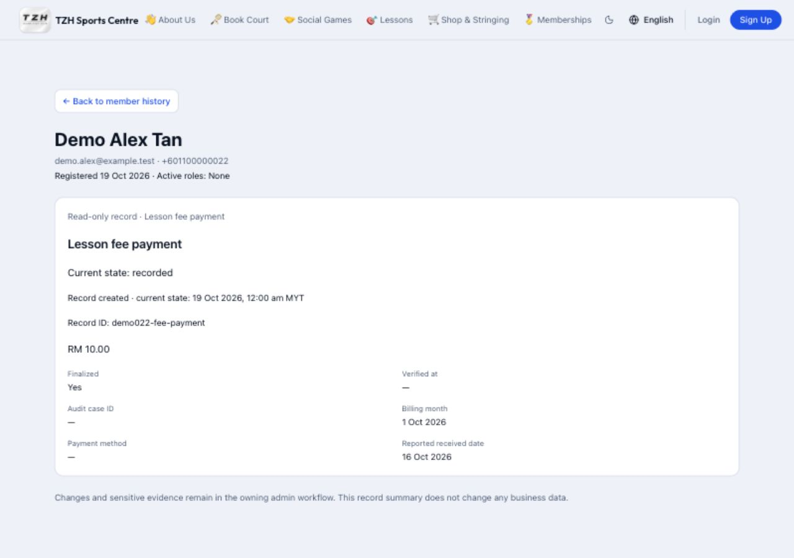

# Review a member's activity

[← Overview](../overview.md) · **Who:** Administrators

**Availability:** Awaiting deployment confirmation. Stringing history will be added separately.

## Find the member

1. Sign in and open [Admin Dashboard](https://tzhsports.vercel.app/admin) → **Member Activity**, or go directly to [Member Activity](https://tzhsports.vercel.app/admin/member-activity).
2. Search by name, email or phone and select **Search**. Open the matching member's **View activity** card. You can also select **View Activity** below their name in [Users](https://tzhsports.vercel.app/admin/users).
3. To review an old account, choose **Retired accounts** and search again. Its detail is labelled **Retired account**. A new registration keeps separate history, even when contact details were reused.

## Review balances and records

1. Check current points and membership tier, the all-time lesson fee position, pending receipts, and available replacements. Manual unpaid charges are shown separately from lesson fees.
2. Check **Upcoming scheduled activity** for the next recorded services.
3. Under **Recorded activity**, choose a category and optional **From recorded date** / **Through recorded date**, then select **Apply filters**. Dates use Malaysia time. These filters change history, while current/all-time summary figures stay the same.
4. Select **Older activity** for more records. Use **View record** to inspect an exact entry, then **Back to member history** to keep your filters. Shop orders have separate **Next items** / **Previous items** controls for long item lists.
5. Invoice corrections show the previous and corrected totals and offer **Download previous invoice**. They do not count as another payment. Invoice records offer the existing invoice download; completed Foundation and Level reports offer report downloads. Make operational changes or review sensitive evidence in the usual admin workflow.

This screen is read-only: opening it does not settle money, approve receipts, award points, or send messages. Invoice documents do not count as another payment. Ordinary replacement tokens and lifetime audit replacements are shown separately.

If a source says **Unavailable**, retry the page. The visible records are partial until it loads. The overview shows recorded entries and their current state; it is not a complete history of every edit. Social-game participation and WhatsApp handoffs are not recorded here. Recurring court previews use recorded occurrences; future sessions without a recorded occurrence are not listed as upcoming.

