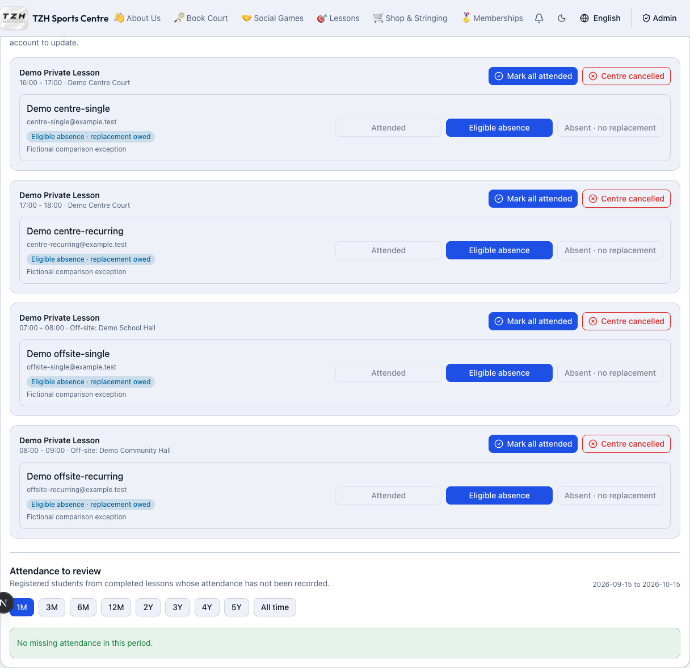
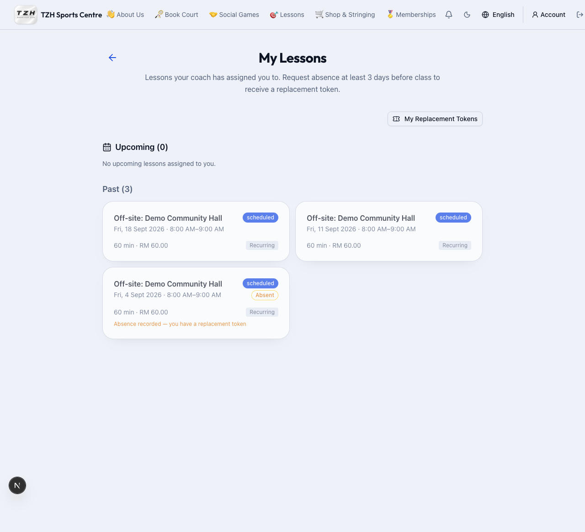
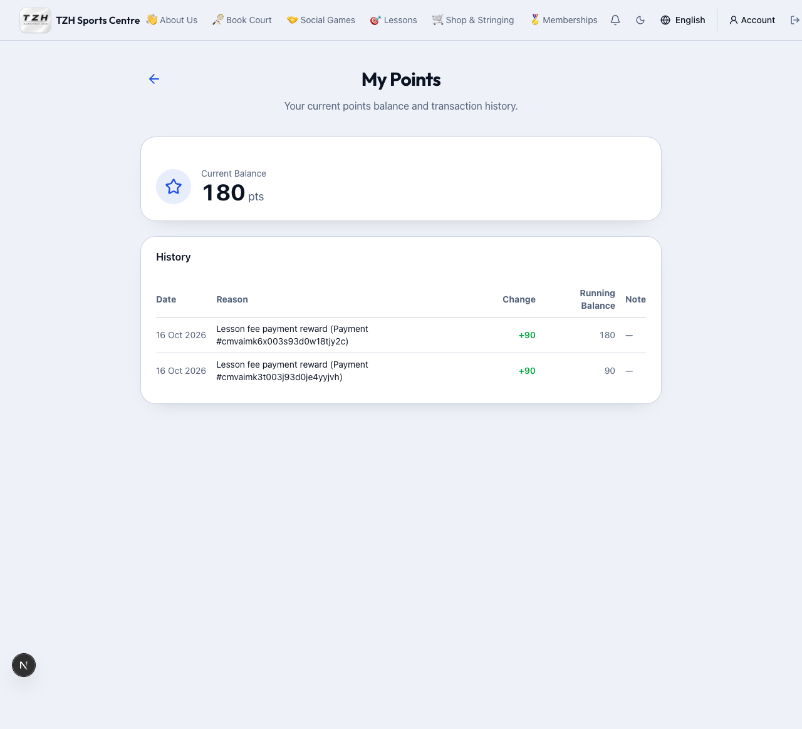
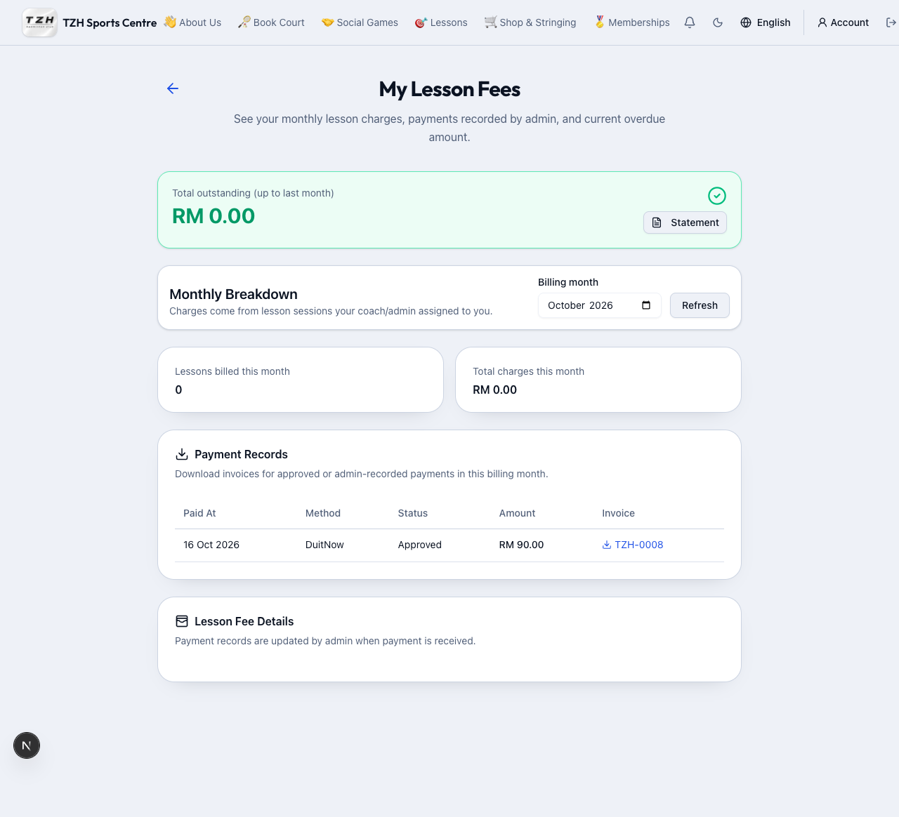

# Arrange off-site lessons

[← Overview](../overview.md) · **Who:** Administrators (including coaches using admin accounts)

**Status: Available** — released on 16 October 2026 at [TZH Sports Centre](https://tzhsports.vercel.app/).

## Administrator

1. Open [Lesson Management](https://tzhsports.vercel.app/admin/lesson-fees), choose the date and select **Create Lesson** or **Create Recurring Lesson**. The same forms are available in [Schedule → Lessons](https://tzhsports.vercel.app/admin/schedule?tab=lessons).
2. In **Court / venue**, choose **Off-site — no centre court**.
3. Enter **Off-site location**, for example **Demo School Hall**. Choose the lesson type, start time and duration. Off-site times can be outside centre operating hours; the lesson must finish by midnight on the same date.
4. Check the fee and seats, add students and any assistants, then create the lesson. For recurring lessons, also check the recurrence and start/end dates.
5. In Lesson Management, find the occurrence in the **Off-site** timetable column after the centre courts, then click its venue card for later changes. Use the normal Enrollment, Attendance and Member Fees tabs for student administration and payments.

For example, a weekly **7:00–8:00 AM** lesson from **15–29 October 2026** creates three occurrences: **15, 22 and 29 October**. Each carries the external venue and enrolled students.

## View off-site lessons in the timetable

1. Open [Lesson Management](https://tzhsports.vercel.app/admin/lesson-fees), select **Schedule** and choose the lesson date.
2. Find the **Off-site** column after the centre court columns. Each venue card shows the time and enrollment count; all lesson columns have equal widths.
3. Click a venue card to inspect or edit that occurrence.

Early or late lessons extend the displayed hours, while centre courts outside operating hours show **Closed**. Overlapping off-site lessons at different venues remain visible together. These entries reserve no centre court.

## Expected results and points

The lesson shows its external location and reserves **no centre court**. Generated recurring sessions and monthly renewal keep the location. Centre courts remain available for ordinary bookings, subject to their other bookings and lessons.

Off-site lessons use the normal enrollment-based fees. Creating or renewing them awards **no points**. When an admin approves a registered member's lesson-fee receipt or records received payment, the member earns **1 point per complete RM received** automatically. Follow [Recurring payments and points](recurring-payments-points.md#recurring-lessons); do not add the same points manually.

Enrolled members can check the external location in [My Lessons](https://tzhsports.vercel.app/my-lessons) and their charges in [My Lesson Fees](https://tzhsports.vercel.app/my-lesson-fees).

## Check attendance, student history and payments

1. After a lesson ends, use **Lesson Management → Attendance**. Record **Attended**, **Eligible absence** or **Absent · no replacement** as appropriate. Existing fees remain payable; an eligible absence issues one replacement token.
2. The student checks **My Lessons** for the venue, date, duration and fee. Eligible absences remain in their history with an **Absent** badge and a replacement-token message. **My Replacement Tokens** shows the entitlement.
3. Use **My Lesson Fees** and the fee statement to check the balance. A submitted receipt stays pending until an admin reviews it. Pending or rejected receipts do not reduce the balance or award points.
4. When an admin records received payment or approves the receipt, **My Points** shows the award and **My Invoices** contains the payment invoice. For example, two finalized RM90 payments earn 180 points in total.

