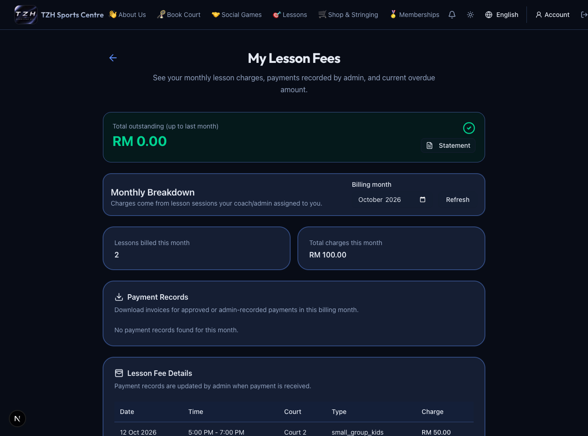
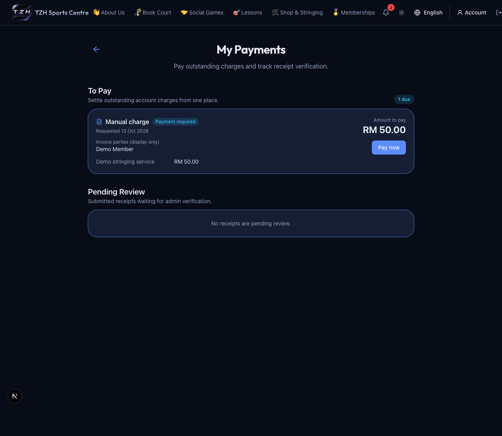

# Payments, statements and invoices

[← Overview](../overview.md) · **Who:** Signed-in members

1. Open [My Payments](https://tzhsports.vercel.app/my-payments) for unpaid recurring court bookings, manual charges and finalized lesson-fee balances.
2. Choose the item, check the amount, select Touch 'n Go or DuitNow, pay externally and upload the receipt. Avoid submitting another payment while one is under review.
3. Refresh for the approval/rejection result. If a resubmission action is offered, read the reason and upload the corrected proof.
4. Open [My Lesson Fees](https://tzhsports.vercel.app/my-lesson-fees) for month-by-month classes, charges and payment records. Its **Pay Now** leads to My Payments.
5. Open [My Invoices](https://tzhsports.vercel.app/my-invoices), filter by date/type, and download a paid invoice. Shop invoices are also available in My Orders.

**Expected:** Pending/rejected receipts do not reduce balances. Lesson fees follow enrollment and the configured per-session/monthly model. An unpaid manual charge becomes an invoice only when payment is finalized. Lesson-fee invoices summarize payments; the statement contains lesson detail. Each complete RM of finalized registered-user spend earns one point. Check the website outcome even if an email does not arrive.

Receipt uploads are capped at 4 MiB; the browser attempts to shrink oversized supported images.

