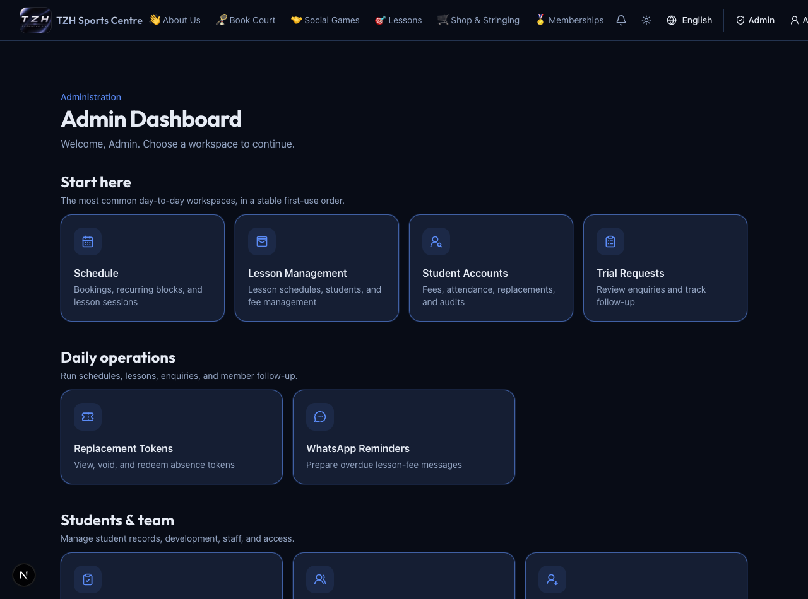
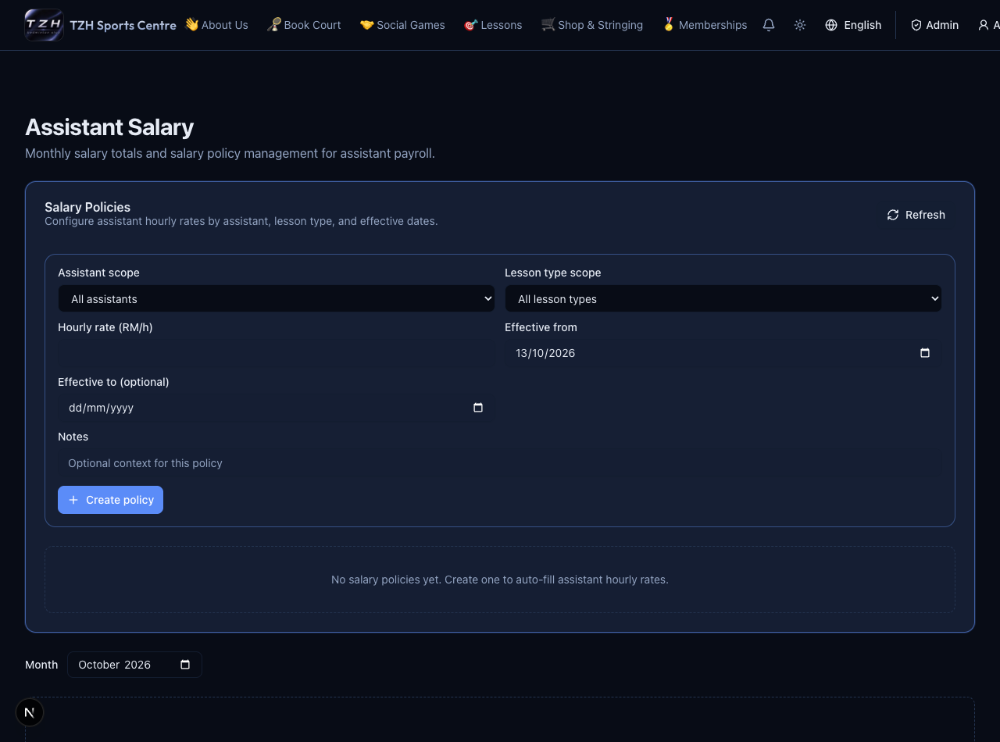
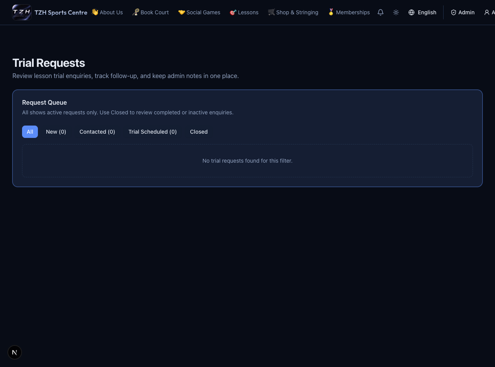
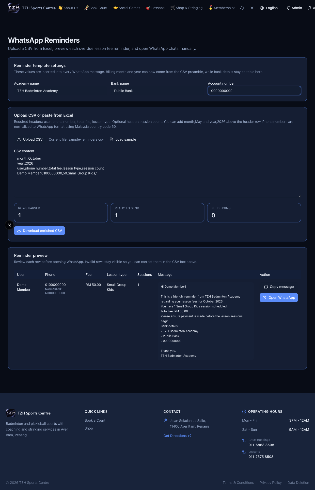

# People, trials, salary and follow-up

[← Overview](../overview.md) · **Who:** Administrators; assistants see their own salary

## Users

Open [Users](https://tzhsports.vercel.app/admin/users), search the list and edit name/email/phone or allowed role cards. Create a walk-in account using name, email and phone, then give the initial login details privately and ask the member to update their password. Roles such as student, assistant and coach control available workflows. Points are read-only here; use Points Management. Deletion retires a non-admin login and preserves business history; a new registration does not inherit it.

**View Activity** below a user name opens their [Member Activity](member-activity.md) overview (awaiting deployment confirmation). Review their records and return to Users without editing the account.

## Trial requests

Open [Trial Requests](https://tzhsports.vercel.app/admin/trial-requests). Review the answers, contact the applicant, and save status/notes. **Trial scheduled** requires date, exact time and active court; eligible applicants receive the scheduling email. Close requests that need no further action. This intake does not create a lesson seat automatically.

## Assistant salary

Open [Assistant Salary](https://tzhsports.vercel.app/admin/assistant-salary). Create an effective-dated hourly policy before assigning assistants in lesson details; avoid overlapping policies for the same scope. Choose a month to inspect assignments and totals. Assistants use [My Salary](https://tzhsports.vercel.app/my-salary). These are calculated assignment amounts, not evidence of salary payment.

## Manual WhatsApp reminders

Open [WhatsApp Reminders](https://tzhsports.vercel.app/admin/reminders). Check the centre/bank settings, then upload CSV or paste rows with `user, phone number, total fee, lesson type` and optional `session count`. Review/fix flagged rows and each message; open WhatsApp and send manually. **Download enriched CSV** keeps the prepared output. This screen does not send automatically or mark fees paid.

