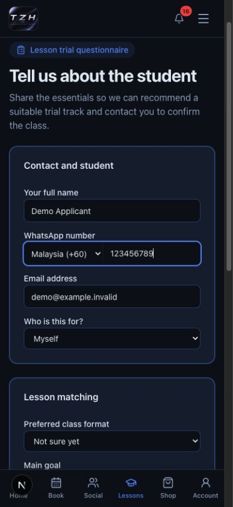
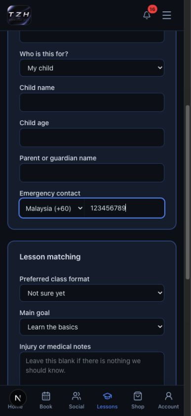
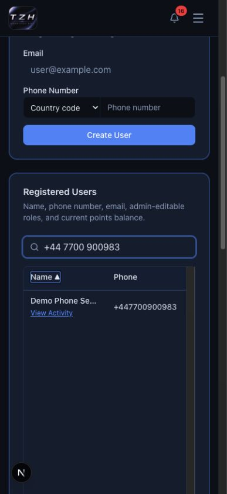
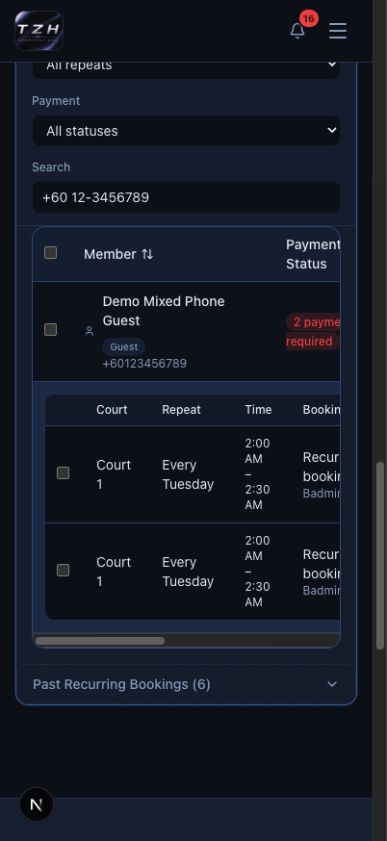

# Enter a phone number

**Public, member and administrator** · Preview only; awaiting production deployment.

[Request a trial](https://tzhsports.vercel.app/lessons/trial) · [Register](https://tzhsports.vercel.app/register) · [Account settings](https://tzhsports.vercel.app/account/settings)

1. Choose **Country code**. All 11 ASEAN countries appear first (Malaysia and Singapore lead), followed by Taiwan, China, Japan, South Korea, Hong Kong, Macao, Mongolia and North Korea, then other Asian countries and the rest of the world.
2. Enter the phone number beside it. You can also paste the complete number with its `+` country code.
3. Complete the form and save. A missing country code or incomplete number must be corrected before it can be saved.

For a child’s trial request, choose a country code for the **Emergency contact** too.

Changing a user’s name, email or roles keeps an unchanged older phone number; choose its country code when you edit the phone itself.

Administrators use the same control when creating or editing users, guest court bookings and guest lesson students. Optional guest phone fields can remain blank. For [WhatsApp reminder imports](https://tzhsports.vercel.app/admin/reminders), include the full international number in each phone column, such as `+60123456789`.

Older trial numbers without a country code show **Country code needs confirmation**. Confirm the complete number with the customer before contacting them. A phone’s country code does not confirm where the customer lives.

## Find an existing contact

**Administrator** · [Open Users](https://tzhsports.vercel.app/admin/users)

Paste a full number with spaces, such as `+44 7700 900983`, or search its local
form `07700 900983`. Review the matching name and email before selecting a person.
This also applies to Student Accounts, Member Activity, stringing customer/member
search, points and invoice member pickers. Local-number searches may match more
than one country.

Recurring guest court bookings with the same name and equivalent old Malaysian
local / new `+60` number appear together. Converting a guest to a registered user
still applies only to the latest active cycle; it does not mark a payment paid.

