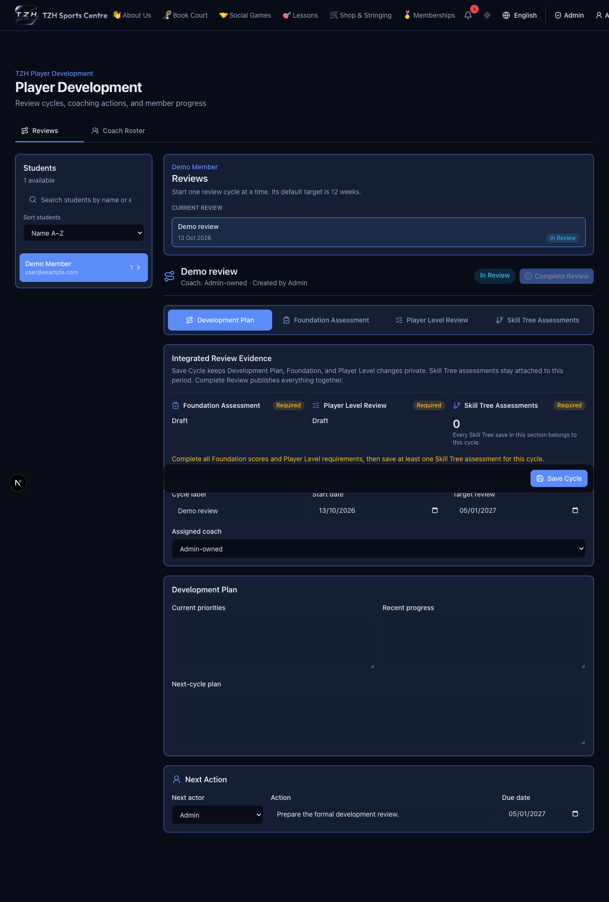

# Player Development and coaching reviews

[← Overview](../overview.md) · **Who:** Administrators and assigned coaches

1. Admins give staff the coach role in [Users](https://tzhsports.vercel.app/admin/users), then assign students in **Coach Roster** at [Player Development](https://tzhsports.vercel.app/admin/player-development). Assistant access alone is insufficient.
2. Select a student and create a named review cycle, or continue their existing open review. Active student accounts are available without separate development enrollment.
3. Complete **Development Plan**, **Foundation**, **Player Level** and **Skill Tree**. Foundation uses 1–5 scores; Level uses a Level 1–9 placement and 0–10 module scores; Skill mastery uses 1–5 plus learning status.
4. Use **Save Cycle** for plan/report drafts. Save each Skill Tree assessment from its own dialog.
5. When ready, choose **Complete Review**, check the student/cycle and evidence summary, then confirm. Completion requires both full reports and at least one cycle-linked Skill assessment.
6. The member checks [My Assessments](https://tzhsports.vercel.app/my-assessments) and downloads the shared PDFs.

**Expected:** Draft saves do not publish or send email. Completion publishes and locks the review and queues one combined eligible-student email. Coaches see only actively assigned students. Past Reviews retains history; only admins may delete eligible older reviews, with current/latest reviews protected.

