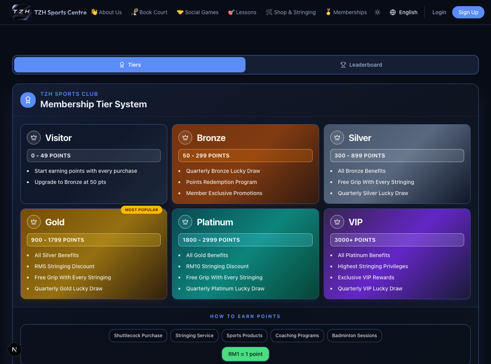
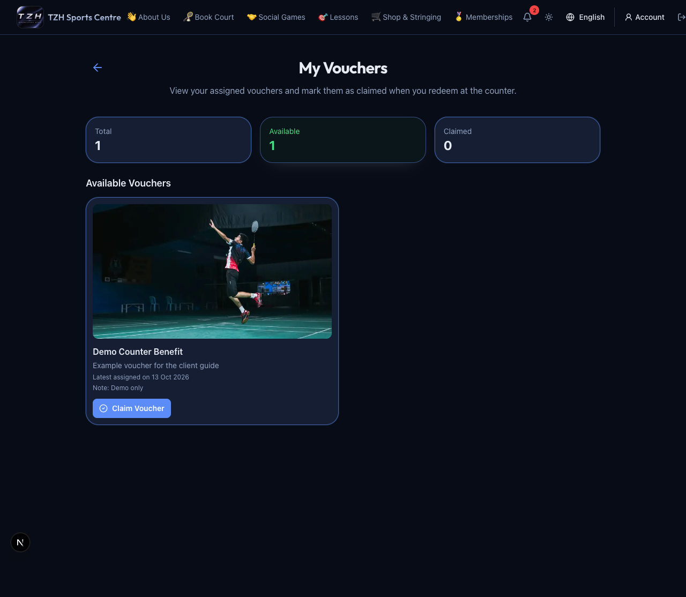

# Rewards and your development reports

[← Overview](../overview.md) · **Who:** Members; tier guide and leaderboard are public

- **Memberships:** Open [Memberships](https://tzhsports.vercel.app/memberships) to compare tier benefits and current promotions. Your current tier follows the preceding Malaysia month's net point movement; this month's progress projects next month's tier.
- **Points:** Open [My Points](https://tzhsports.vercel.app/my-points) for spendable balance and award/deduction history.
- **Rankings:** Open [Leaderboard](https://tzhsports.vercel.app/memberships/leaderboard), then compare **Monthly ranking** and **Lifetime ranking**. Only admins see full names. Rankings use net history and can differ from spendable balance.
- **Vouchers:** Open [My Vouchers](https://tzhsports.vercel.app/my-vouchers), check the benefit and choose **Claim** when ready to use it. Duplicate vouchers display a quantity; each claim uses one assignment. The centre checks member claims separately.
- **Development:** Open [My Assessments](https://tzhsports.vercel.app/my-assessments) to view shared Foundation/Level reports, Skill Tree history and review plans. Download available reports as PDFs. Acknowledge a plan only when that action is shown for you.

**Expected:** Saved coach drafts remain private until review completion. Development records are independent assessments; one score does not calculate the others.

