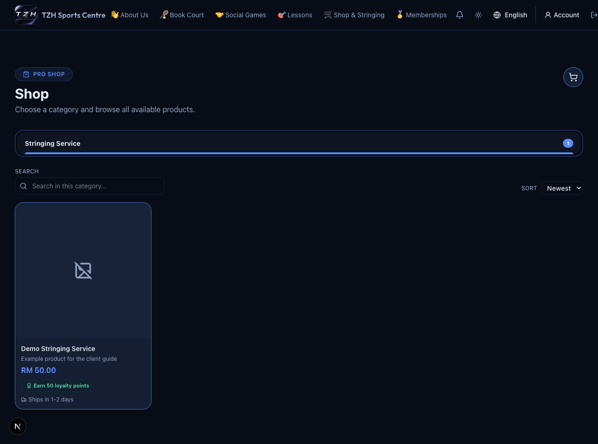
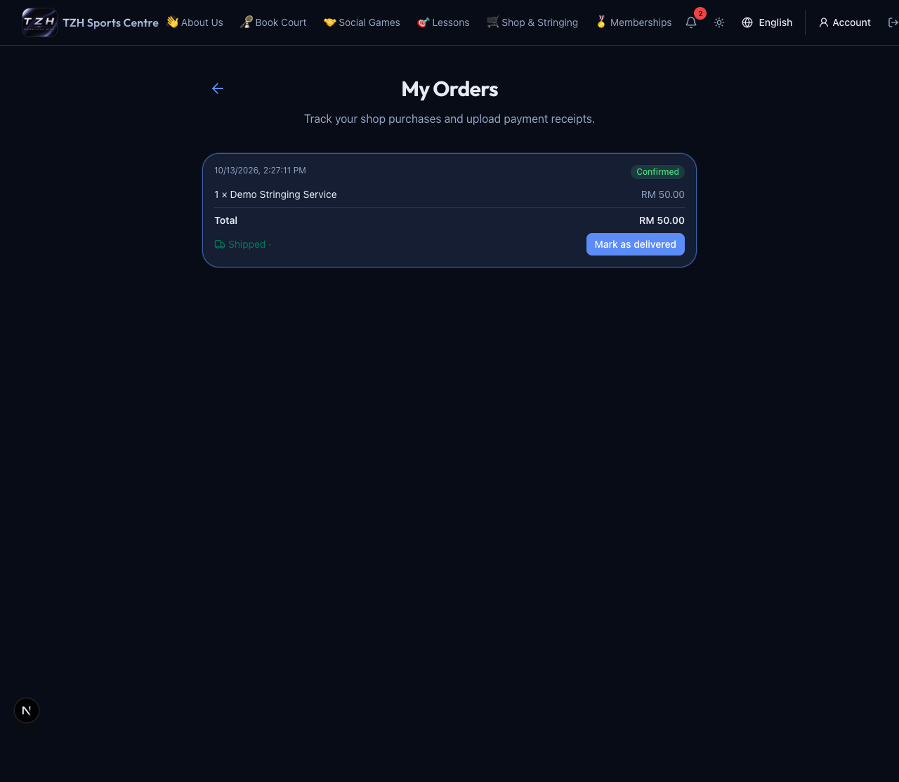

# Shop and orders

[← Overview](../overview.md) · **Who:** Visitors browse; members purchase

For a racket service request, use [Customer stringing](customer-stringing.md) (awaiting deployment).

1. Open [Shop](https://tzhsports.vercel.app/shop). Select a product tab and search within it.
2. Open a product, choose its required options (such as string, pickup date/time), set quantity, and add it to the cart.
3. Review every cart line and checkout. Pay via the displayed QR and upload the receipt before the payment window ends.
4. Open [My Orders](https://tzhsports.vercel.app/my-orders) to check receipt review and fulfillment. An active unpaid order offers receipt upload.
5. After approval, download its **Invoice**. When a shipped order arrives, use **Mark as delivered**.

**Expected:** Stock is reserved while the payment window is active. Approval finalizes the order and member points; rejection/expiry releases reserved stock. Rejected orders are terminal, so ask the centre before placing a replacement order. Options remain visible in order history even if the product later changes.

