# Stringing · a complete customer visit

**Customer and administrator**

[Customer Stringing](https://tzhsports.vercel.app/stringing) · [Admin Stringing](https://tzhsports.vercel.app/admin/stringing) · [Admin quick guide](stringing.md)

Follow one fictional visit from request to collection, feedback and the next restring reminder.

<strong>1 · Customer submits a request</strong>

Open **Request stringing**. Enter the racket model and future drop-off/pickup times.
Leave **String model** and **Tension** blank if you need advice; add any preferences
in **Special instructions**. Fields marked **\*** are required.

Choose **Submit request → Confirm request**. Wait for **Request accepted**.
The job appears in **My requests** as **Requested**, with fees **To be confirmed**.
Submitting does not record payment.

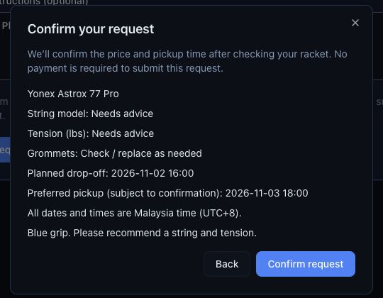

<strong>2 · Admin agrees the setup and receives the racket</strong>

Open **Requests**, search the customer, then **View stringing → Details → … → Edit stringing**.
Discuss the setup, price and pickup with the customer. Save the agreed details.
This example uses **Exbolt 63(White)**, **25 lbs**, **RM35 stringing** and **RM5 grommets**.

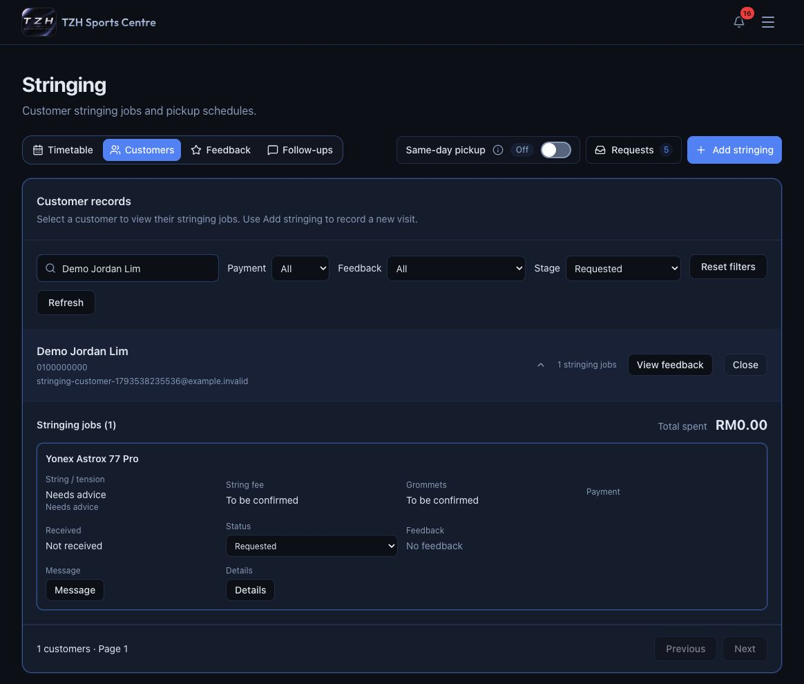

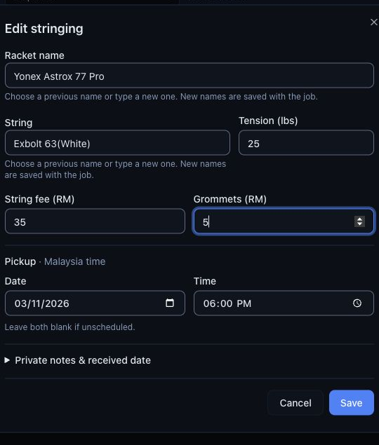

When the racket arrives, choose **Received**, enter the actual received date and
**Confirm change**. The job leaves the Requested filter. Use **Stage → All stages**
to see it again.

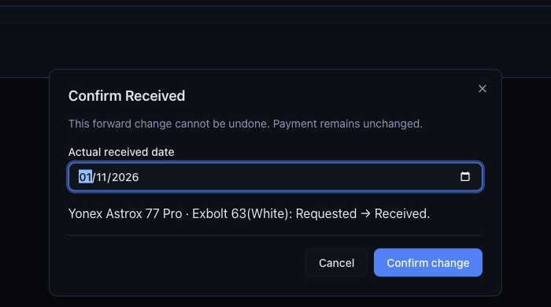

<strong>3 · Start work and record payment</strong>

Choose **In progress → Confirm change** when work starts.
Once full payment is actually received, choose **Mark Paid**, review the amount,
points and payment date, then **Confirm payment received**.

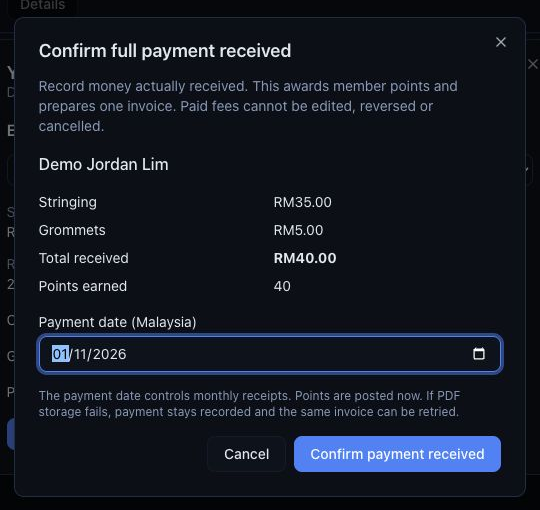

This records **RM40**, awards **40 points** and creates invoice **TZH-0063** for
this example. The customer can download it from **My requests**. Payment does
not change the job's progress.

<strong>4 · Ready for pickup, then collected</strong>

Choose **Ready for pickup → Confirm change** when the racket is ready.
Use **Message → Stage: Ready for pickup** to review the message, open WhatsApp
and send it. Return and choose **Mark as sent**; opening WhatsApp alone does not
record contact.

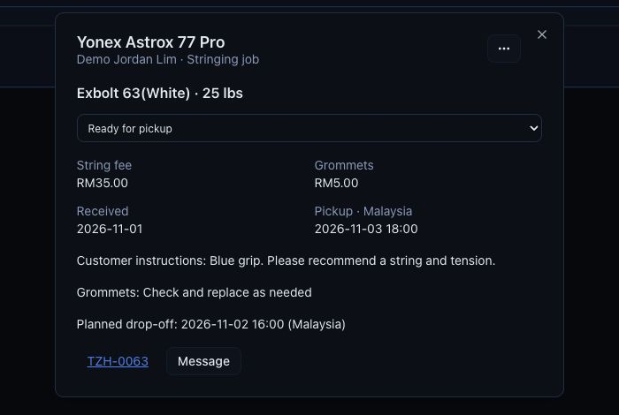

After handing over the racket, choose **Collected → Confirm change**.
The customer sees **Collected**, **Paid** and their invoice in **My requests**.

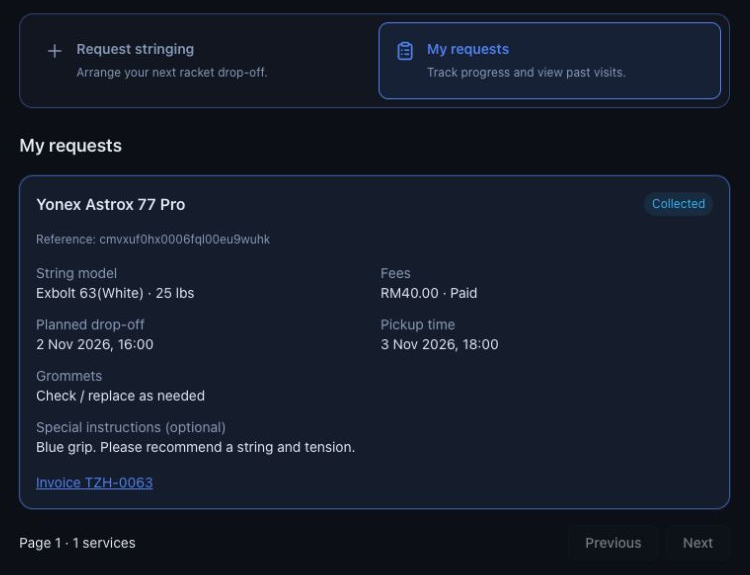

<strong>5 · Ask for feedback and read the response</strong>

For the collected job, choose **Message → Stage: Feedback request → Prepare feedback link**.
Expand **Prepare feedback message**, review and send it, then **Mark as sent**.
Each job accepts one response.

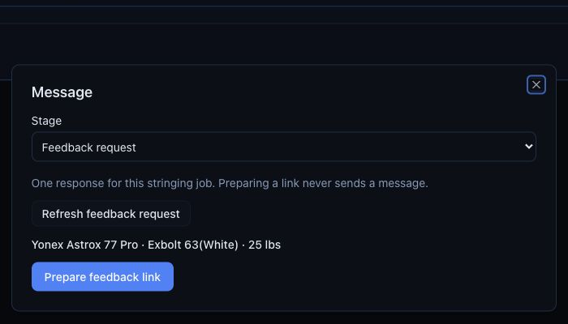

The customer opens their private link, chooses ratings and **Submit feedback**.
They do not need to sign in. Keep that link private.

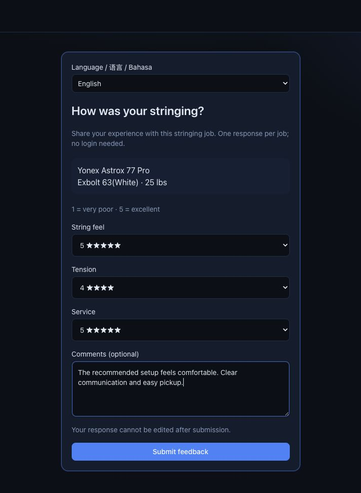

Use **View feedback** on the customer's header to read all their responses.
The job row's **View feedback** opens just that visit's response.

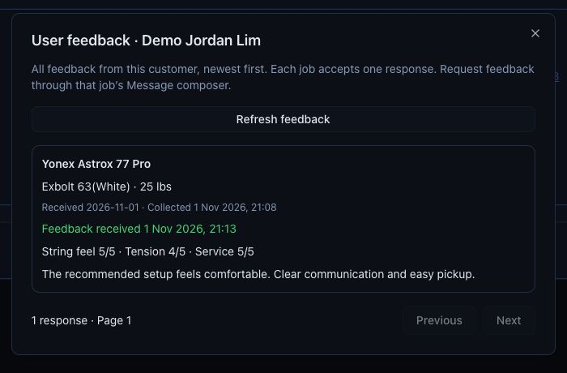

<strong>6 · Follow up about the next restring</strong>

Collection creates a reminder for that job, normally **45 days later**.
Use **Details → … → Restring reminder → Settings** to change its interval or disable it.

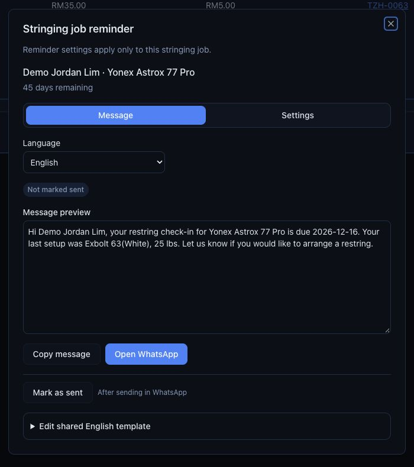

When due, open **Follow-ups → Due → Send reminder**. Review and send the message,
then **Mark as sent**. It moves to **Contact done**; no message is sent automatically.
The example below uses a **0-day interval** to demonstrate a reminder due on collection day.

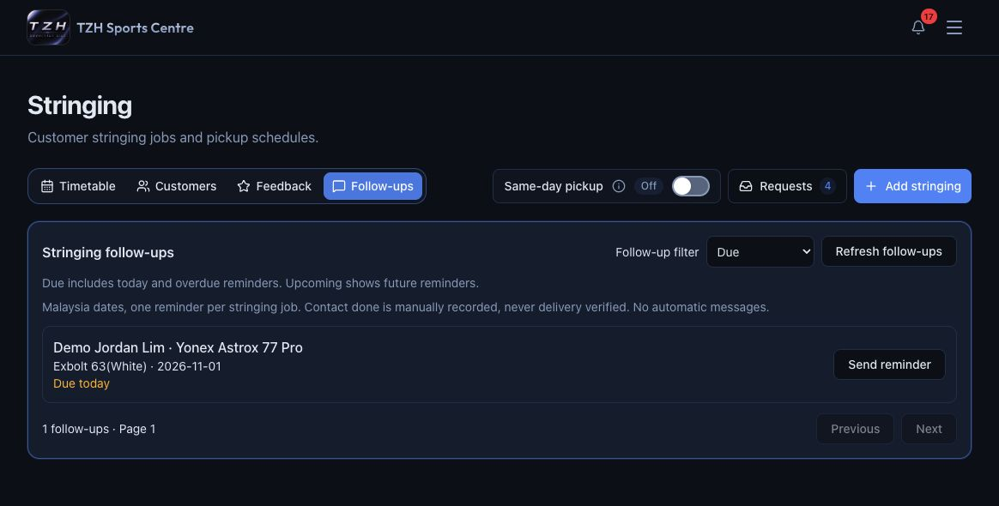

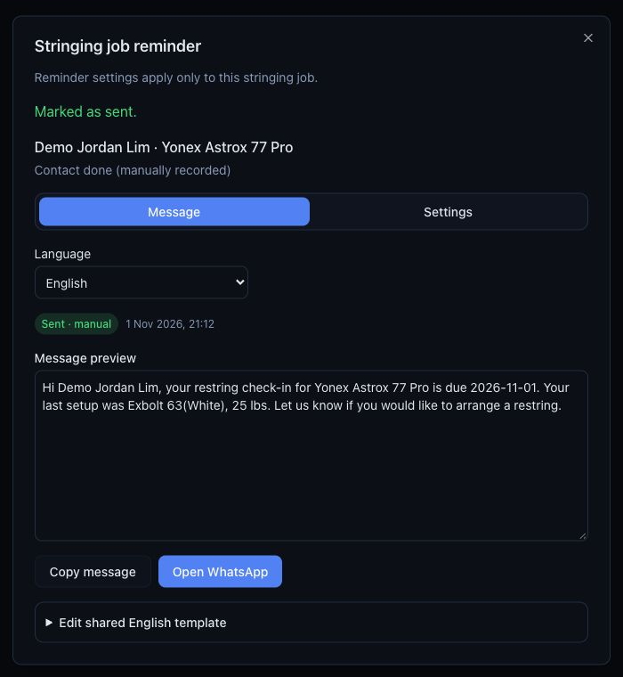

