# Stringing jobs

[← Website guides](README.md)

**Role:** Administrator. **Availability:** Awaiting production database update and deployment; this preview covers contacts, rackets, jobs, full-payment recording, the timetable, manual messages, racket follow-ups and private customer feedback.

After deployment, open [Admin → Stringing](https://tzhsports.vercel.app/admin/stringing).

1. Find an existing registered member and select **Add contact**. The stringing name/phone is separate from the member account; **Edit contact** changes only this contact.
2. Select **Add racket**, enter its model and an optional nickname such as “Blue grip”, then save. Add separate records for separate physical rackets, even when their models match.
3. Expand **Rackets and job history**, select **New job**, and enter the string, main/cross tension, stringing fee, optional grommet fee/notes and received date. Set both pickup date and time, or leave both empty.
4. Save. The job starts **Received / Unpaid**. Search by name, contact or string; expand history to find all open jobs. **Edit job** changes an unpaid, open job.
5. Select **In progress**, **Ready for pickup** or **Collected**, review the confirmation, and confirm. Progress moves forward only; collection records its time. **Cancel job** closes an unpaid, uncollected job after confirmation.

Contact/racket edits preserve earlier job details. If another administrator changed a record, refresh before trying again. Progress does not record payment, award points or issue an invoice.

Private feedback links are available for collected jobs in this preview. Existing Shop ordering remains available separately.

Fictional examples:

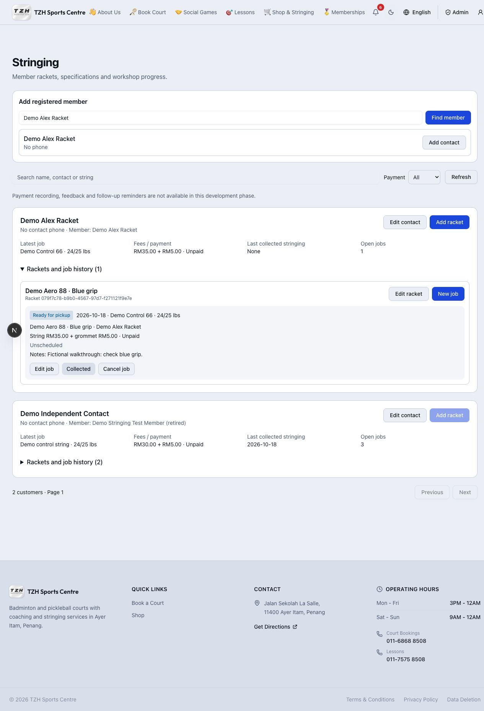

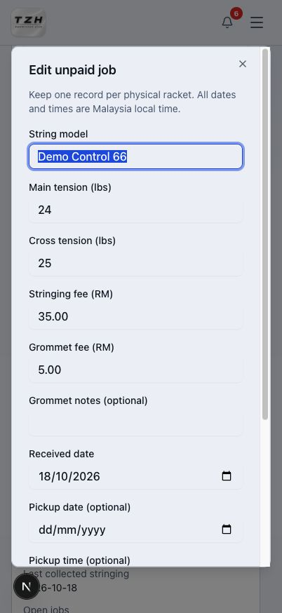

## Record full payment

1. Find the racket job and select **Mark Paid**. Check the linked member, both fees, total and points. Choose the actual payment date (today or earlier, Malaysia time).
2. **Cancel** leaves the job unpaid. Select **Confirm payment received** only after the full amount has been received. Deposits and partial payments are not supported.
3. The job becomes **Paid**, earns the displayed points once, and shows its invoice link. The invoice also appears under **Stringing** in Admin Invoices and the member's My Invoices.
4. If the PDF could not be prepared, the job stays Paid and shows **Retry invoice**. Use that action; do not record another payment. Retrying does not award more points or resend the payment email.
5. Check the cards: distinct customers, received money this Malaysia month by payment date, and all unpaid fees excluding cancelled jobs. Changing the customer filter does not change these totals.

Paid fees cannot be edited or reversed, and paid jobs cannot be cancelled. Stringing invoices do not offer manual Edit or Regenerate PDF; recover a missing PDF from the job using **Retry invoice**. Normal forward progress remains available, and an unpaid collected job can still be settled. Payment emails are best-effort; email failure never reverses a payment.

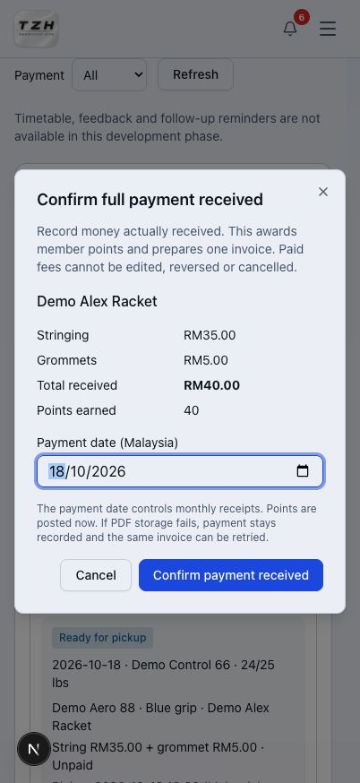

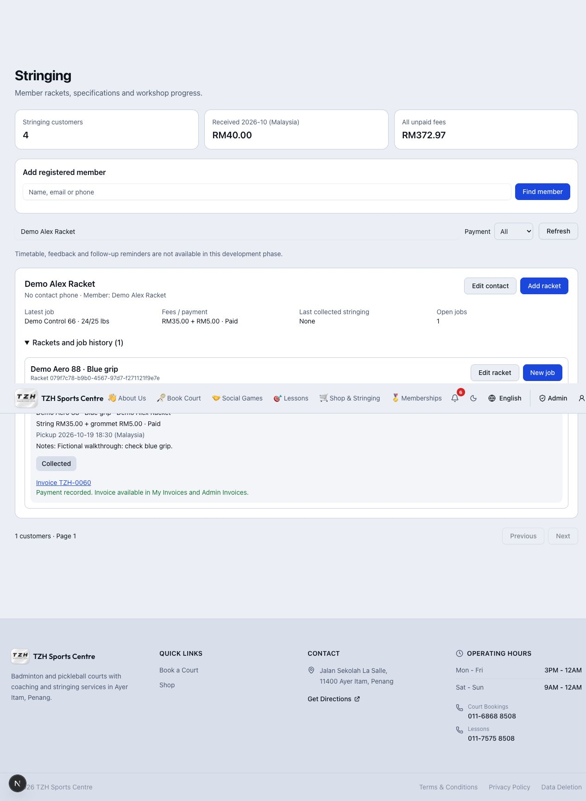

## Plan pickup deadlines

1. In **Timetable**, use **Daily agenda**, enter a date and select **Go to date**, or open **Month calendar** and select a day. All times are Malaysia time. Multiple rackets may share a pickup time.
2. In **Unscheduled open jobs**, select **Edit job / pickup** on an unpaid open job. Fill both pickup date and time, then **Save**. It moves into the selected day's agenda and calendar.
3. Clear both pickup fields to return it to the unscheduled queue. Paid and closed job details remain locked; eligible forward progress is still available.
4. **Overdue work** means a Received/In progress job has passed its pickup deadline. **Awaiting pickup** means the racket is ready. Unscheduled jobs have no deadline.
5. Enable **Include collected / cancelled** to see scheduled history. Lists have page controls; a busy month may show several pages. Select a day for its full agenda, and use **Refresh timetable** to see other administrators' changes.

Scheduling does not record payment or contact completion. The unscheduled list scrolls independently so other workspace controls remain reachable.

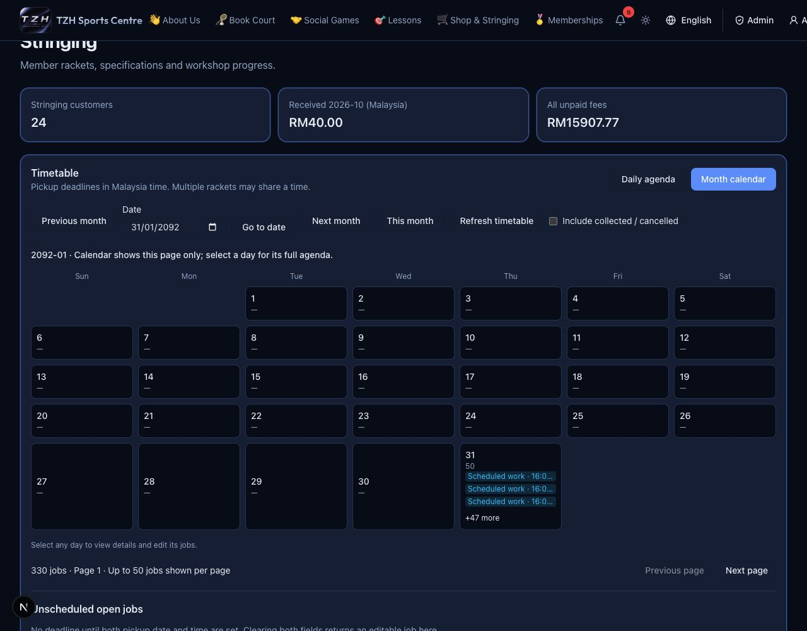

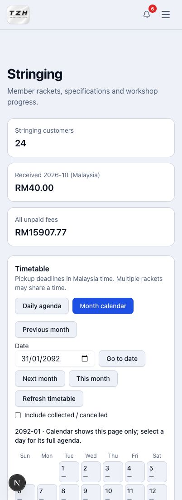

## Prepare WhatsApp messages and follow-ups

1. Open a job’s **Messages / follow-up**, or choose **Manage follow-up** in the **Racket follow-ups** panel.
2. Choose a message stage and English, 中文 or Bahasa Melayu. Check the separate stringing contact number and the racket details. Edit the **One-off message preview** for this contact; resolve or deliberately remove any missing placeholders.
3. **Copy message** copies the draft. **Open WhatsApp** prepares it for you to send yourself. Neither action records a sent message or changes payment/progress. A missing/invalid contact number disables WhatsApp; correct it using **Edit contact**.
4. To reuse different wording, expand **Edit shared template**, edit the template, tick the replacement confirmation and select **Save shared template**. This changes that stage/language for all admins. One-off edits do not change the shared template.
5. After completing the contact yourself, tick the confirmation and select **Record contact done**. The record is labelled manually recorded, not delivery verified. For a restring reminder this closes the follow-up; it does not send anything.
6. Set **Days after collection** (default 45, zero allowed), or disable this job’s reminder, then save. No date is due until the racket is collected. A newer collection replaces only that physical racket’s old pending reminder, even if the new reminder is disabled. Completed contact remains history.
7. Use **Follow-up filter** for due/overdue, all pending, contact done, superseded or disabled reminders. Use page controls and **Refresh follow-ups** as needed.

Feedback requests use the private link created for the collected job below. There are no automatic WhatsApp messages.

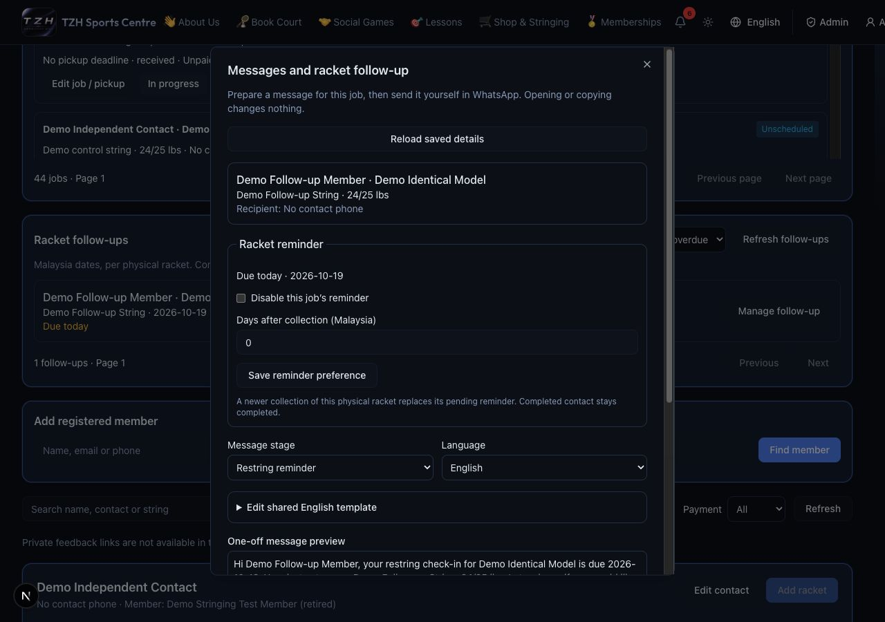

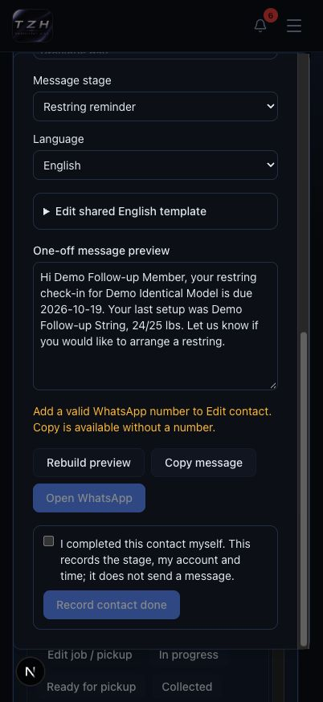

## Request and review private feedback

**Awaiting deployment.** Admins manage links; customers need only their private link,
with no account or login required.

1. Open **Messages / follow-up** on a **Collected** job. In **Private feedback**,
   tick **Invalidate any previous link for this job**, then **Create new private link**.
2. Select **Feedback request** and English, 中文 or Bahasa Melayu. Check the preview
   and **Copy message** or prepare it with **Open WhatsApp**. Send it yourself.
   Copy the request before closing: reopening requires creating a new link if you
   did not keep the original message. The new link replaces the previous one.
3. The customer opens the link, chooses a language, gives 1–5-star ratings for
   string feel, tension and service, optionally comments, then submits. A confirmation
   replaces the form; repeat visits cannot submit or edit another response.
4. In the admin dialog, select **Reload saved details** to see ratings, comment and
   submission time. Use the workspace **Feedback** filter for received or awaiting
   responses across collected jobs. Respondent identity is not verified.
5. To stop access, confirm invalidation and select **Revoke link**. Links have no
   automatic expiry. Revocation preserves feedback; creating a replacement link
   never allows a second response.

Opening/copying a request does not record contact done or feedback received.
Feedback does not change payment, points, invoices or racket progress.

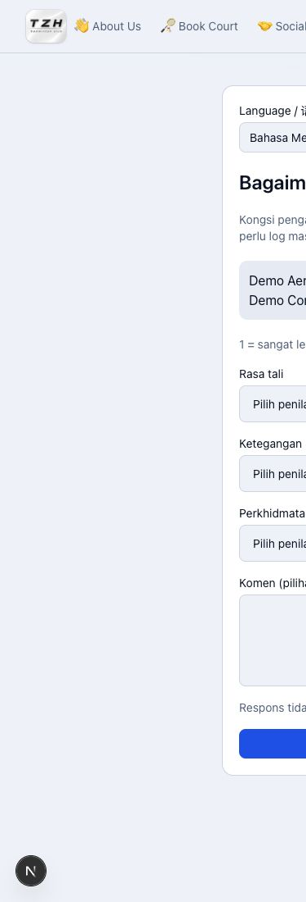

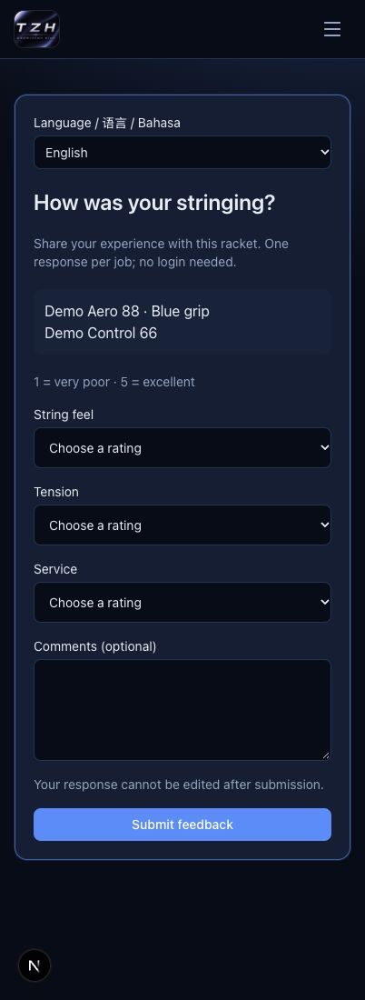

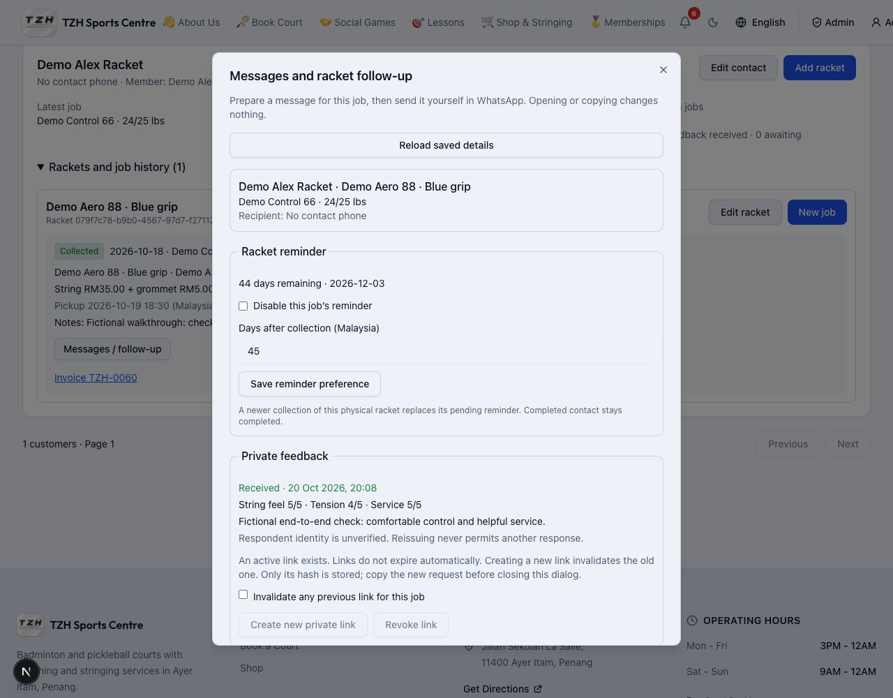

## Preview examples

The job below is collected and paid. Its received feedback remains visible after
the administrator revokes the private link. The reminder still belongs to this
physical racket and is due 45 days after collection. All records shown are fictional.

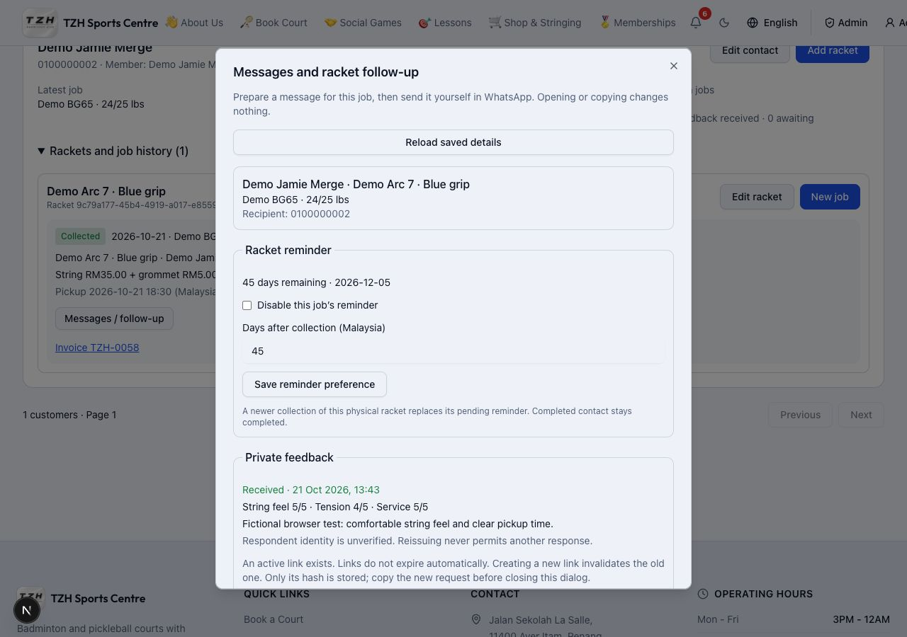

Customers can choose 中文 on the private feedback form without logging in:

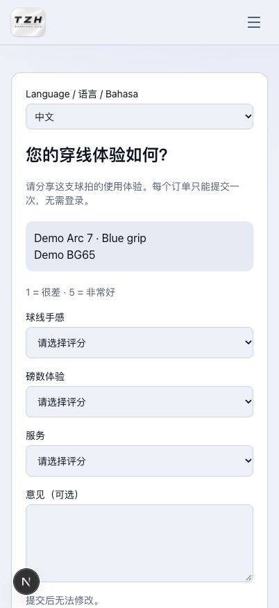

The mobile month calendar also supports dark mode:

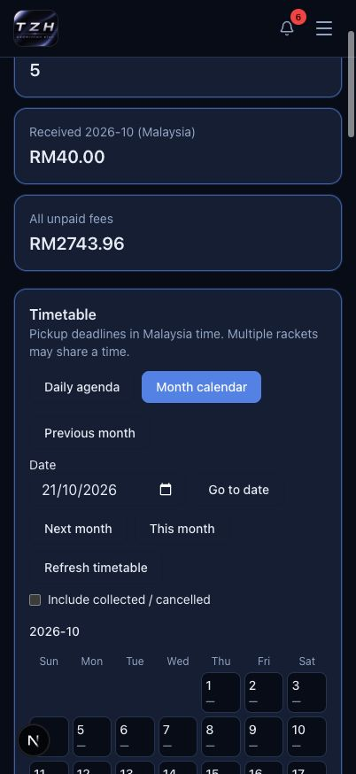
