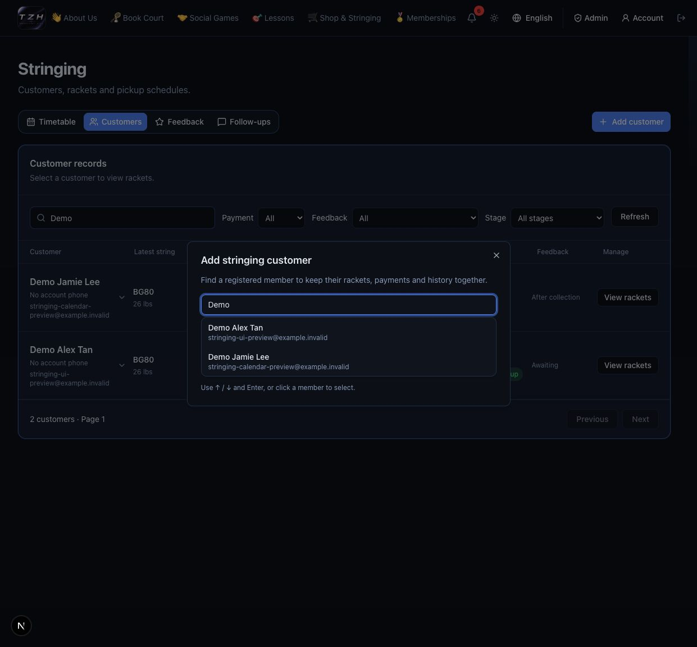
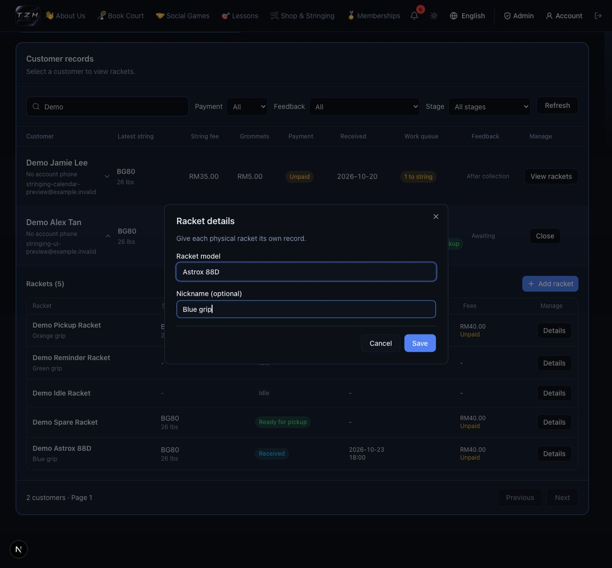
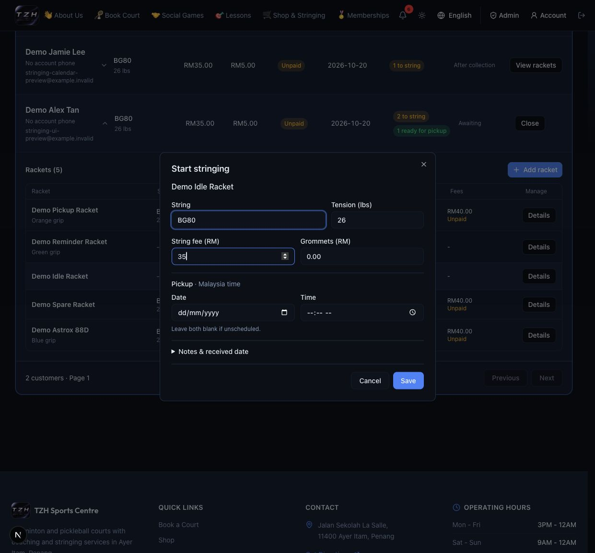
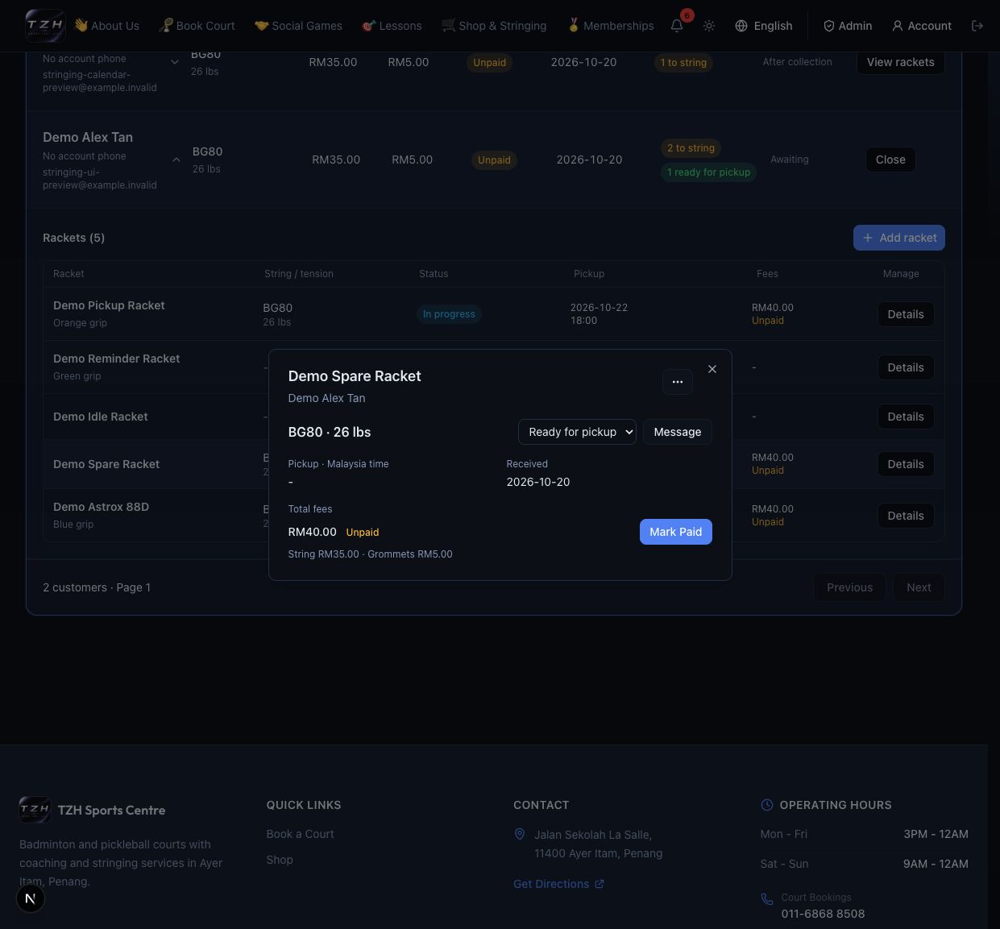
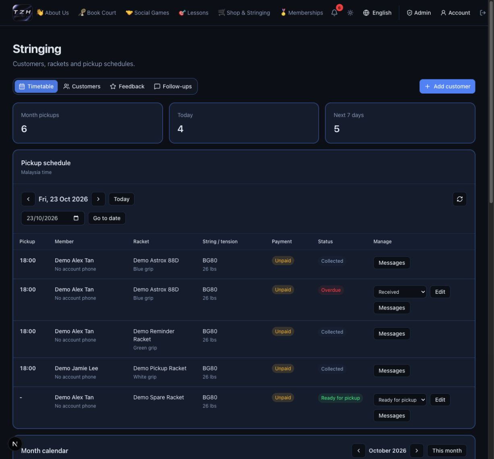
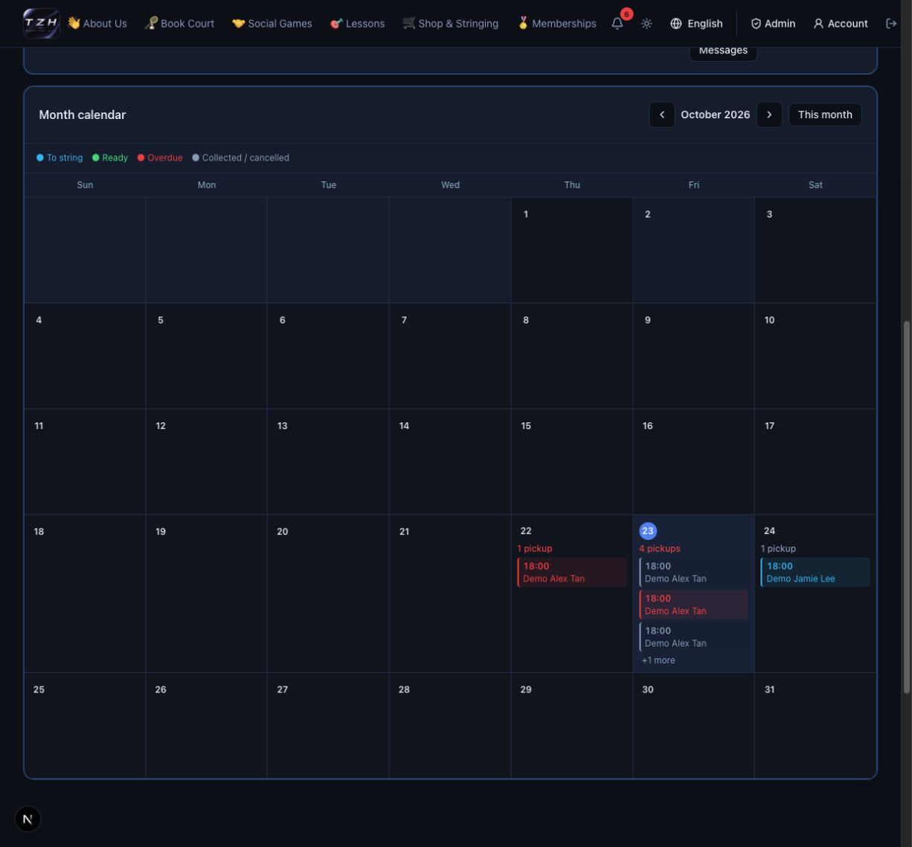
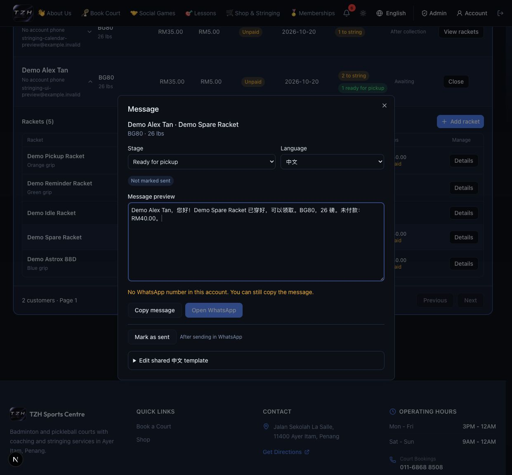
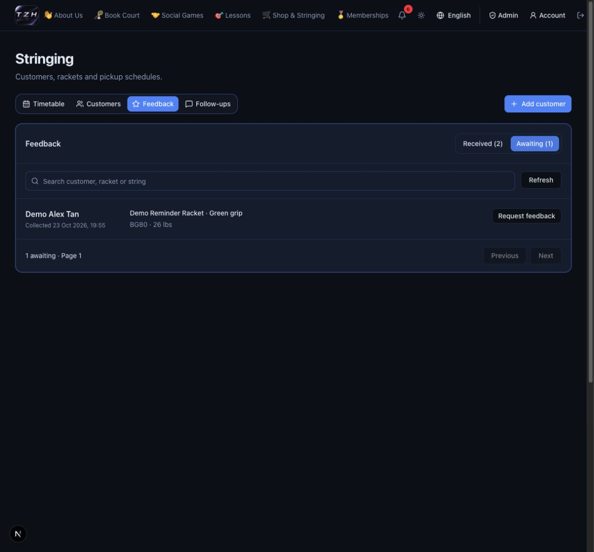
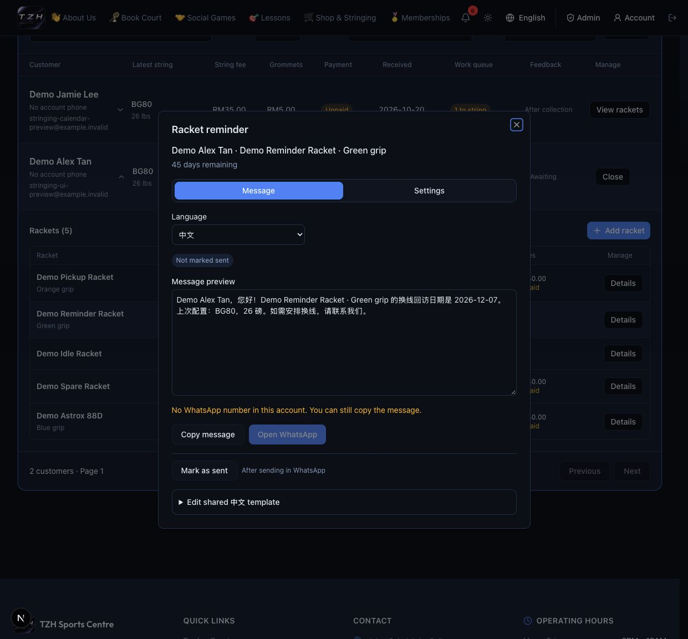

# Stringing · quick guide

**Administrator · Awaiting deployment**
[Open Stringing](https://tzhsports.vercel.app/admin/stringing) · [This week](../changelog/2026-10-19.md)

Open the step you need. Screenshots use fictional customers.

<strong>1 · Add customer</strong>

**Customers → Add customer → search member → select → Add contact.**
The customer must have a registered account.

<strong>2 · Add racket</strong>

**View rackets → Add racket → model + optional nickname → Save.**
One record per physical racket, even for identical models.

<strong>3 · Add stringing</strong>

**Racket Details → Start stringing → fill specifications/fees → Save.**
Pickup needs both date and time, or neither. Extra instructions go in **Notes**.
Only one active stringing per racket.

<strong>4 · Change status</strong>

**Details → status dropdown → choose → confirm.**

Received → In progress → Ready for pickup → Collected.
Status changes do not send WhatsApp or record payment.

<strong>5 · Daily routine</strong>

- **Timetable → Today:** work through pickups; “-” means unscheduled.
- Update status as work finishes; use **Messages** for customer updates.
- Check **Feedback** for replies and **Follow-ups** for due reminders.

**Payment received?** Open racket Details → **Mark Paid** → review → confirm full
payment. Points/invoice follow; progress stays unchanged.

<strong>6 · Calendar</strong>

Scroll below the daily list. **Click a date** for its agenda; red shows overdue work.
Completed pickups stay visible. On desktop, **drag an unpaid open item → review →
Save** to reschedule; on mobile, use the daily **Edit** action.

<strong>7 · WhatsApp updates, stage by stage</strong>

**Details → Message → Stage:**

| When | Choose |
| --- | --- |
| Received / in progress, payment pending | First payment reminder |
| Still unpaid, another reminder needed | Second payment reminder |
| Payment recorded | Paid confirmation |
| Racket ready | Ready for pickup |

Choose language → review preview → **Open WhatsApp → send → Mark as sent**.
Language is remembered per customer. Sent stages can be resent.

WhatsApp needs a valid account phone; **Copy message** also works without one.

<strong>8 · WhatsApp feedback request</strong>

After **Collected**, the unique link is ready automatically.
**Feedback → Awaiting → Request feedback → Open WhatsApp → send → Mark as sent.**

The customer rates/comments without login, once per stringing.
Read replies in **Feedback → Received**.

<strong>9 · WhatsApp reminder for the next stringing</strong>

**Follow-ups → Manage racket reminder → Message → Open WhatsApp → send → Mark as sent.**
Or open **racket Details → … → Restring reminder**.

Default: **45 days after collection**. Change the interval or disable it in
**Settings**. Marking the reminder sent closes that pending follow-up.

