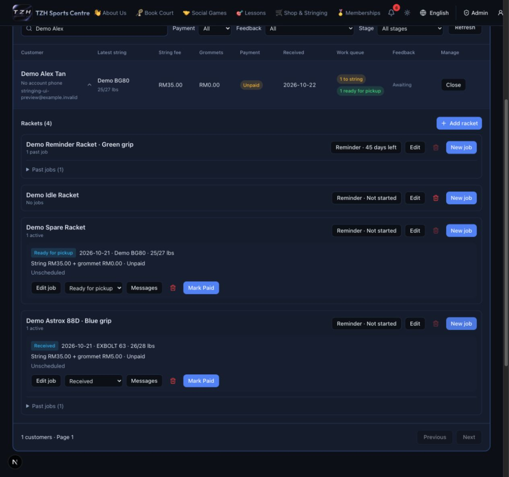
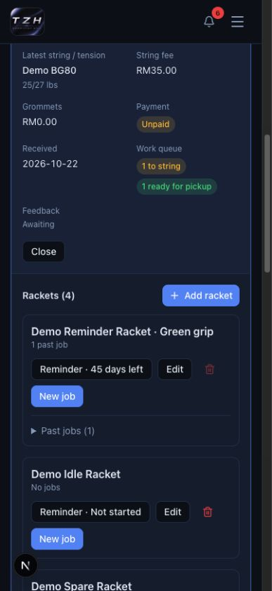
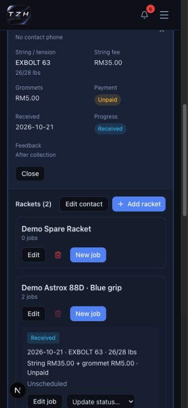

# Stringing jobs

[← Website guides](README.md)

**Role:** Administrator. **Availability:** Awaiting production database update and deployment; this preview covers contacts, rackets, jobs, full-payment recording, the timetable, manual messages, racket follow-ups and private customer feedback.

After deployment, open [Admin → Stringing](https://tzhsports.vercel.app/admin/stringing).

1. In **Customers**, select **Add customer**, type at least two characters of a registered member’s name, email or phone, choose them from the dropdown, then select **Add contact**. Clear the field to start again. Each row is the linked member. Its name, email and phone come from the account and cannot be edited here. Account updates appear in Stringing automatically.
2. Select the customer name or **View jobs**, then **Add racket**, enter its model and an optional nickname such as “Blue grip”, then save. Add separate records for separate physical rackets, even when their models match.
3. Under **Rackets**, select **New job**, and enter the string, main/cross tension, stringing fee, optional grommet fee/notes and received date. Set both pickup date and time, or leave both empty.
4. Save. The job starts **Received / Unpaid**. Use the outlined **Search members or strings** field to search by member name, email, phone or string; expand the customer to find active jobs. **Edit job** changes an unpaid, open job.
5. Open the status dropdown (it shows the current status), choose **In progress**, **Ready for pickup** or **Collected**, review the confirmation, and confirm. Cancel keeps the current status. Progress moves forward only; collection records its time. Choose **Cancel job** in that dropdown to close an unpaid, uncollected job after confirmation.

Account/racket edits preserve earlier job details. If another administrator changed a record, refresh before trying again. Progress does not record payment, award points or issue an invoice.

Private feedback links are available for collected jobs in this preview. Existing Shop ordering remains available separately.

Fictional examples:

The desktop list shows each customer's latest string, fees and payment in aligned columns. **Work queue** covers all their rackets: **2 to string** means two physical rackets have Received/In progress jobs; **ready for pickup** is separate. Collected/cancelled jobs do not add work, and multiple unfinished jobs on one racket count once per queue. On mobile,
each row becomes labeled details. Select **View jobs** to reach all job actions.
Use **Stage** with the Payment and Feedback filters: **Received**, **In progress**,
**Ready for collection**, **Collected**, or **Follow up**. Follow up finds pending
racket reminders due today or overdue (Malaysia dates). A member appears when any
of their jobs/rackets matches; the row still shows their latest job. Choose
**All stages** to clear it.

Expanding a customer shows **all rackets**, including empty rackets. Received,
In progress and Ready for pickup jobs stay visible. Each racket's collected or
cancelled jobs are under **Past jobs**. Open that section for history, messages
or an eligible unpaid collected job's **Mark Paid** action. Racket actions and
reminder countdowns remain visible without opening Past jobs. Search can match
older jobs in those sections.

## Remove an accidental job

1. Expand the customer, find the racket and select the trash icon on the job’s
   action row. Check the racket, string, tension, date and total in **Delete job?**.
2. Select **Cancel** to keep it, or **Delete job** to remove it from history,
   timetable, workload and unpaid totals. This cannot be undone.
3. Paid/collected jobs and jobs with recorded contact or other linked history are
   protected. Use cancellation for an eligible unpaid job when history should remain.
4. The racket and member remain. If the racket has no other jobs, its own trash
   icon becomes available. Retrying an old creation request cannot restore a
   deleted job; start a genuinely new job if needed.

**Awaiting production migration and deployment.**

## Remove an unused racket

1. Select the customer name or **View jobs** to show all their rackets.
2. Select the trash icon beside an empty racket, check its model/nickname, then
   **Delete racket**. **Cancel** keeps it.
3. Rackets with any job history cannot be deleted, including those with cancelled
   jobs. Their trash icon is disabled; the member and all job history stay intact.

Dark mode uses matching outlined controls for Edit, status and Messages.

## Record full payment

1. Find the racket job and select **Mark Paid**. Check the linked member, both fees, total and points. Choose the actual payment date (today or earlier, Malaysia time).
2. **Cancel** leaves the job unpaid. Select **Confirm payment received** only after the full amount has been received. Deposits and partial payments are not supported.
3. The job becomes **Paid**, earns the displayed points once, and shows its invoice link. The invoice also appears under **Stringing** in Admin Invoices and the member's My Invoices.
4. If the PDF could not be prepared, the job stays Paid and shows **Retry invoice**. Use that action; do not record another payment. Retrying does not award more points or resend the payment email.
5. Check the cards: distinct customers, received money this Malaysia month by payment date, and all unpaid fees excluding cancelled jobs. Changing the customer filter does not change these totals.

Paid fees cannot be edited or reversed, and paid jobs cannot be cancelled. Stringing invoices do not offer manual Edit or Regenerate PDF; recover a missing PDF from the job using **Retry invoice**. Normal forward progress remains available, and an unpaid collected job can still be settled. Payment emails are best-effort; email failure never reverses a payment.

## Plan pickup deadlines

1. Select the **Timetable** view, then use **Daily agenda**, enter a date and select **Go to date**, or open **Month calendar** and select a day. All times are Malaysia time. Multiple rackets may share a pickup time.
2. In **Unscheduled open jobs**, select **Edit job / pickup** on an unpaid open job. Fill both pickup date and time, then **Save**. It moves into the selected day's agenda and calendar.
3. Clear both pickup fields to return it to the unscheduled queue. Paid and closed job details remain locked; eligible forward progress is still available.
4. **Overdue work** means a Received/In progress job has passed its pickup deadline. **Awaiting pickup** means the racket is ready. Unscheduled jobs have no deadline.
5. Enable **Include collected / cancelled** to see scheduled history. Lists have page controls; a busy month may show several pages. Select a day for its full agenda, and use **Refresh timetable** to see other administrators' changes.

Scheduling does not record payment or contact completion. The unscheduled list scrolls independently so other workspace controls remain reachable.

## Prepare WhatsApp messages and follow-ups

1. For payment, pickup or feedback messages, open a job’s **Messages**. For the 45-day restring reminder, select **Reminder** beside the physical racket, or **Follow-ups → Manage racket reminder**. The **Reminder** button shows remaining days, **Due today**, days overdue, **Off**, **Contact done** or **Not started** before collection, so you can check without opening it.
2. For job messages, choose a message stage; a racket reminder opens directly on the restring message. Choose English, 中文 or Bahasa Melayu. Check the member’s account phone and the racket details. Edit the **One-off message preview** for this contact; resolve or deliberately remove any missing placeholders.
3. **Copy message** copies the draft. **Open WhatsApp** prepares it for you to send yourself. Neither action records a sent message or changes payment/progress. A missing/invalid account phone disables WhatsApp. The member must update their account phone before WhatsApp can be opened; Copy remains available.
4. To reuse different wording, expand **Edit shared template**, edit the template, tick the replacement confirmation and select **Save shared template**. This changes that stage/language for all admins. One-off edits do not change the shared template.
5. After completing the contact yourself, tick the confirmation and select **Record contact done**. The record is labelled manually recorded, not delivery verified. For a restring reminder this closes the follow-up; it does not send anything.
6. In **Reminder**, set **Days after collection** (default 45, zero allowed), or **Disable reminders for this racket**, then **Save racket reminder**. You can configure an empty racket before its first job. This preference carries over to future jobs. Each collection resets only this physical racket’s countdown; saving recalculates its pending due date from the last collection. Completed contact stays closed, and the saved preference applies to the next collection.
7. Use **Follow-up filter** for due/overdue, all pending, contact done, superseded or disabled reminders. Use page controls and **Refresh follow-ups** as needed.

Feedback requests use the private link created for the collected job below. There are no automatic WhatsApp messages.

## Request and review private feedback

**Awaiting deployment.** Admins manage links; customers need only their private link,
with no account or login required.

1. Open **Messages** on a **Collected** job. In **Private feedback**,
   tick **Invalidate any previous link for this job**, then **Create new private link**.
2. Select **Feedback request** and English, 中文 or Bahasa Melayu. Check the preview
   and **Copy message** or prepare it with **Open WhatsApp**. Send it yourself.
   Copy the request before closing: reopening requires creating a new link if you
   did not keep the original message. The new link replaces the previous one.
3. The customer opens the link, chooses a language, gives 1–5-star ratings for
   string feel, tension and service, optionally comments, then submits. A confirmation
   replaces the form; repeat visits cannot submit or edit another response.
4. In the admin dialog, select **Reload saved details** to see ratings, comment and
   submission time. Use the workspace **Feedback** filter for received or awaiting
   responses across collected jobs. Respondent identity is not verified.
5. To stop access, confirm invalidation and select **Revoke link**. Links have no
   automatic expiry. Revocation preserves feedback; creating a replacement link
   never allows a second response.

Opening/copying a request does not record contact done or feedback received.
Feedback does not change payment, points, invoices or racket progress.

## Preview examples

The job below is collected and paid. Its received feedback remains visible after
the administrator revokes the private link. The reminder still belongs to this
physical racket and is due 45 days after collection. All records shown are fictional.

Customers can choose 中文 on the private feedback form without logging in:

The mobile month calendar also supports dark mode:

