# Stringing

[← Website guides](README.md)

**Role:** Administrator. **Availability:** Awaiting production database update and deployment; this preview covers contacts, rackets, services, full-payment recording, the timetable, manual messages, racket follow-ups and private customer feedback.

After deployment, open [Admin → Stringing](https://tzhsports.vercel.app/admin/stringing).

1. In **Customers**, select **Add customer**, type at least two characters of a registered member’s name, email or phone, choose them from the dropdown, then select **Add contact**. Clear the field to start again. Each row is the linked member. Its name, email and phone come from the account and cannot be edited here. Account updates appear in Stringing automatically.
2. Select the customer name or **View rackets**, then **Add racket**, enter its model and an optional nickname such as “Blue grip”, then save. Add separate records for separate physical rackets, even when their models match.
3. Under **Rackets**, select the racket name or **Details**, then **Start stringing**, and enter the string, one tension value, stringing/grommet fees and optional Notes; the received date defaults to today. Set both pickup date and time, or leave both empty.
4. Save. The service starts **Received / Unpaid**. Use the outlined **Search members or strings** field to search by member name, email, phone or string; expand the customer to find active services. **Actions → Edit stringing** changes an unpaid, open service.
5. Open the status dropdown (it shows the current status), choose **In progress**, **Ready for pickup** or **Collected**, review the confirmation, and confirm. Cancel keeps the current status. Progress moves forward only; collection records its time. Choose **Cancel stringing** in that dropdown to close an unpaid, uncollected service after confirmation.

Account/racket edits preserve earlier service details. If another administrator changed a record, refresh before trying again. Progress does not record payment, award points or issue an invoice.

Private feedback links are available for collected services in this preview. Existing Shop ordering remains available separately.

Fictional examples:

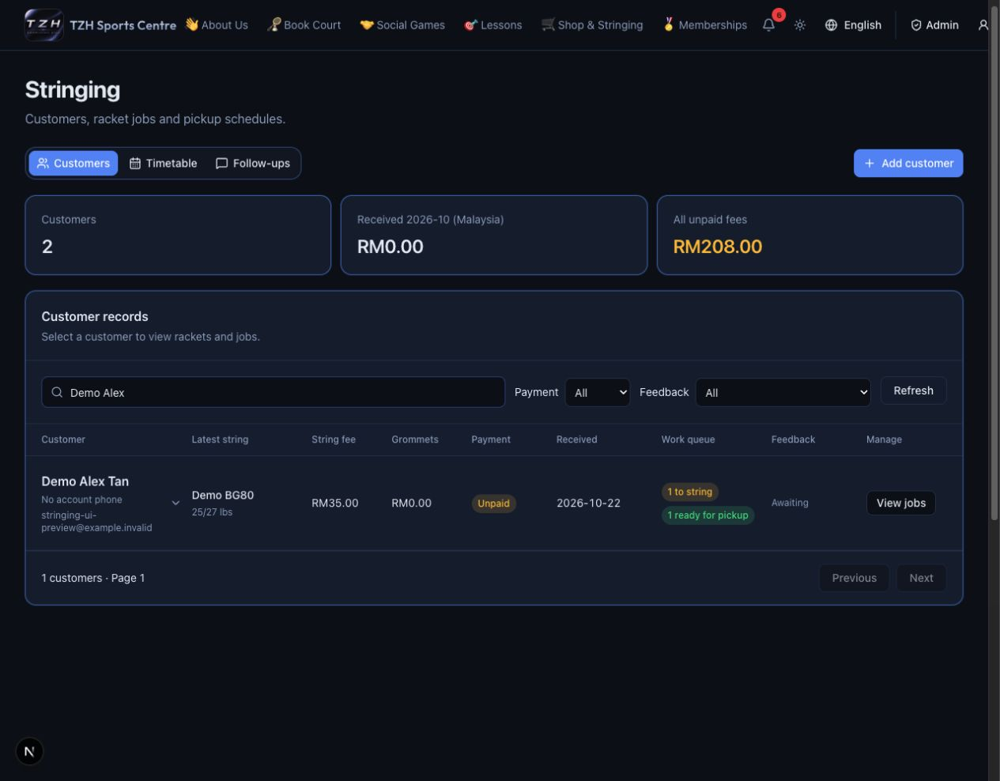

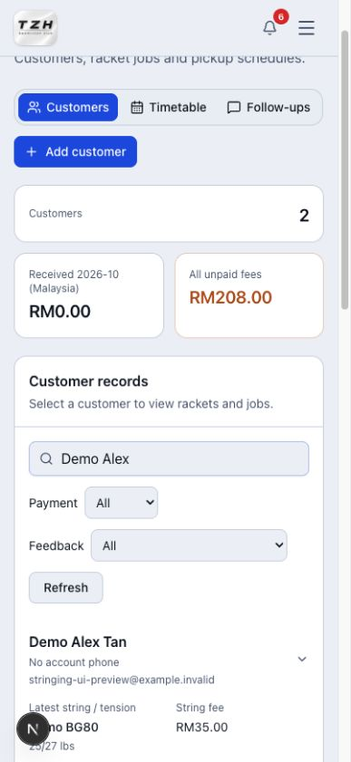

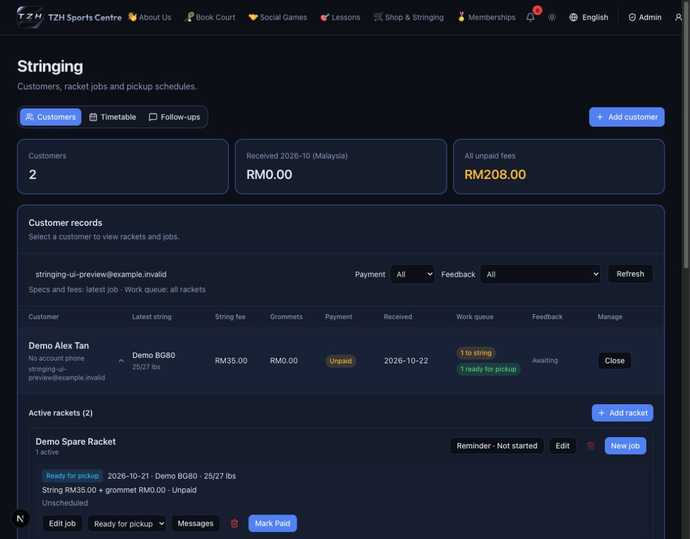

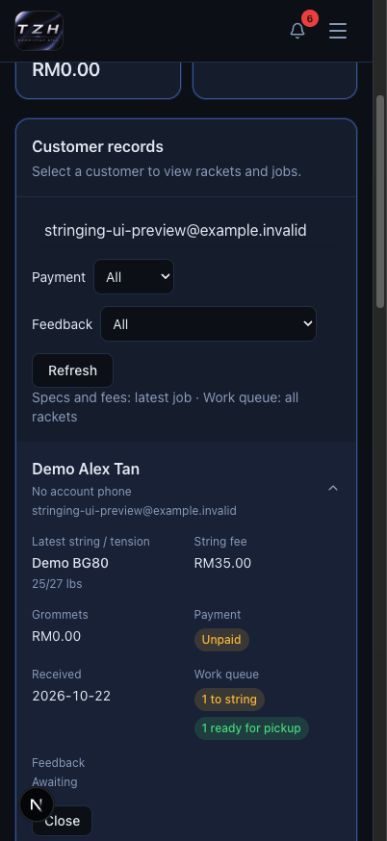

The desktop list shows each customer's latest string, fees and payment in aligned columns. **Work queue** covers all their rackets: **2 to string** means two physical rackets have Received/In progress services; **ready for pickup** is separate. Collected/cancelled services do not add work, and each racket permits only one active service. On mobile,
each row becomes labeled details. Select **View rackets** to reach all service actions.
Use **Stage** with the Payment and Feedback filters: **Received**, **In progress**,
**Ready for collection**, **Collected**, or **Follow up**. Follow up finds pending
racket reminders due today or overdue (Malaysia dates). A member appears when any
of their services/rackets matches; the row still shows their latest service. Choose
**All stages** to clear it.

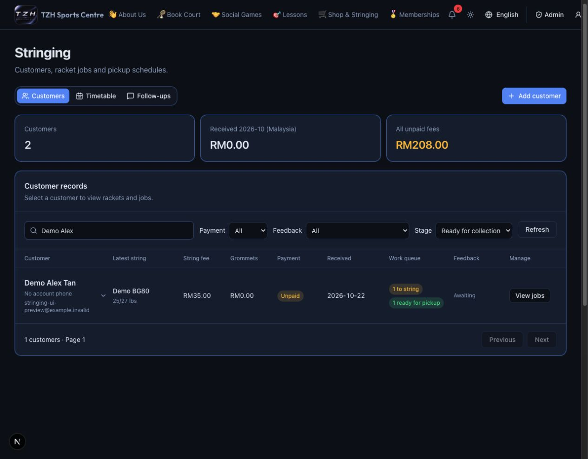

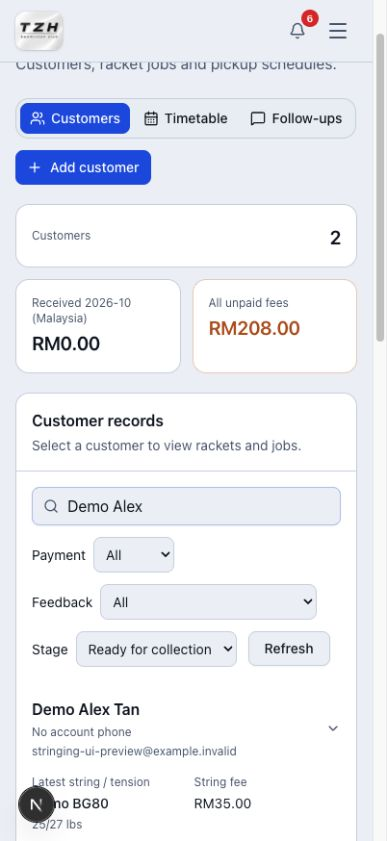

Expanding a customer shows **all rackets**, including empty rackets. Received,
In progress and Ready for pickup services are summarized in compact racket rows. Select **Details** to open a window with current stringing and its actions. **Start stringing** is available only when the racket has no active service. Collect or cancel its current service before starting another. Each racket's collected or
cancelled services are under **Stringing history**. Open that section for history, messages
or an eligible unpaid collected service's **Mark Paid** action. Inside **Details**, racket actions and
reminder countdowns remain available without opening Stringing history. Search can match
older services in those sections.

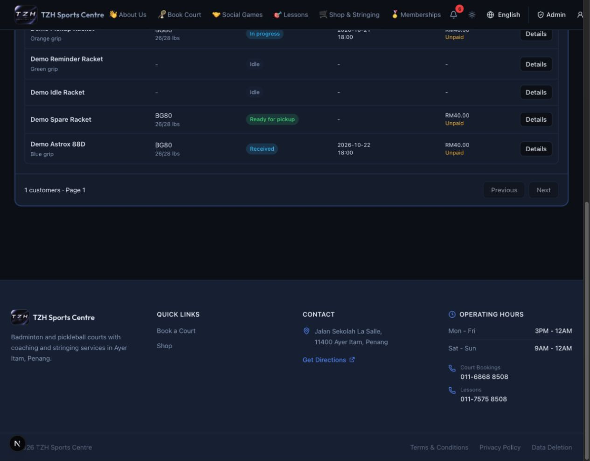

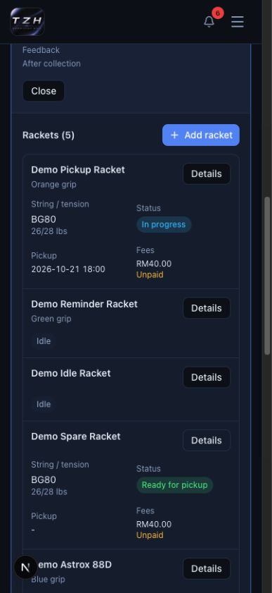

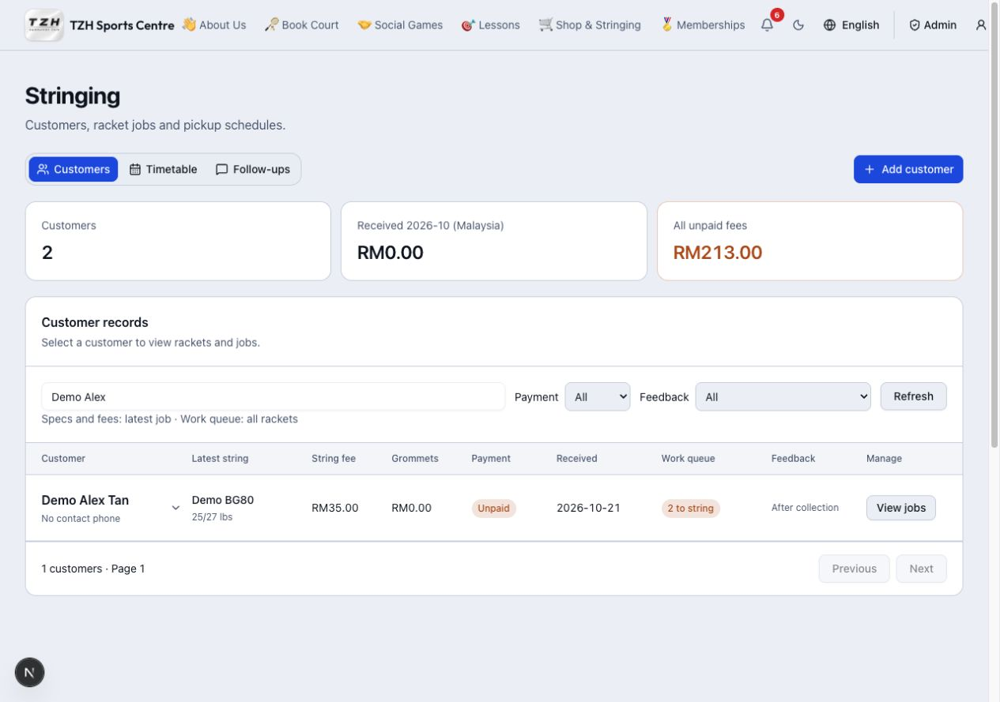

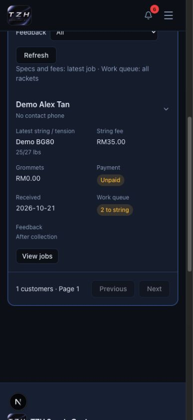

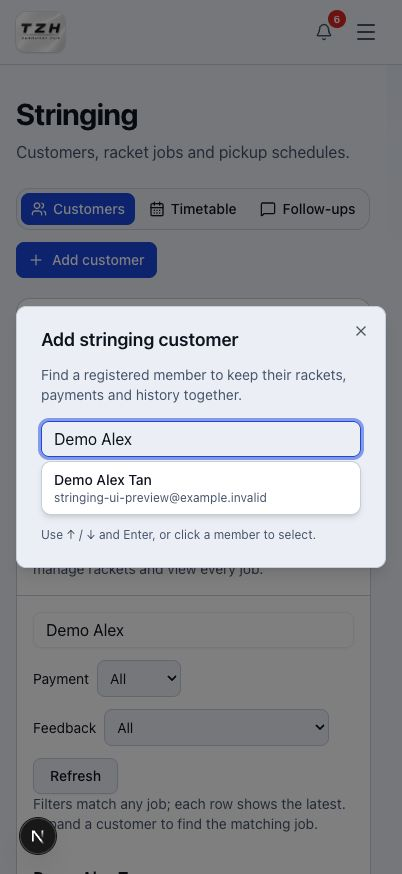

## Delete a stringing service

1. Expand the customer and select **Details → … → Delete stringing**. No status change is needed, including for paid, collected or previously contacted services.
2. Check the racket, string, tension, received date and total. Select **Cancel** to keep it, or **Delete stringing** to confirm.
3. The service disappears from the workspace, calendar and follow-ups. The racket and member remain, and you can start another stringing. Existing payments, points, invoices and linked history are kept; deletion does not issue a refund.

**Awaiting production migration and deployment.**

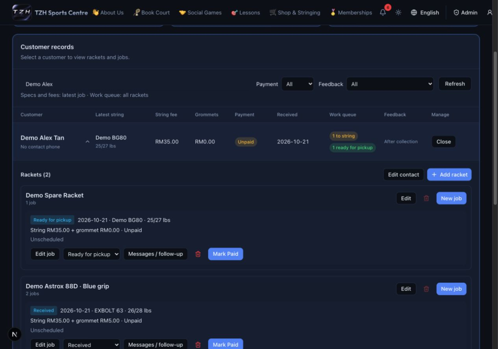

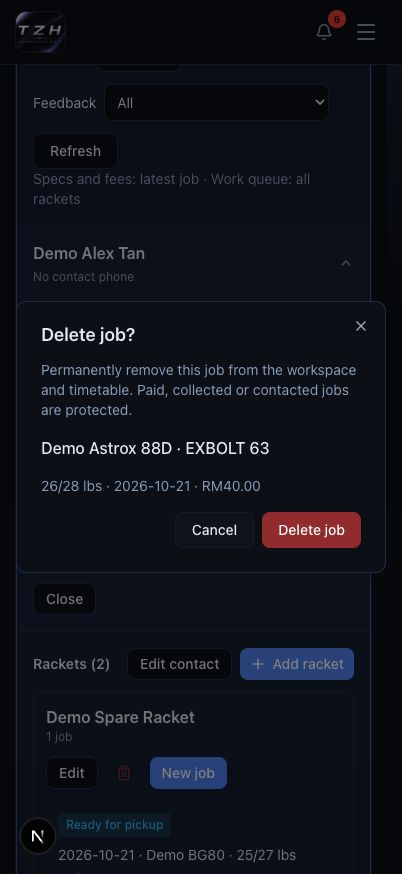

## Remove an unused racket

1. Select the customer name or **View rackets** to show all their rackets.
2. Select **Details → Actions → Delete racket** for an empty racket, check its model/nickname, then
   **Delete racket**. **Cancel** keeps it.
3. Rackets with any service history cannot be deleted, including those with cancelled
   services. Their Delete racket menu item is disabled; the member and all service history stay intact.

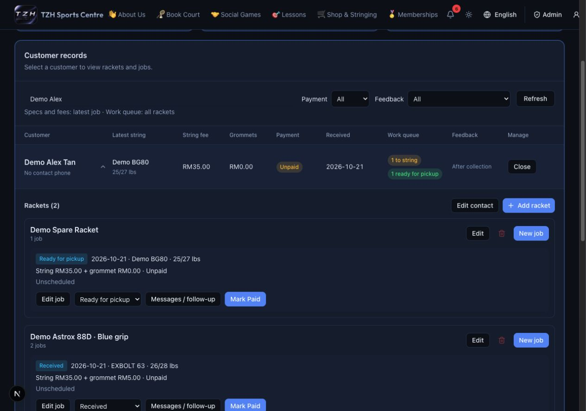

Dark mode uses the same theme controls for status, payment and Actions.

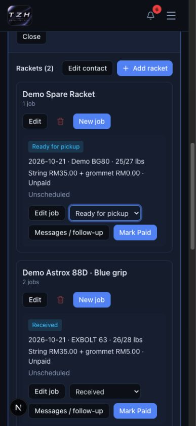

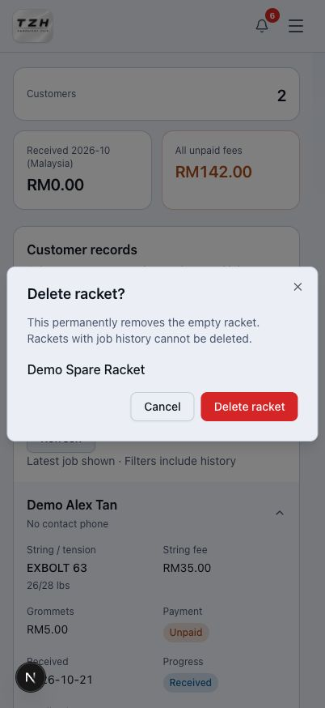

## Record full payment

1. Find the racket service and select **Mark Paid**. Check the linked member, both fees, total and points. Choose the actual payment date (today or earlier, Malaysia time).
2. **Cancel** leaves the service unpaid. Select **Confirm payment received** only after the full amount has been received. Deposits and partial payments are not supported.
3. The service becomes **Paid**, earns the displayed points once, and shows its invoice link. The invoice also appears under **Stringing** in Admin Invoices and the member's My Invoices.
4. If the PDF could not be prepared, the service stays Paid and shows **Retry invoice**. Use that action; do not record another payment. Retrying does not award more points or resend the payment email.
5. Check each service row for its fee and payment status. The customer count appears below the customer table and follows its filters.

Paid fees cannot be edited or reversed, and paid services cannot be cancelled. Stringing invoices do not offer manual Edit or Regenerate PDF; recover a missing PDF from the service using **Retry invoice**. Normal forward progress remains available, and an unpaid collected service can still be settled. Payment emails are best-effort; email failure never reverses a payment.

## Plan pickup deadlines

1. Select **Timetable**. The daily pickup list appears first and the monthly calendar stays below it. Enter a date and select **Go to date**, or select a day in the calendar. All times are Malaysia time. Multiple rackets may share a pickup time.
2. In the daily list, services without a pickup date appear at the bottom with **-** in the pickup field. Select **Edit** on an unpaid open service. Fill both pickup date and time, then **Save**. It moves into the selected day's agenda and calendar.
3. Clear both pickup fields to show **-** for its pickup in the same list. Paid and closed service details remain locked; eligible forward progress is still available.
4. **Overdue work** means a Received/In progress service has passed its pickup deadline. **Awaiting pickup** means the racket is ready. Unscheduled services have no deadline.
5. The calendar and daily list always include dated completed and cancelled services. The combined daily list has page controls when needed. Calendar counts cover the whole month; up to three time/member previews appear per day on desktop, with counts on mobile. Use the calendar’s month arrows to browse without changing the daily list. Select a day to load its full agenda above, and use the refresh icon to see other administrators' changes.

The pickup cards show this month, today and the next seven days. The daily table shows pickup time, member, racket, string/tension, payment and status; mobile uses cards. Choose the current-status dropdown to advance a service after confirmation, or **Messages** to prepare its message.

Scheduling does not record payment or contact completion. The daily list sorts earliest pickup first, with blank pickups last.

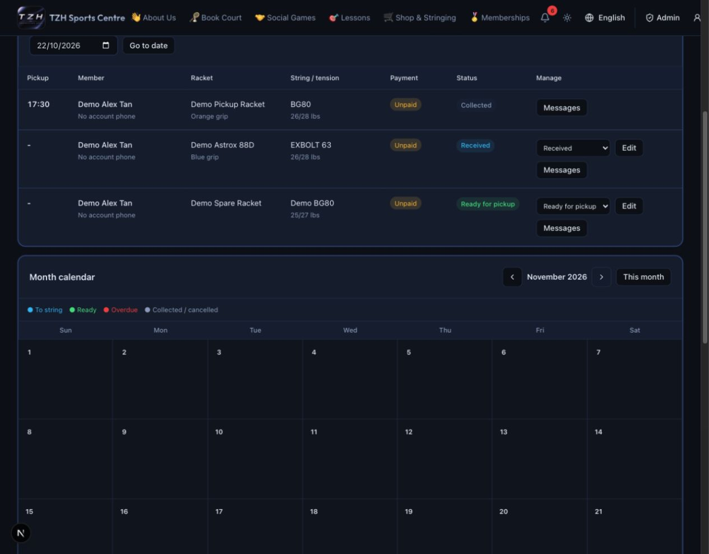

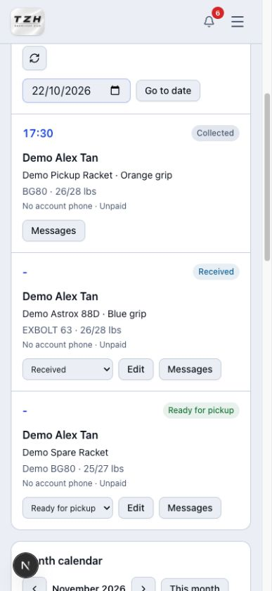

## Prepare WhatsApp messages and follow-ups

1. For payment, pickup or feedback messages, open **Details → Actions → Messages**. For the 45-day restring reminder, select **Details → Actions → Reminder settings & message**, or **Follow-ups → Manage racket reminder**. The reminder label shows remaining days, **Due today**, days overdue, **Off**, **Contact done** or **Not started** before collection, so you can check without opening it.
2. For service messages, choose a message stage; a racket reminder opens directly on the restring message. Choose English, 中文 or Bahasa Melayu. This choice saves automatically for this customer and is reused across their rackets and stages. Check the member’s account phone and the racket details. Edit the **Message preview** for this contact; resolve or deliberately remove any missing placeholders.
3. **Copy message** copies the draft. **Open WhatsApp** prepares it for you to send yourself. Neither action records a sent message or changes payment/progress. A missing/invalid account phone disables WhatsApp. The member must update their account phone before WhatsApp can be opened; Copy remains available.
4. To reuse different wording, expand **Edit shared template**, edit the template, tick the replacement confirmation and select **Save shared template**. This changes that stage/language for all admins. One-off edits do not change the shared template.
5. After completing the contact yourself, select **Mark as sent**. The selected stage shows **Sent · manually recorded** and its first confirmation time. For a restring reminder this closes the follow-up; it does not send anything.
6. In **Reminder → Settings**, set **Days after collection** (default 45, zero allowed), or **Disable reminders for this racket**, then **Save racket reminder**. You can configure an empty racket before its first service. This preference carries over to future services. Each collection resets only this physical racket’s countdown; saving recalculates its pending due date from the last collection. Completed contact stays closed, and the saved preference applies to the next collection.
7. Use **Follow-up filter** for due/overdue, all pending, contact done, superseded or disabled reminders. Use page controls and **Refresh follow-ups** as needed.

Feedback requests use the private link created for the collected service below. There are no automatic WhatsApp messages.

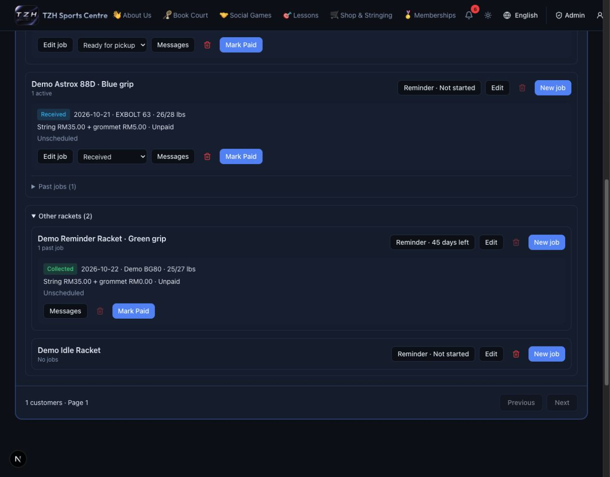

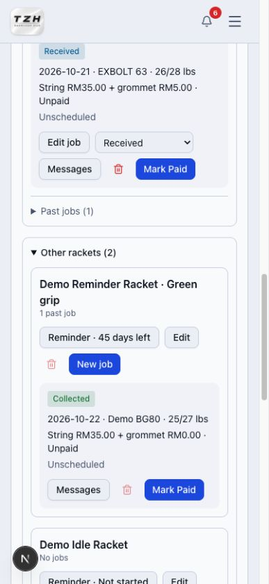

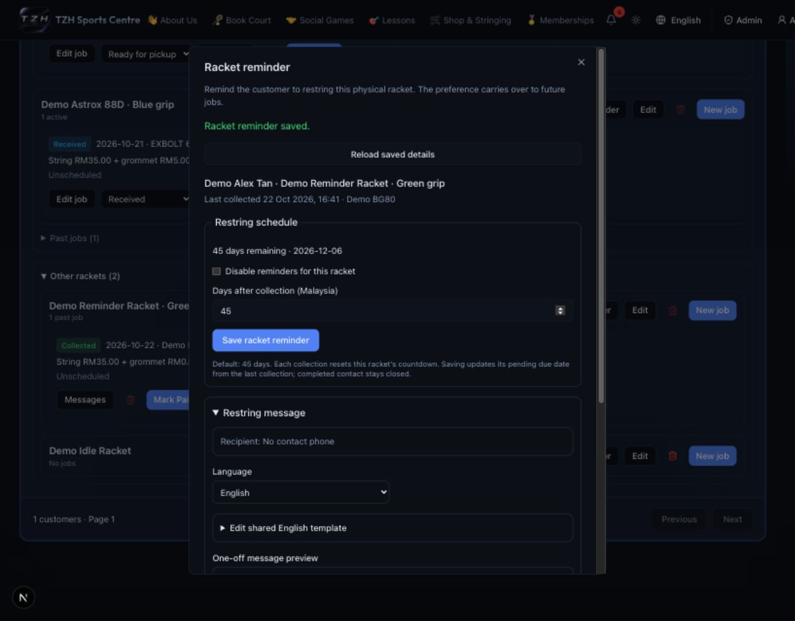

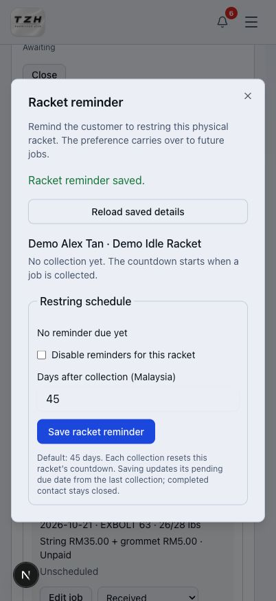

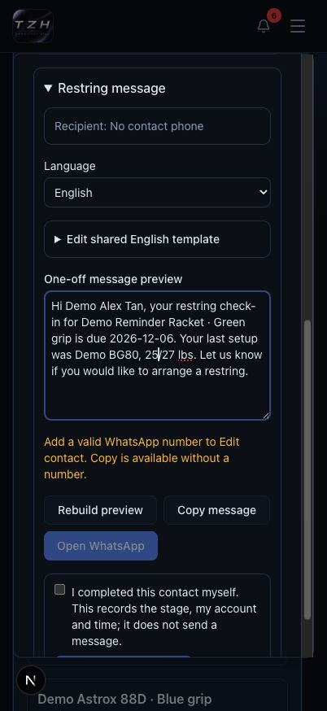

## Request and review private feedback

**Awaiting deployment.** Admins manage links; customers need only their private link,
with no account or login required.

1. Mark the service **Collected**. Its feedback link is created automatically.
2. Open **Details → Stringing history → Request feedback**. The message already
   contains the link. Choose English, 中文 or Bahasa Melayu, then **Copy message**
   or **Open WhatsApp** and send it yourself. Reopening reuses the same link.
3. The customer opens the link, chooses a language, gives 1–5-star ratings for
   string feel, tension and service, optionally comments, then submits. A confirmation
   replaces the form; repeat visits cannot submit or edit another response.
4. Reopen **View feedback** to see ratings, comment and submission time. Use the workspace **Feedback** filter for received or awaiting
   responses across collected services. Respondent identity is not verified.
5. To stop access, open **Feedback & link options**, confirm **Deactivate this feedback link** and select **Revoke link**. Links have no
   automatic expiry. Revocation preserves feedback and disables the link. There is no manual
   create or replacement action.

Opening/copying a request does not record contact done or feedback received.
Feedback does not change payment, points, invoices or racket progress.

## Preview examples

The service below is collected and paid. Its received feedback remains visible after
the administrator revokes the private link. The reminder still belongs to this
physical racket and is due 45 days after collection. All records shown are fictional.

Customers can choose 中文 on the private feedback form without logging in:

The mobile month calendar also supports dark mode:

### Move a pickup on the calendar (Admin, awaiting deployment)

In the calendar below the daily list, drag an unpaid, unfinished item on desktop onto another date. Review
**Reschedule pickup**, then **Save**. The original pickup time is kept; you can
adjust it before saving. **Close without saving** leaves the schedule unchanged.
Paid, Collected and Cancelled services cannot be dragged. For a different month or on
mobile, select the day, choose **Edit**, then change the pickup date/time and save.

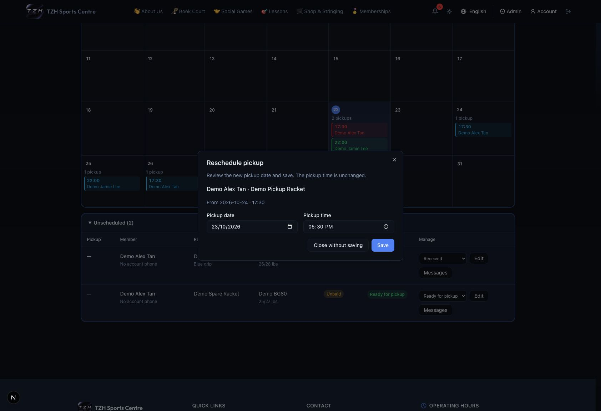

The calendar stays visible below the daily list, including when the selected day
has no dated pickups. Red entries identify overdue stringing on their original
pickup dates; ready rackets remain green. On mobile, red counts/dots highlight
past dates with unfinished stringing. Calendar navigation does not add older services
to the selected day's list.

### One current service per racket

A racket can be Received, In progress or Ready for pickup with one current
service. Its current string/tension, status, pickup and total fees appear in one compact
row. Select the racket name or **Details** for its window with active stringing, actions, reminders and history.
Close the window to choose another racket. **Start stringing** appears after collection or cancellation and
for unused rackets, inside **Details**. Previous services remain in **Stringing history**, including
unpaid collected services that still need payment. The racket's reminder continues
from its last collection, independently of the current service.

If older records contain several active services, all remain visible with a
warning. Correct those records by collecting or cancelling them; the app prevents
another start. Do not remove financial or contact history to resolve a duplicate.

### Sent labels and resending

Choose a message stage to see **Not marked sent** or **Sent · manually recorded**.
After sending yourself in WhatsApp, tick **I sent this message myself** and select
**Mark as sent**. This only records your confirmation; it does not send anything.

You can use **Copy message** or **Open WhatsApp** again for a sent stage, even after
a reminder is completed. Marking sent keeps your edited draft. The first sent
record stays unchanged; resending does not create a second record or reopen a
reminder. Missing placeholders must still be resolved, and WhatsApp needs a valid
account phone. Feedback links must be retained by the admin or explicitly reissued.

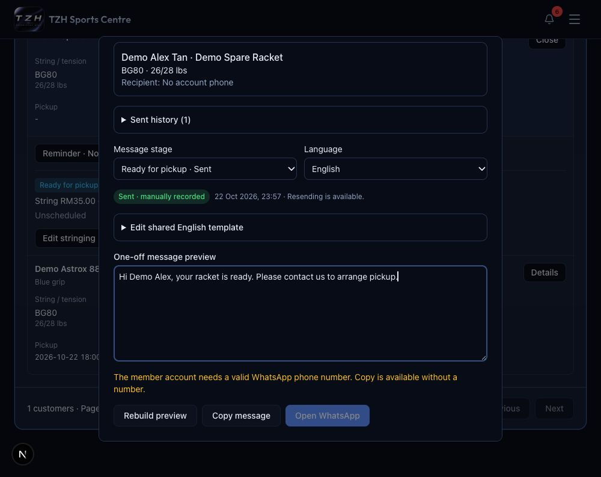

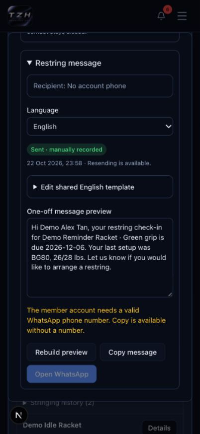

### Remember the customer's message language (awaiting deployment)

Choose **Language** in a service message or racket reminder. The app saves it for
that customer automatically. Reopening a message, choosing another stage, or
opening another of their rackets uses the same preference. Other customers keep
their own language; English is the initial default. Changing language rebuilds
the preview and preserves the stage's sent label.

If another admin changed the language, use **Reload saved details** before trying
again. Saving a language does not send or mark a message sent.

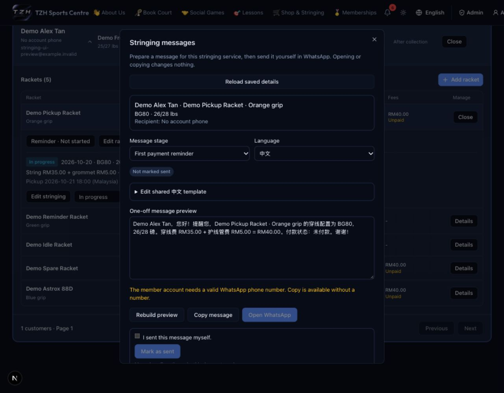

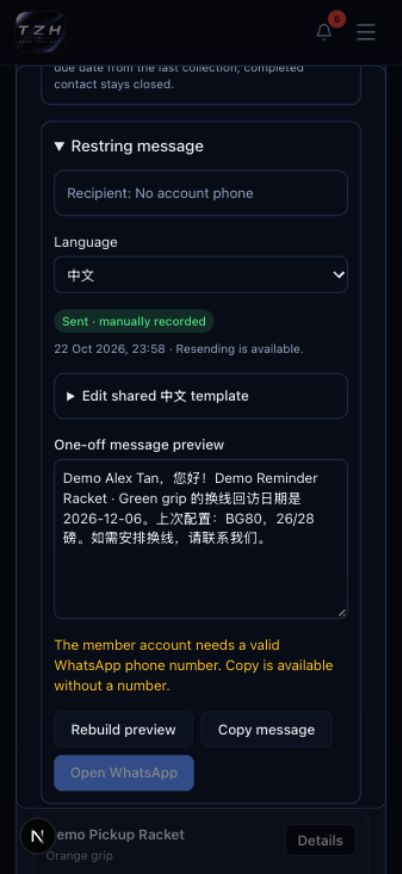

### Simpler message window (awaiting deployment)

As an admin, open a racket's **Details → Actions → Messages**. Review **Stage** and
**Language**, edit **Message preview**, then **Copy message** or **Open WhatsApp**.
After sending yourself, click **Mark as sent**. Its date appears for that stage;
you can still copy or open WhatsApp again. Opening WhatsApp does not mark it sent.

**Sent history** and **Edit shared template** start collapsed below the actions.
For a collected service, select **Request feedback**; its link is already in the
preview. **Feedback & link options** contains received feedback and revocation. A valid account phone is
required for WhatsApp; Copy remains available without one. Resolve any missing
message details before copying.

For **Reminder**, the **Message** view opens first. Choose **Settings** to change
the days after collection or disable reminders for that racket. Switching views
keeps an edited message. Before the first collection, only settings are available.

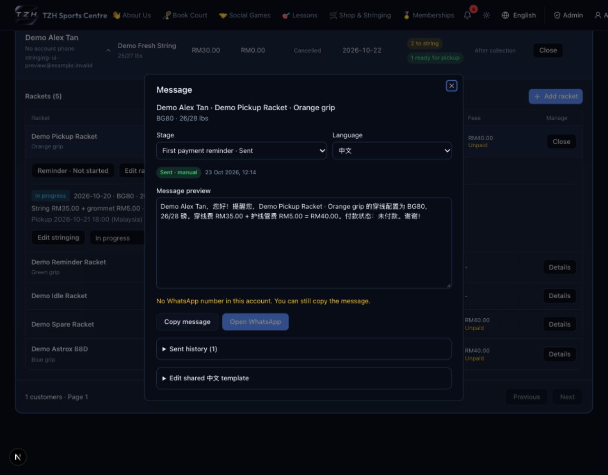

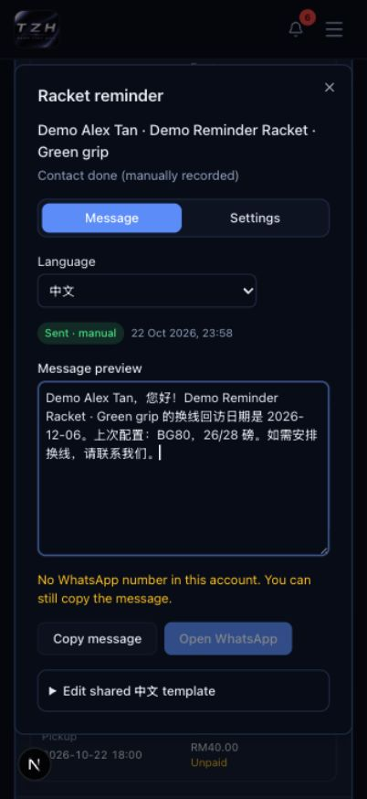

### Compact stringing details (awaiting deployment)

As an admin, expand a member and racket's **Details**, then choose **Actions → Edit stringing**
(or **Start stringing** for an idle racket). String, one tension value, fees and
optional pickup are shown together. Pickup uses Malaysia time; leave both date
and time blank when unscheduled.

Expand **Notes & received date** for the single **Notes** field or the received
date. Existing notes show **Notes saved**. Collapsing this section keeps its values.
**Save** and **Cancel** remain visible while the fields scroll on a small screen.
Cancel discards edits; Save updates the unpaid service without recording payment.

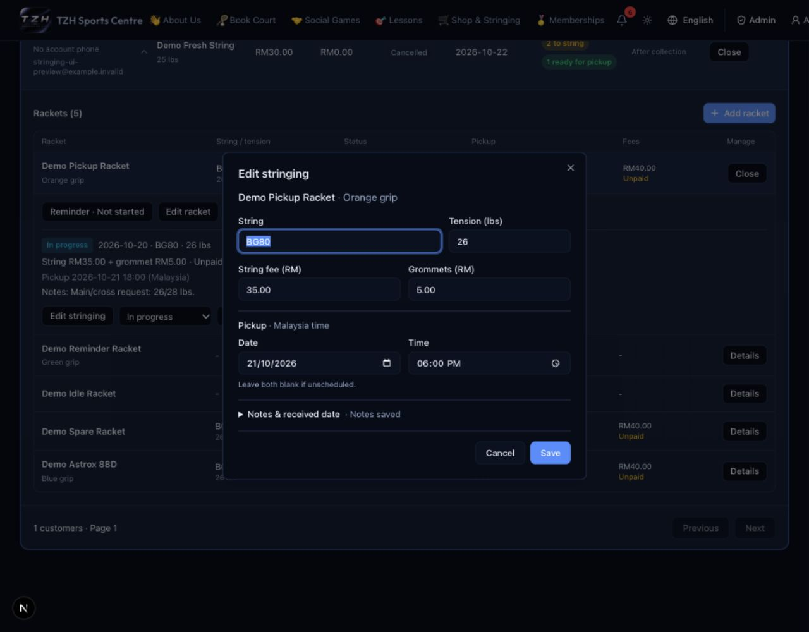

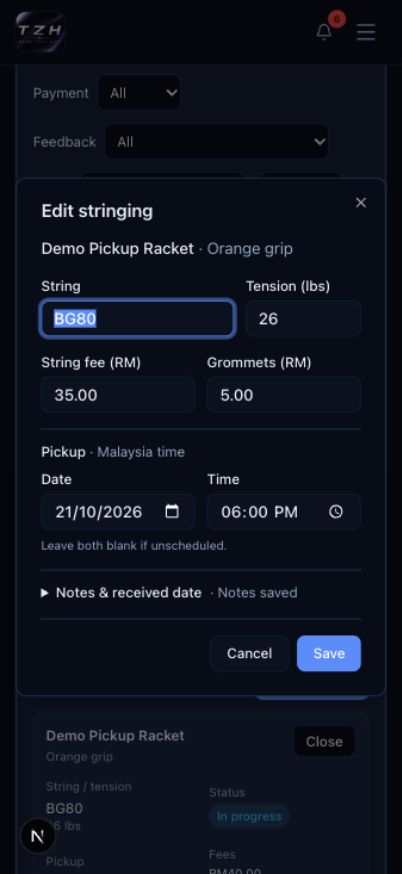

For **Tension (lbs)**, enter one value such as **26** or **26.5**. Put special
main/cross instructions in **Notes & received date → Notes**, for example
“Main 26 / cross 28 lbs.” Existing unequal main/cross values are preserved there
automatically; the main value becomes the single tension. Messages and the
timetable show one tension, and new invoice descriptions use the same value.

### One note for all instructions (awaiting deployment)

In **Actions → Edit stringing → Notes & received date**, use **Notes** for all instructions,
including grommets and special main/cross tension. There is no separate Grommet
notes field. Existing grommet notes are kept in Notes with a “Grommets:” label.
Save and reopen to review the combined text.

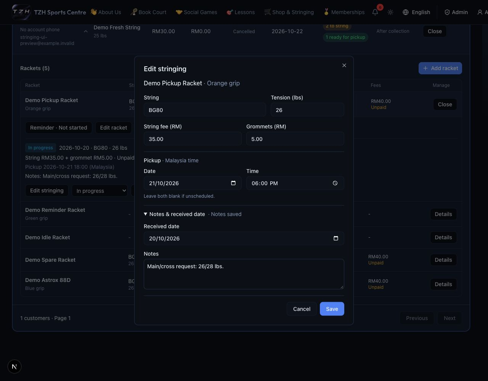

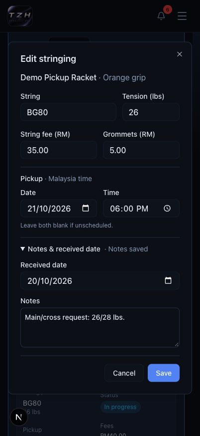

### Racket details window (awaiting deployment)

Select **Details** or a racket name to open its window. The active stringing is
visible immediately: string, tension, progress, Malaysia pickup time, received
date, fees/payment and notes. Previous services stay in collapsed **Stringing
history**. Idle rackets show **No active stringing** and **Start stringing**.

Change status beside the string details. Select **Message** beside status for
payment, pickup and feedback messages. Use **Mark Paid** beside the total fees.
The **…** menu in the window header contains editing and eligible deletion, plus:

- **Restring reminder**: the racket’s reminder schedule and message, normally 45 days after collection.

Payment/status still need confirmation. Closing an editor or message returns to
the racket window; closing that window returns to the racket list.

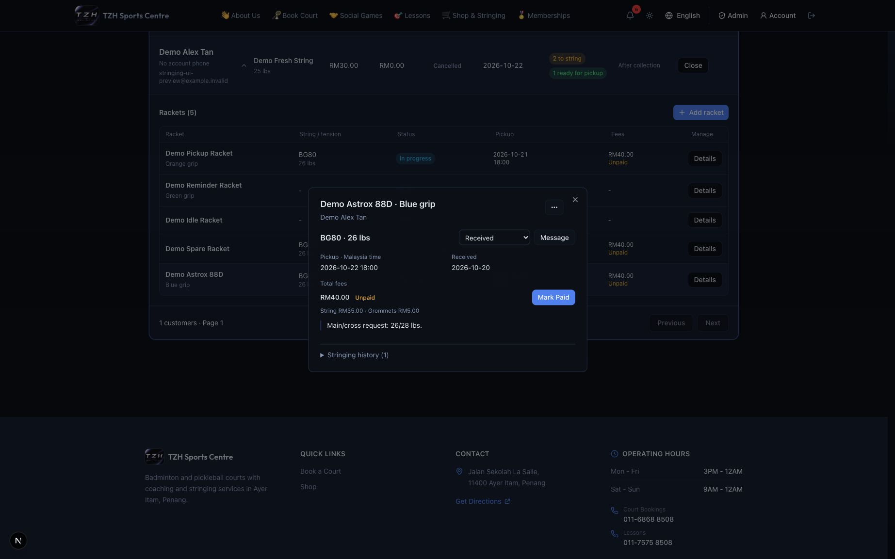

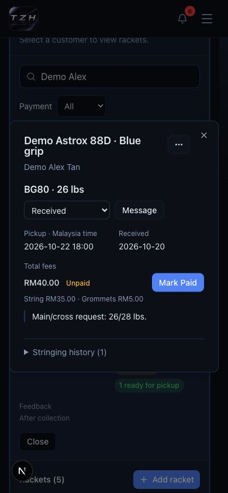

The Actions menu shows action names with a divider between service and racket
options; it has no extra title rows.

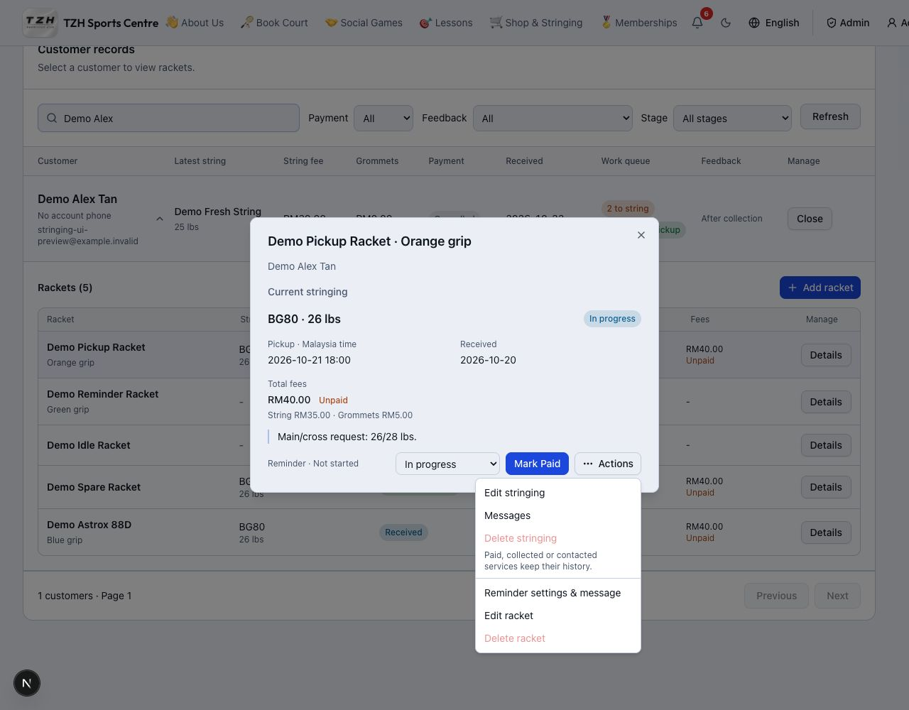

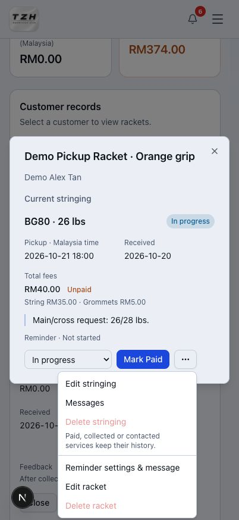

The details window omits the extra current-stringing heading and reminder
countdown line. Open **… → Restring reminder** for reminder details.

### Default view (awaiting deployment)

Open [Stringing](https://tzhsports.vercel.app/admin/stringing) as an administrator.
**Timetable** is the first tab and opens by default, with the daily agenda and monthly calendar below it.
Select **Customers** to manage members and rackets, or **Follow-ups** for reminders.

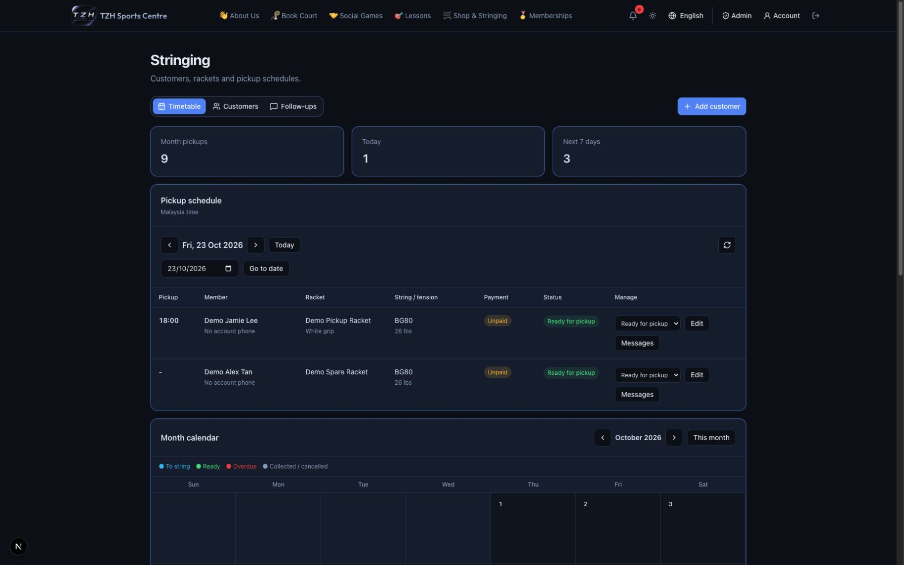

### Request feedback (awaiting deployment)

Open **Customers → View rackets → Details → Stringing history**. On the collected
stringing, select **Request feedback** directly. The message window opens on
**Feedback request**, with its unique service link already filled in. Copy the message and send it in WhatsApp. After submission, the button becomes **View
feedback** and the received ratings and comment are expanded automatically.

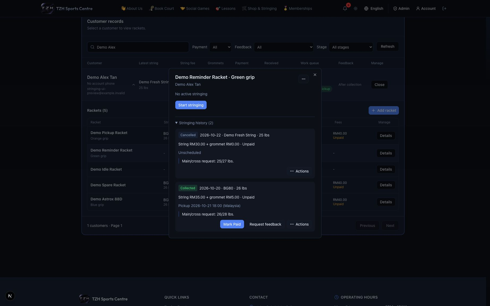

Each collected service has its automatically generated link. Reopening the message
reuses it; there is no manual create or replace step. Deleting a service makes its
link unavailable and retains submitted feedback.

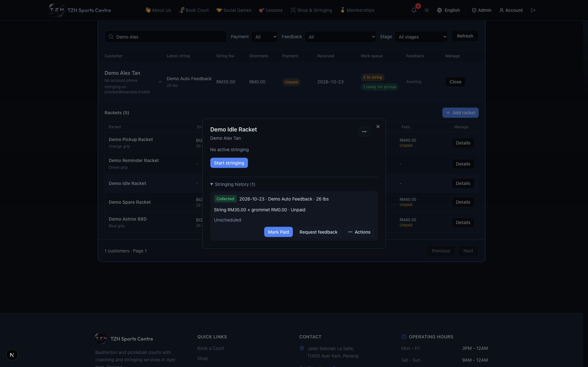

### Review feedback directly (awaiting deployment)

As an administrator, open [Stringing](https://tzhsports.vercel.app/admin/stringing)
and select **Feedback**.

- **Received** opens first, newest responses at the top. Customer, racket, string,
  tension, three ratings, comment and submission time are visible immediately.
- **Awaiting** shows collected services without a response. Select **Request
  feedback** on a row to prepare its WhatsApp request.
- Search by customer, racket or string. Counts follow the search; use **Refresh**
  for new responses and **Previous / Next** for more results.

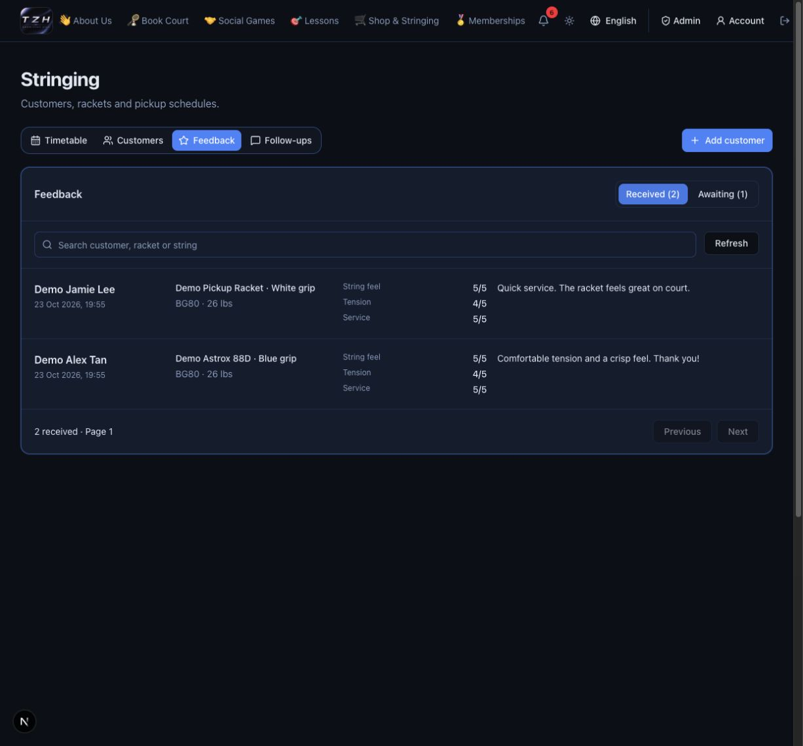

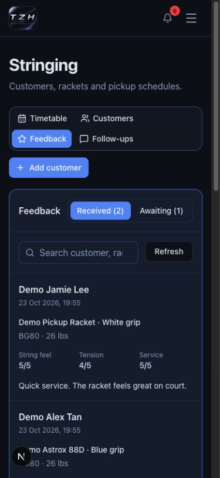

### Simpler workspace summary (awaiting deployment)

Customers and Follow-ups open directly into their records without summary cards.
The customer count appears below the customer table and follows its filters.
Individual stringing fees and payment actions remain available.

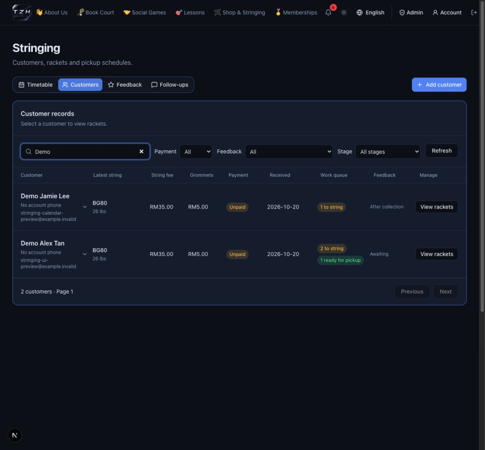
