# Stringing · quick guide

**Administrator · Awaiting deployment**
[Open Stringing](https://tzhsports.vercel.app/admin/stringing) · [This week](../changelog/2026-10-19.md)

Open the step you need. Screenshots use fictional customers.

<strong>Customer requests and same-day pickup</strong>

**Customer ordering · Awaiting deployment.** Customers use the separate
[Stringing page](customer-stringing.md). In the toolbar, **Requested (count)**
opens requests needing review. Open job **Details → … → Edit stringing** to
confirm fees and pickup; **Requested → Received** separately asks for the actual
received date. Then use the normal service and payment steps below.

**Same-day pickup today** is visible on every tab. Switch On while open to allow
later-today customer pickup; switch Off at any time. It ends at closing, never
carries into tomorrow, and switching Off preserves accepted requests. Staff can
still arrange exceptions directly.

<strong>1 · Choose a customer</strong>

**Add stringing → search member → select.** Search by name, email or phone.
The customer must have a registered account. Continue with the racket details in
the same form; selecting a member or cancelling does not create a record.
A red customer field means no account matched or a search result still needs
to be selected. Correct the search and choose a result to enable Save.

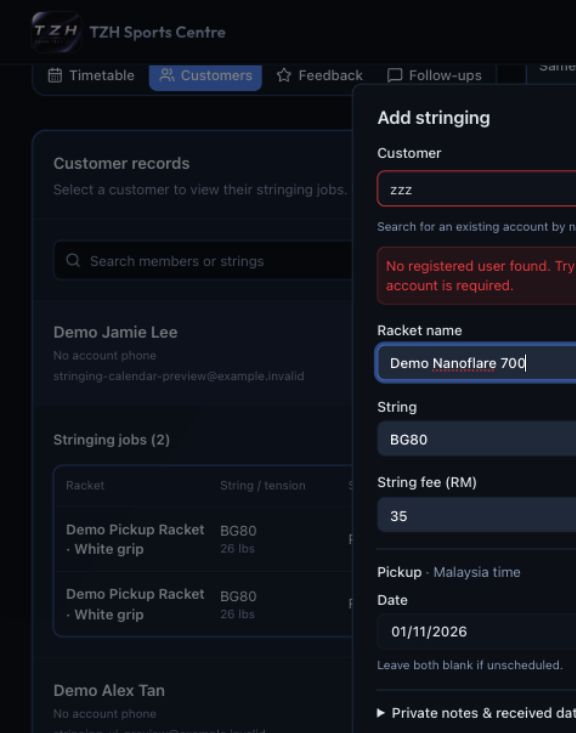

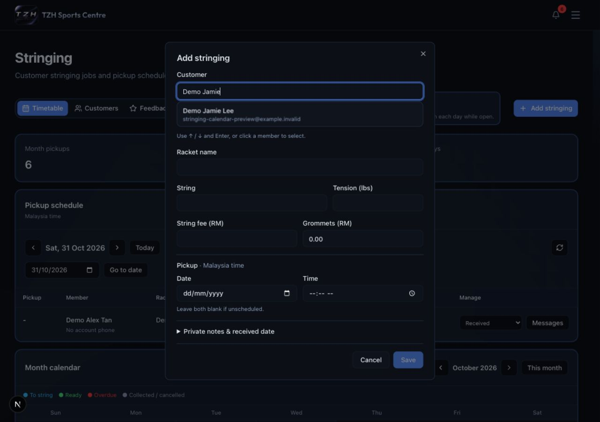

<strong>2 · Add stringing</strong>

**Add stringing** at the top of the workspace. Search and select a registered
member, then type in **Racket name** and **String** to choose a previous name.
For a new name, choose **Add new racket** or **Add new string**; it becomes
available next time after you save the job. Enter
tension and fees, then **Save**. Pickup needs both date and time, or neither.
Both fee boxes start blank with a 0.00 hint. Enter the string fee; leave
Grommets blank for RM0.00.

Extra instructions go in **Notes**. Repeat for each racket the customer brings;
identical names can have separate jobs. No separate racket setup is needed.

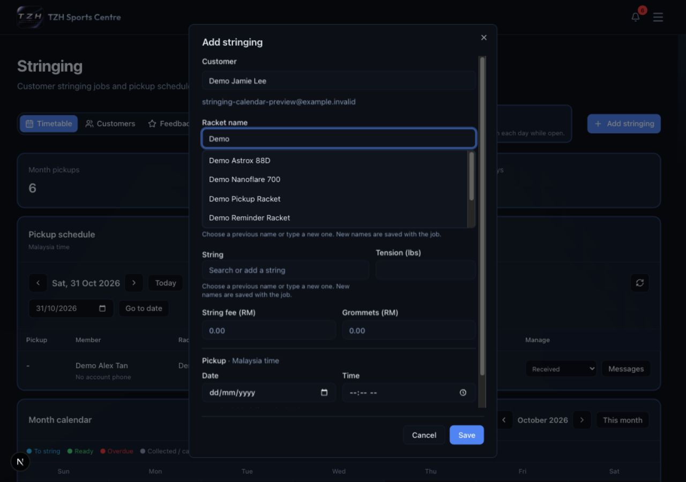

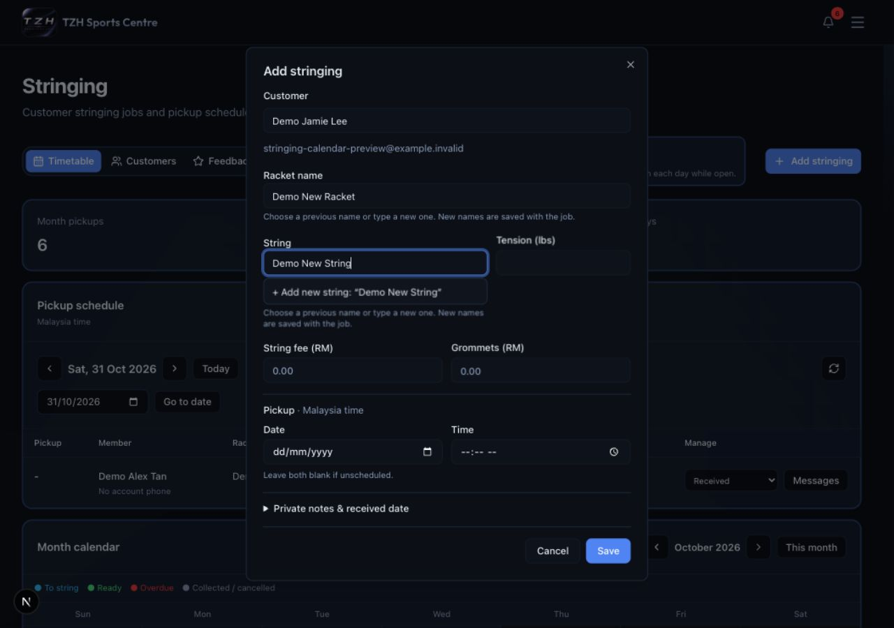

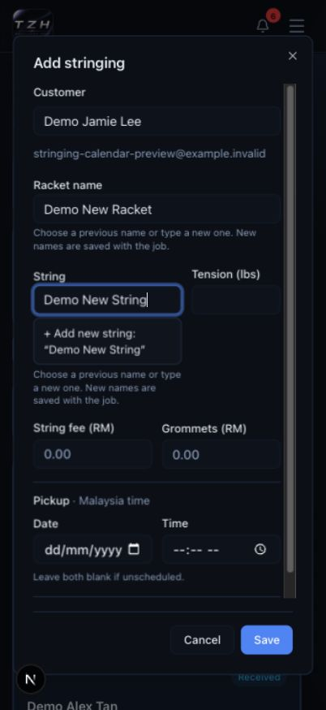

<strong>3 · See all jobs under a customer</strong>

**Customers → View stringing.** Each racket visit has its own row, including
completed jobs. **Total spent** at the right above the job rows adds all confirmed
stringing and grommet payments, including paid jobs removed from the list. Unpaid
jobs are excluded. Check string/tension, separate fees, payment, received date,
and status. The **Feedback** column shows **No feedback** or an underlined **View feedback**
action to read that visit’s response. **Message** and **Details** have
separate columns. Use **View feedback** on the customer header to read all their
responses, with racket details and service dates. Use **Message** on a row to prepare a message
for that job; opening the composer does not send it. Open **Details** for that specific job; **Edit stringing**
can correct its racket name while it is unpaid and open.
For paid or completed jobs, use **Details → … → Edit**, enter the
correct racket/string names and a reason, then **Save correction**. The change
is audited; payment amounts and issued invoices stay unchanged. A typo stops
appearing in suggestions once no other job uses it.

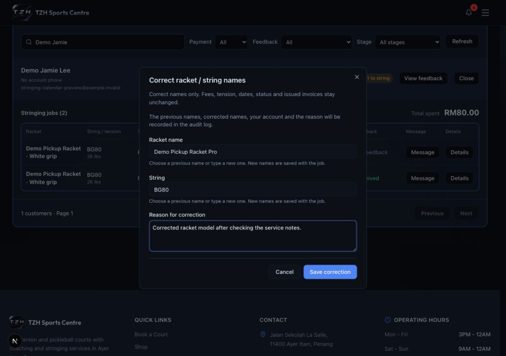

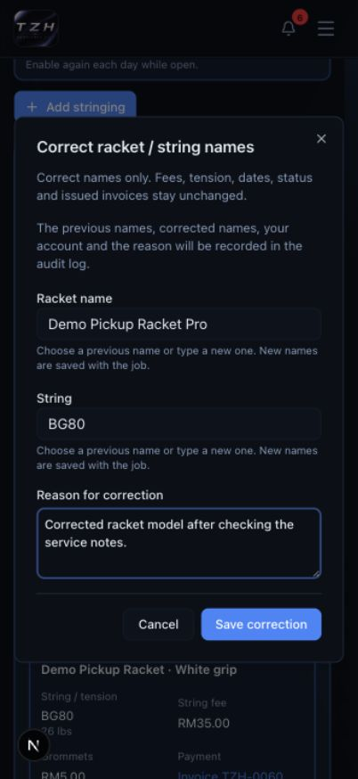

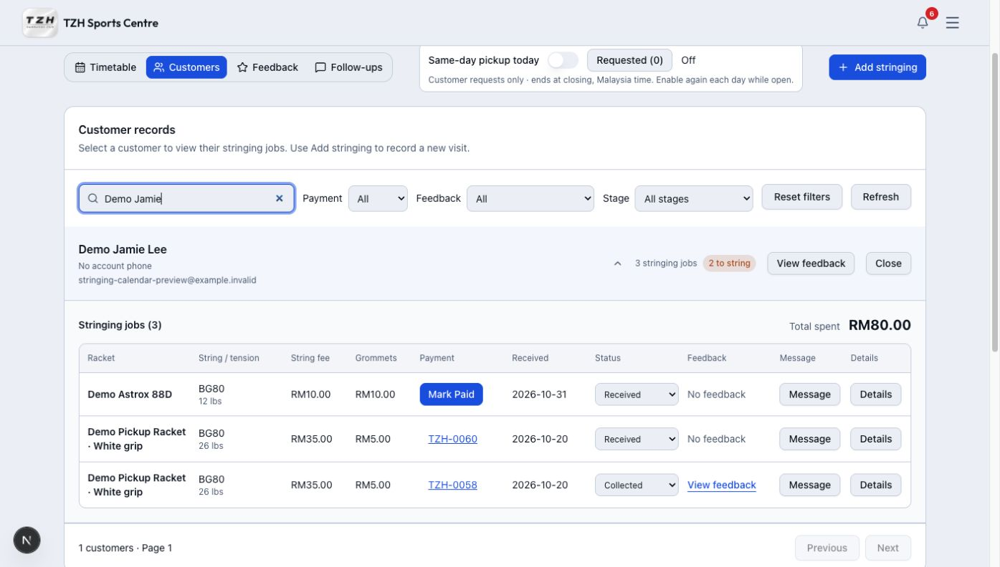

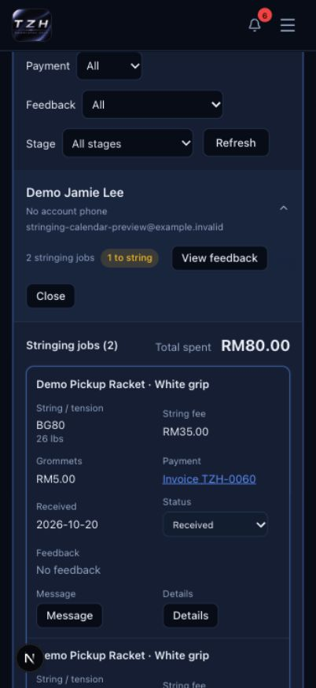

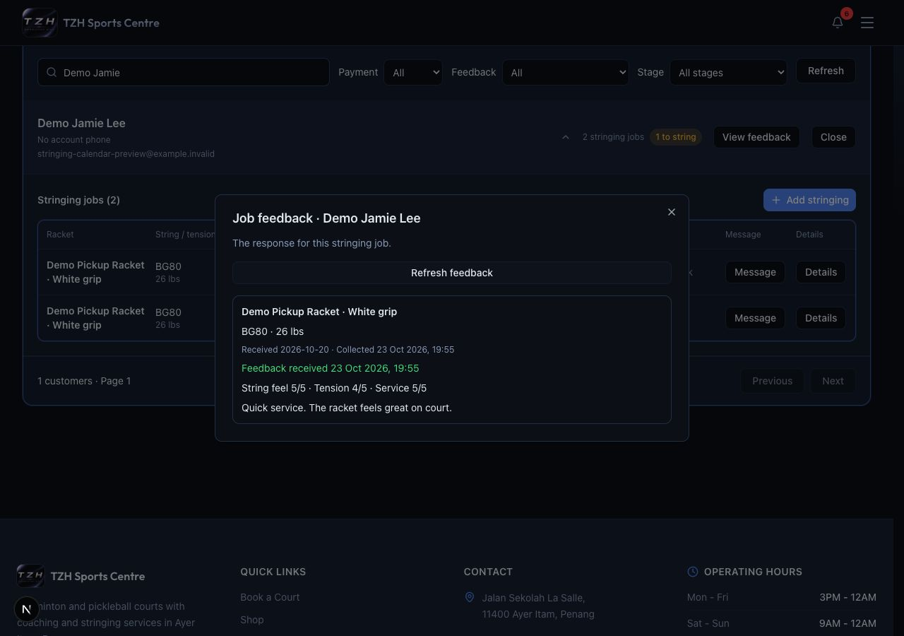

<strong>4 · Change status</strong>

**Details → status dropdown → choose → confirm.**

Received → In progress → Ready for pickup → Collected.
Status changes do not send WhatsApp or record payment.

<strong>5 · Daily routine</strong>

- **Timetable → Today:** work through pickups; “-” means unscheduled.
- Use **Mark Paid** for unpaid jobs; paid jobs show their invoice link.
- Update status as work finishes; use **Messages** for customer updates.
- Check **Feedback** for replies and **Follow-ups** for due reminders.

**Reset filters** clears the customer search and all three filters. Paid invoice
links show the reference only, such as **TZH-0060**.
Invoice links align with **Mark Paid** in the Payment column.

**Payment received?** In the timetable Payment column, choose **Mark Paid** →
review the fees and payment date → confirm full payment. The same button is on
mobile job cards and in job Details. Confirming records money received and awards
points; a brief confirmation appears and the row shows its invoice link. Progress
stays unchanged. Cancel records nothing. If the invoice is unavailable, use
**Retry invoice**.

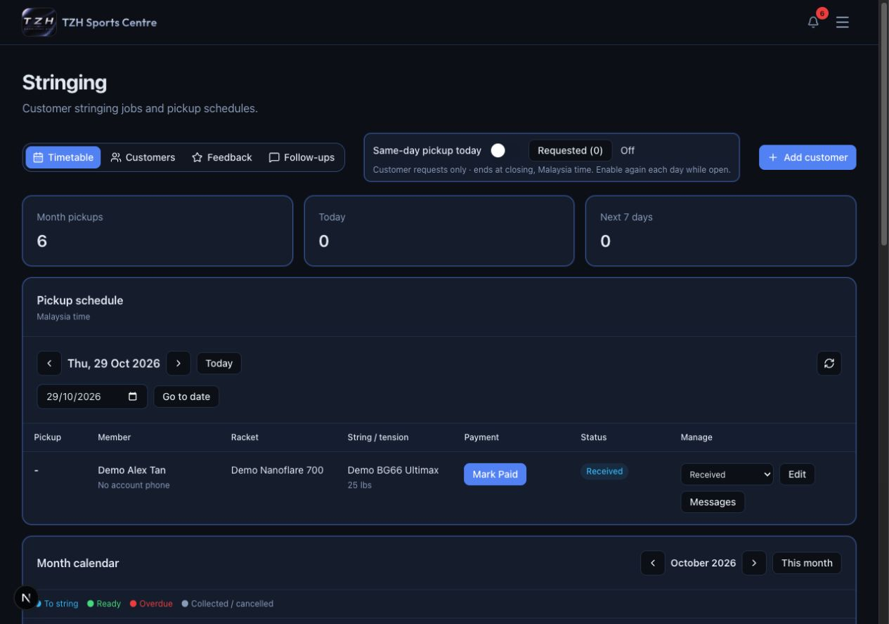

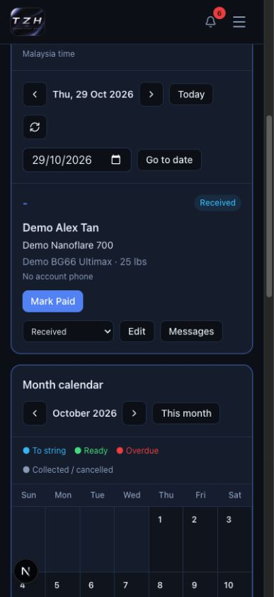

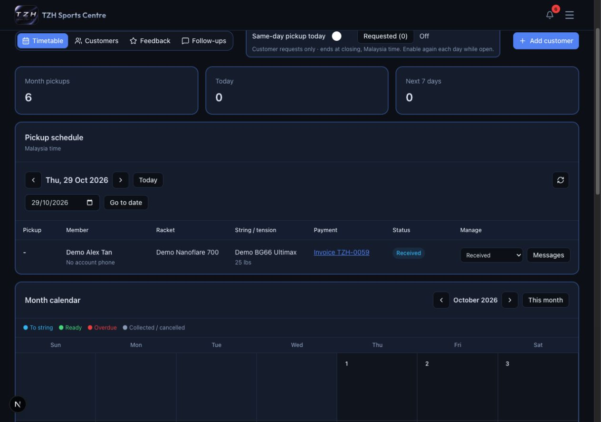

<strong>6 · Calendar</strong>

Choose a date in the daily date box to update the schedule immediately, or use
the arrows / **Today**.
The daily date controls appear together; the month grid below provides an overview.
Scroll below the daily list. **Click a date or any job inside it** to select that
day and return to its table; red shows overdue work. Use the table’s **Edit**
button to edit a job.
Completed pickups stay visible. On desktop, **drag an unpaid open item → review →
Save** to reschedule; on mobile, use the daily **Edit** action.

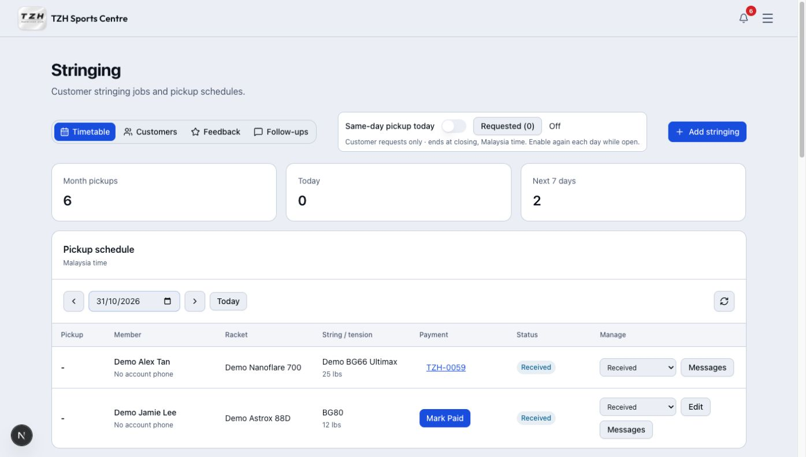

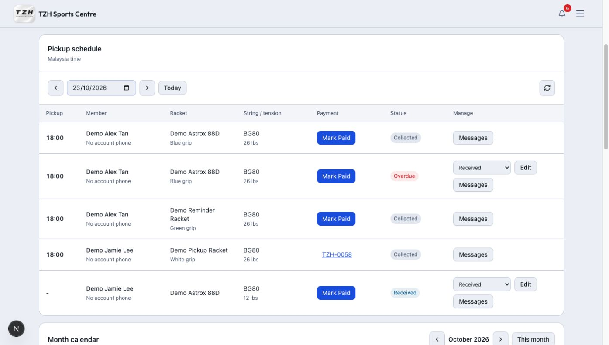

<strong>7 · WhatsApp updates, stage by stage</strong>

**Details → Message → Stage:**

| When | Choose |
| --- | --- |
| Received / in progress, payment pending | First payment reminder |
| Still unpaid, another reminder needed | Second payment reminder |
| Payment recorded | Paid confirmation |
| Racket ready | Ready for pickup |

Choose language → review preview → **Open WhatsApp → send → Mark as sent**.
Language is remembered per customer. Sent stages can be resent.

WhatsApp needs a valid account phone; **Copy message** also works without one.

<strong>8 · WhatsApp feedback request</strong>

For a collected job: **Message → Stage: Feedback request → Prepare feedback link**.
Expand **Prepare feedback message**, review it, then copy or open WhatsApp.
After sending, use **Mark as sent**. Opening the composer does not send anything.

Each job accepts one response. Retrying uses the same link; an old response cannot
make a later job look reviewed. Racket name remains part of the job.

**View feedback** on the customer header opens all responses, newest first, with
racket/string/tension and service dates. This window is for reading only; it has
no invitation creation or link-management actions. Earlier responses whose job
was not recorded remain labelled as earlier feedback.

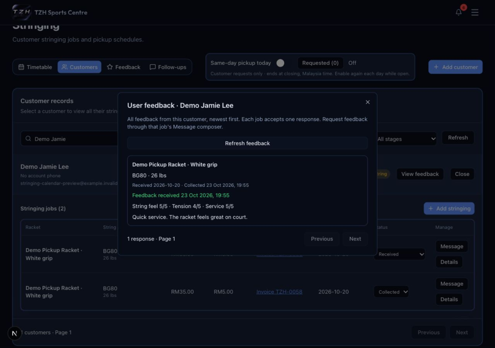

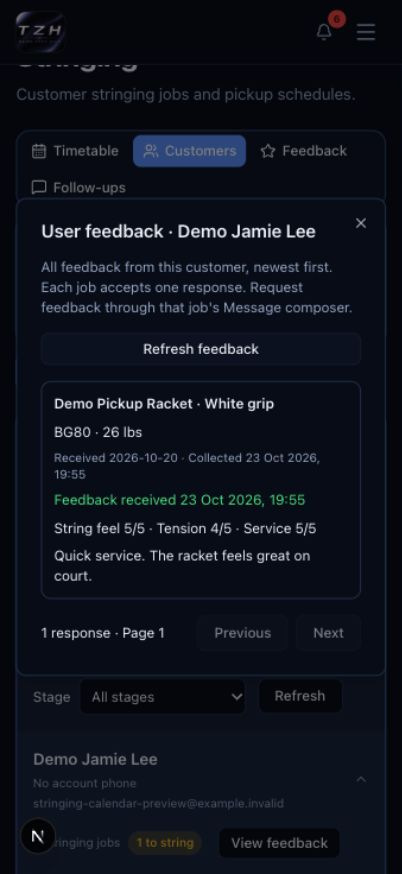

**Feedback → Received** also lists responses. **Awaiting → Message** opens the
specific job's composer. Removing a job retains its response in admin history.

<strong>9 · WhatsApp reminder for the next stringing</strong>

**Follow-ups → Send reminder → Message → Open WhatsApp → send → Mark as sent.**
Or open **job Details → … → Restring reminder**.

Default: **45 days after collection**. Change the interval or disable it in
**Settings**. Each job has its own reminder; a newer job does not replace it.
Marking the reminder sent closes only that job’s follow-up.

Disabled reminders show **Reminder settings** so you can enable them again.

Filter by **Due** (today or overdue), **Upcoming** (future reminders),
**Contact done** (manually marked as sent), or **Disabled** (switched off).
Opening WhatsApp alone does not mark contact done.

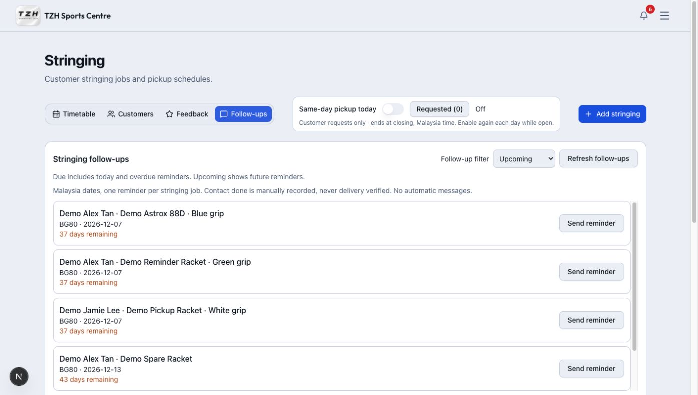

<strong>Automatic outreach pause and recovery · awaiting deployment</strong>

In **Message**, tick **Pause automatic outreach for this customer** to pause all
their jobs. Manual messages remain available.

In **Automatic outreach recovery**, check the original WhatsApp chat and stop the
runner before choosing **Resolve as observed sent** or **Resolve as definitely
not sent**. Tick the exact confirmation, then **Confirm resolution**. Expiry is
never proof that a message was unsent. No WhatsApp send occurs from this panel.

Follow the [stringing outreach guide](../mcp/stringing-outreach.md) for the dry run,
owner test and separate sending/scheduling authorisation.

Customer requests may leave string model and tension blank and show **Needs advice**.
Discuss the setup with the customer, then use **Details → Edit stringing** to save the agreed
string, tension and fees before starting work or recording payment. Awaiting deployment.

Stage, Payment and Feedback filters narrow the jobs shown inside each customer.
For example, **Stage → Requested** shows only requested jobs; **Reset filters**
restores all visits. **Total spent** remains the customer’s lifetime paid total. Awaiting deployment.

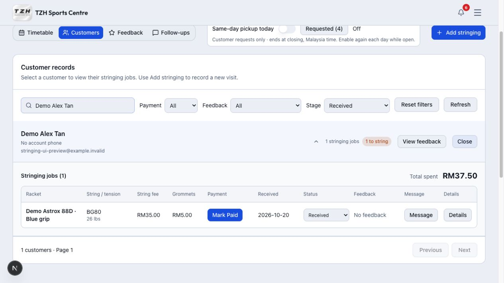

**Same-day pickup** is a compact On/Off switch in the toolbar. Tap the info icon
for the daily reset details. **Requests** beside it opens requested jobs. Awaiting deployment.

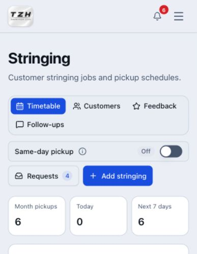

The Same-day pickup setting, Requests and Add stringing controls use matching heights. On phones, the setting sits above the two action buttons.

The Off switch has a contrasting track and border in light and dark themes.

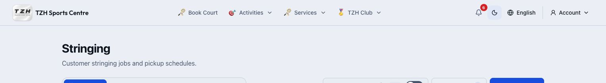

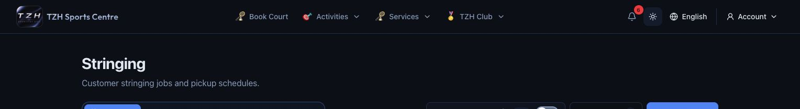
