# Stringing · quick guide

**Administrator · Awaiting deployment**
[Open Stringing](https://tzhsports.vercel.app/admin/stringing) · [This week](../changelog/2026-10-19.md)

Open the step you need. Screenshots use fictional customers.

<strong>Customer requests and same-day pickup</strong>

**Customer ordering · Awaiting deployment.** Customers use the separate
[Stringing page](customer-stringing.md). In the toolbar, **Requested (count)**
opens requests needing review. Open job **Details → … → Edit stringing** to
confirm fees and pickup; **Requested → Received** separately asks for the actual
received date. Then use the normal service and payment steps below.

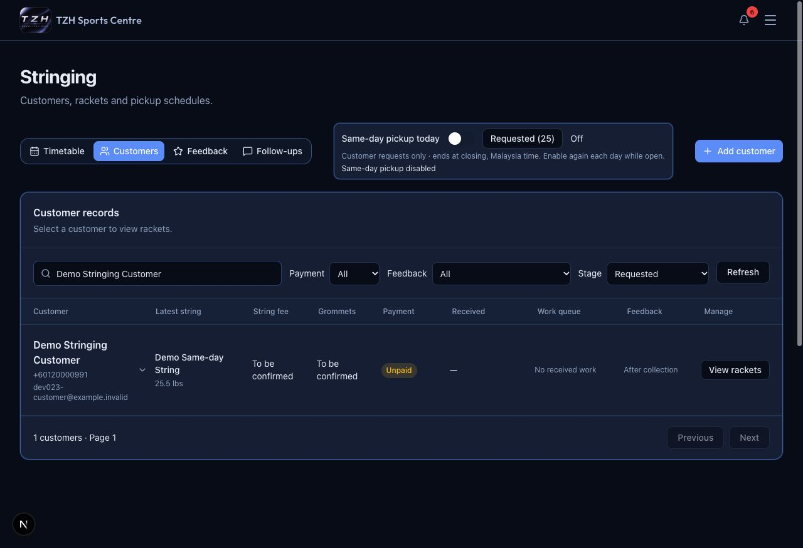

**Same-day pickup today** is visible on every tab. Switch On while open to allow
later-today customer pickup; switch Off at any time. It ends at closing, never
carries into tomorrow, and switching Off preserves accepted requests. Staff can
still arrange exceptions directly.

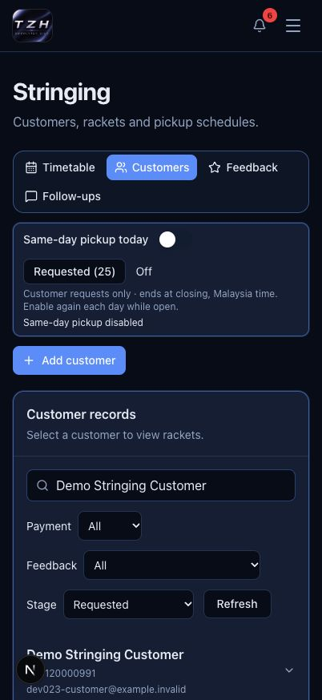

<strong>1 · Add customer</strong>

**Customers → Add customer → search member → select → Add contact.**
The customer must have a registered account.

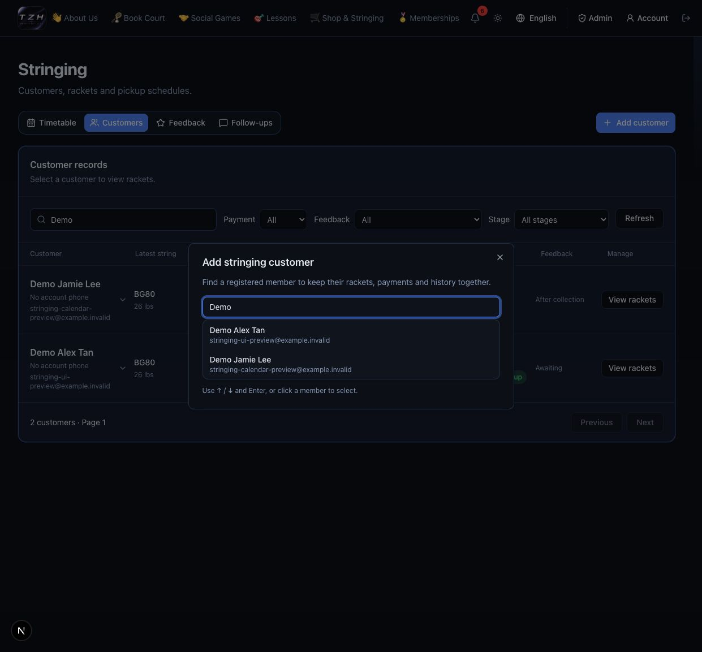

<strong>2 · Add stringing</strong>

**Customers → View stringing → Add stringing.** Enter the **Racket name**, string,
tension and fees, then **Save**. Pickup needs both date and time, or neither.
Extra instructions go in **Notes**. Repeat for each racket the customer brings;
identical names can have separate jobs. No separate racket setup is needed.

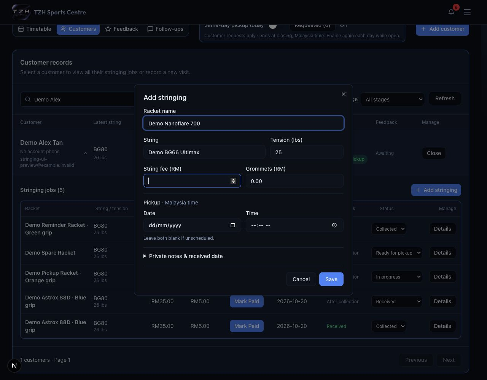

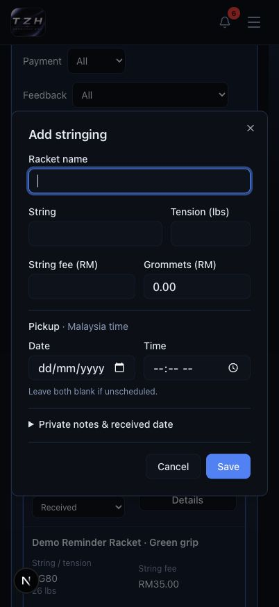

<strong>3 · See all jobs under a customer</strong>

**Customers → View stringing.** Each racket visit has its own row, including
completed jobs. Check string/tension, separate fees, payment, received date,
and status. Open **Details** for that specific job; **Edit stringing**
can correct its racket name while it is unpaid and open.

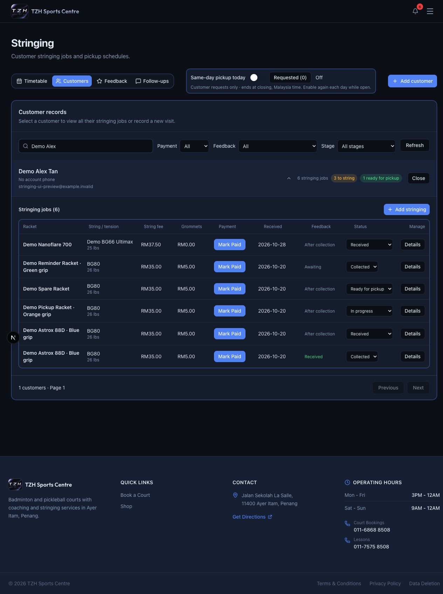

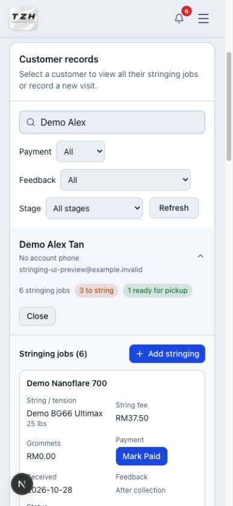

<strong>4 · Change status</strong>

**Details → status dropdown → choose → confirm.**

Received → In progress → Ready for pickup → Collected.
Status changes do not send WhatsApp or record payment.

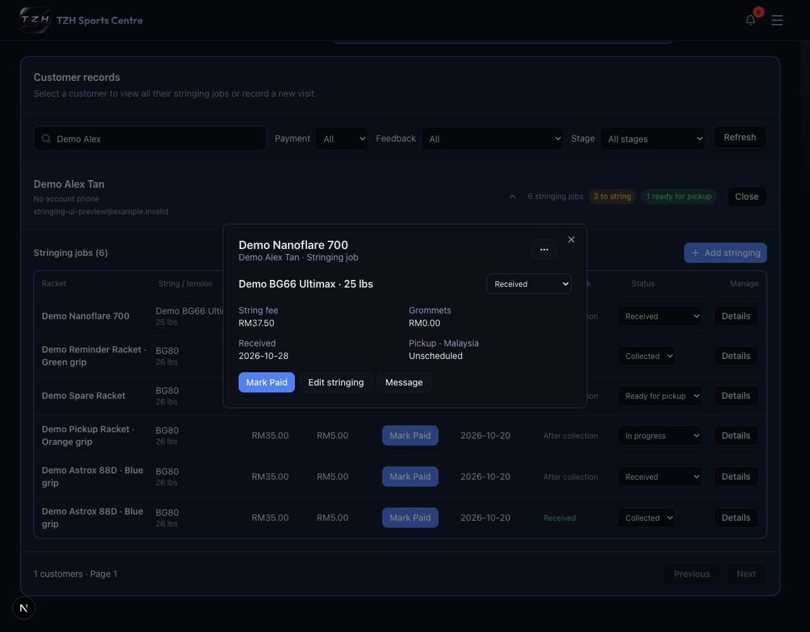

<strong>5 · Daily routine</strong>

- **Timetable → Today:** work through pickups; “-” means unscheduled.
- Update status as work finishes; use **Messages** for customer updates.
- Check **Feedback** for replies and **Follow-ups** for due reminders.

**Payment received?** Open job Details → **Mark Paid** → review → confirm full
payment. Points/invoice follow; progress stays unchanged.

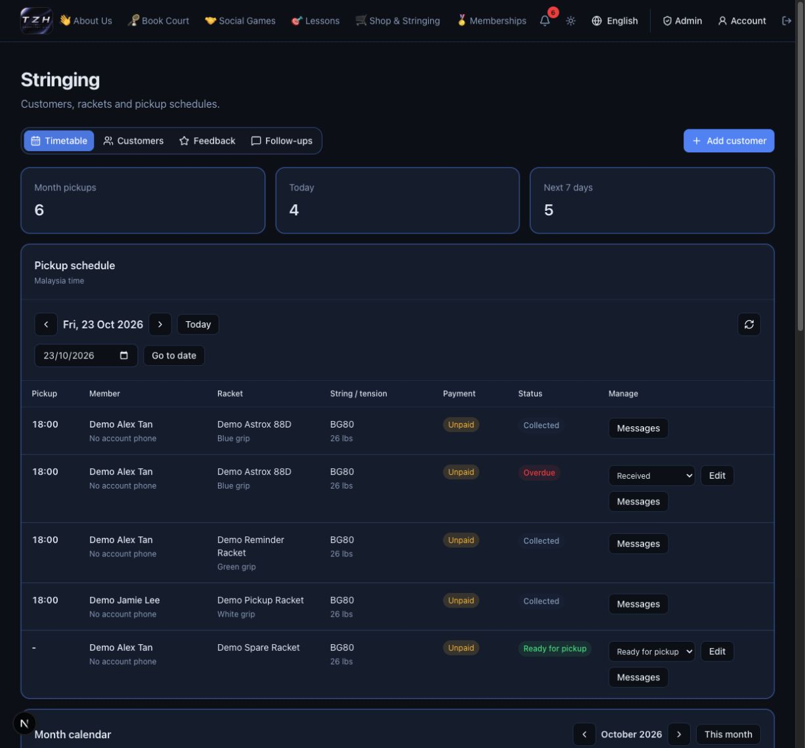

<strong>6 · Calendar</strong>

Scroll below the daily list. **Click a date** for its agenda; red shows overdue work.
Completed pickups stay visible. On desktop, **drag an unpaid open item → review →
Save** to reschedule; on mobile, use the daily **Edit** action.

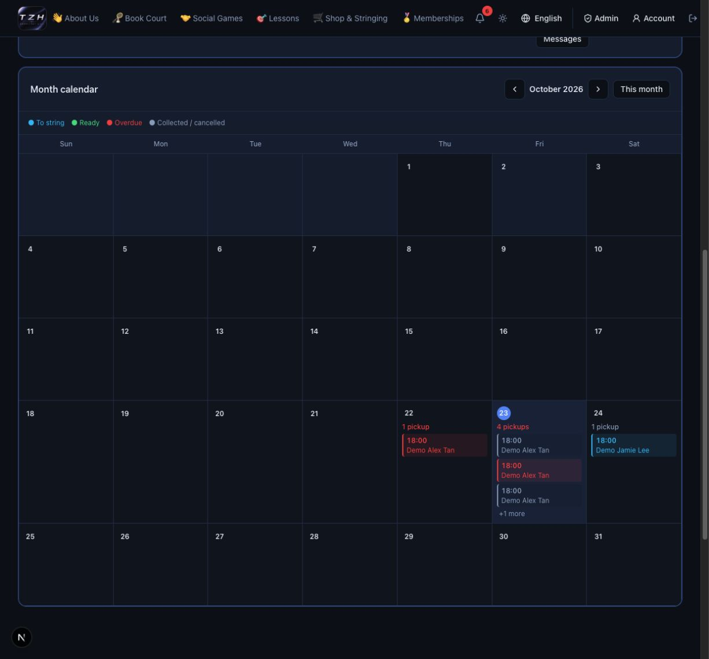

<strong>7 · WhatsApp updates, stage by stage</strong>

**Details → Message → Stage:**

| When | Choose |
| --- | --- |
| Received / in progress, payment pending | First payment reminder |
| Still unpaid, another reminder needed | Second payment reminder |
| Payment recorded | Paid confirmation |
| Racket ready | Ready for pickup |

Choose language → review preview → **Open WhatsApp → send → Mark as sent**.
Language is remembered per customer. Sent stages can be resent.

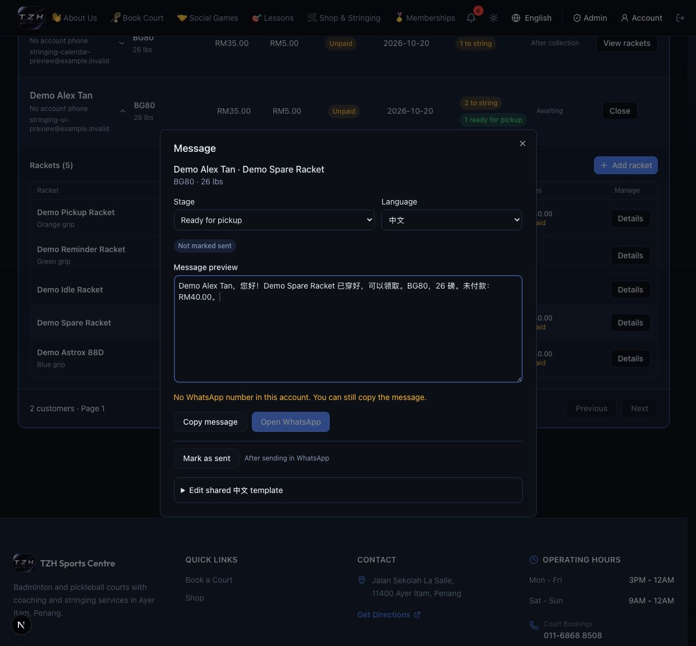

WhatsApp needs a valid account phone; **Copy message** also works without one.

<strong>8 · WhatsApp feedback request</strong>

**Customers → Customer feedback → New feedback request → Prepare feedback message.**
Copy the message or open WhatsApp, send it, then use **Mark as sent**.

Feedback belongs to the customer, with separate responses over time. Creating or
collecting a stringing job does not automatically request feedback. The customer
rates/comments without login, once per invitation. Earlier responses stay visible.

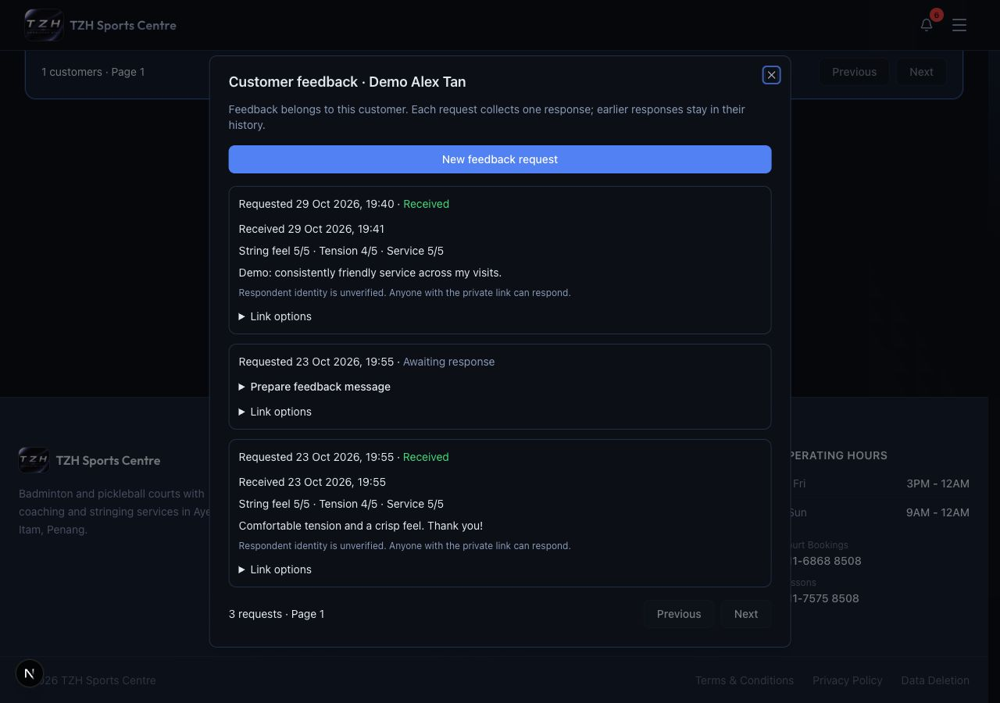

Read replies in **Feedback → Received**. **Awaiting → View customer feedback**
opens that customer's requests. Deleting a job keeps their feedback history.

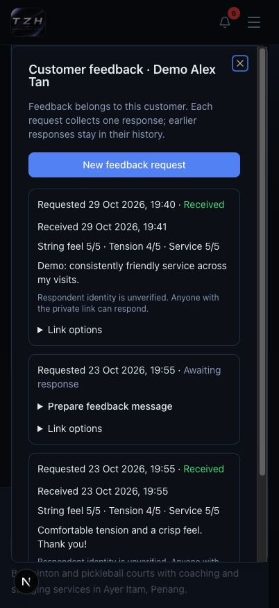

<strong>9 · WhatsApp reminder for the next stringing</strong>

**Follow-ups → Manage job reminder → Message → Open WhatsApp → send → Mark as sent.**
Or open **job Details → … → Restring reminder**.

Default: **45 days after collection**. Change the interval or disable it in
**Settings**. Each job has its own reminder; a newer job does not replace it.
Marking the reminder sent closes only that job’s follow-up.

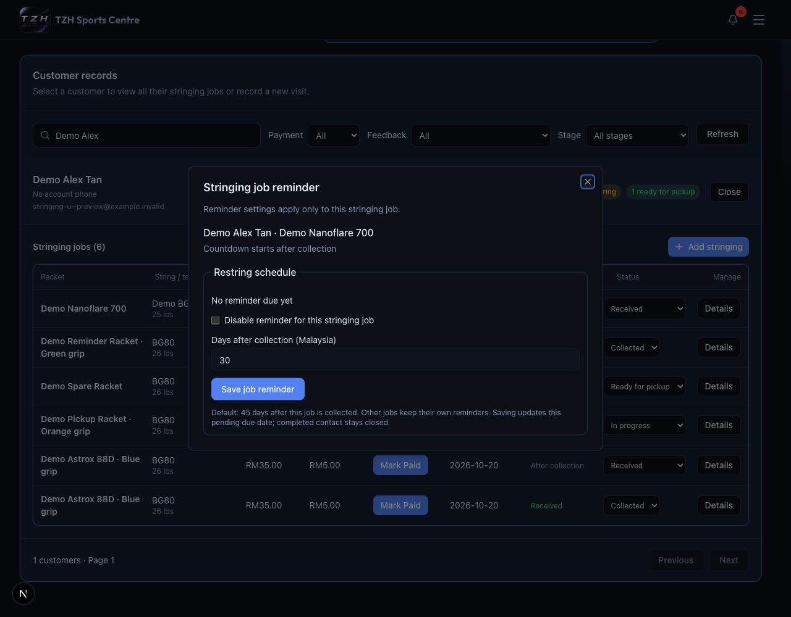

<strong>Automatic outreach pause and recovery · awaiting deployment</strong>

In **Message**, tick **Pause automatic outreach for this customer** to pause all
their jobs. Manual messages remain available.

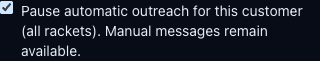

In **Automatic outreach recovery**, check the original WhatsApp chat and stop the
runner before choosing **Resolve as observed sent** or **Resolve as definitely
not sent**. Tick the exact confirmation, then **Confirm resolution**. Expiry is
never proof that a message was unsent. No WhatsApp send occurs from this panel.

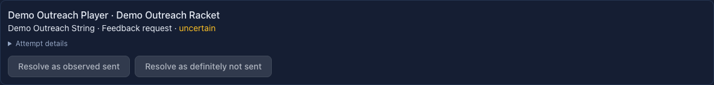

Follow the [stringing outreach guide](../mcp/stringing-outreach.md) for the dry run,
owner test and separate sending/scheduling authorisation.

