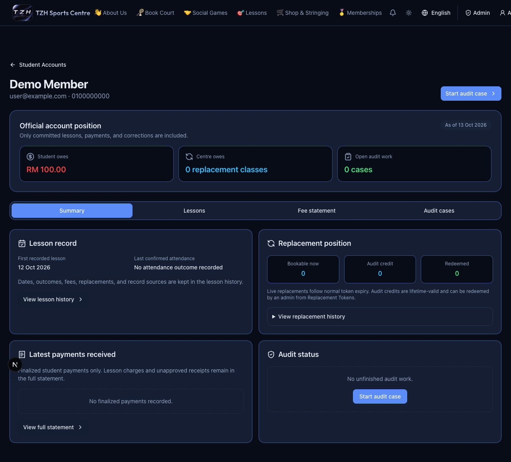
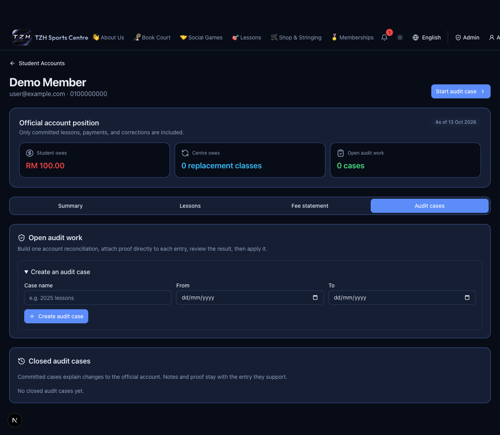

# Student Accounts and historical audits

[← Overview](../overview.md) · **Who:** Administrators

1. Open [Student Accounts](https://tzhsports.vercel.app/admin/student-accounts). Check outstanding fees, students owing, amounts due this week, received payments this month and review work.
2. Search and open a student. Use **Summary**, **Lessons**, **Fee statement** and **Audit cases**. Search/filter history; pending receipts are not received money.
3. For historical reconciliation, create a named audit case with a date range. Add lesson patterns and selected weekdays, historical payment entries, or signed fee/replacement corrections.
4. Check every generated lesson date. The web form starts them as Attended; change exceptions to match your evidence. Add notes and proof images to the entry or exception they support.
5. Inspect the current account, case change and projected balance/replacements. Edit or remove draft entries as needed.
6. Choose **Review calculation**, resolve errors, then approve the exact result with **Confirm and apply to account**.

**Expected:** Drafts and previews do not change the official account. Commit records the reviewed history and payments; replacement obligations become lifetime credits redeemed separately by an admin. Reopen a validated case to edit and review again. A committed case is immutable; use a new traceable correction case. Draft/rejected cases can be permanently deleted with confirmation.

Lesson fees are due at the end of their Malaysia billing month; finalized payments reduce the oldest unpaid month first. Proof uploads are capped at 4 MiB on the website.

